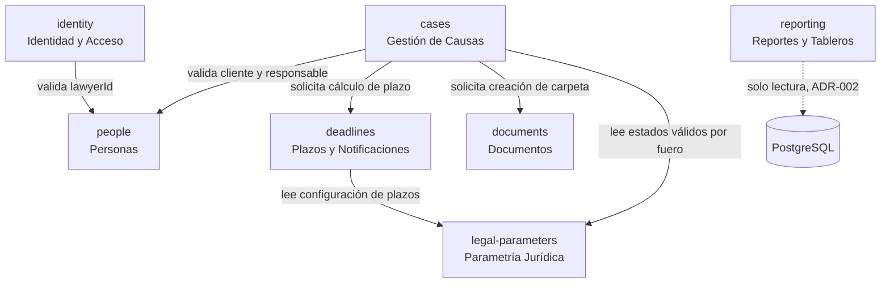
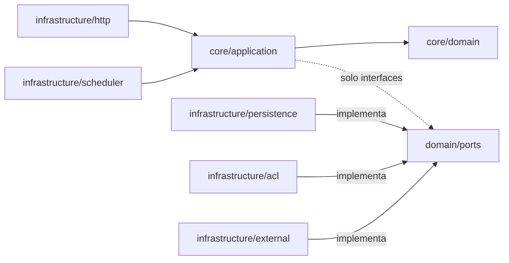
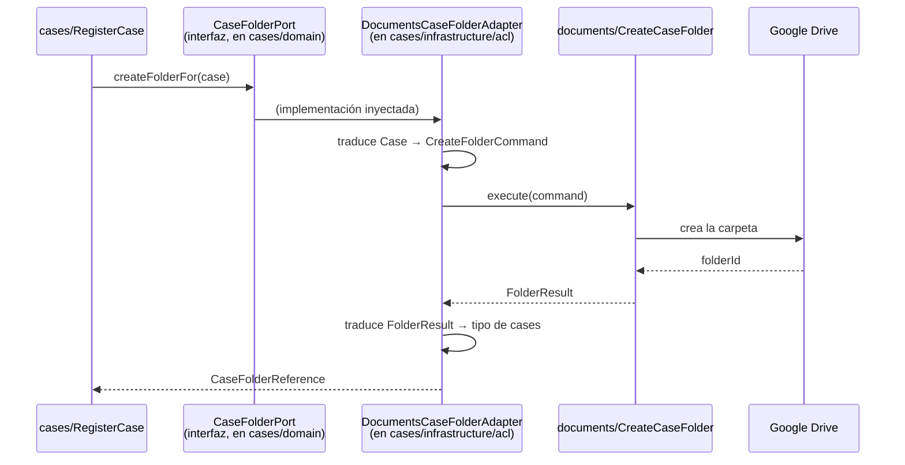

# Arquitectura Backend — VZ Causas

**Sistema Integral de Gestión de Causas · Vázquez & Zárate — Estudio Jurídico**
Versión 1.0 · Grupo 5 · Comisión 3k2 · Seminario Integrador — UTN FRC

---

## Tabla de contenido

1. [Propósito, alcance y audiencia](#1-propósito-alcance-y-audiencia)
2. [Insumos y trazabilidad](#2-insumos-y-trazabilidad)
3. [ADR-001 — Monolito modular con hexágono por subsistema](#3-adr-001--monolito-modular-con-hexágono-por-subsistema)
4. [Descomposición en subsistemas](#4-descomposición-en-subsistemas)
5. [Anatomía canónica de un subsistema](#5-anatomía-canónica-de-un-subsistema)
6. [Comunicación entre subsistemas](#6-comunicación-entre-subsistemas)
7. [Configuración inicial del proyecto](#8-configuración-inicial-del-proyecto)
8. [Riesgos arquitectónicos y deuda asumida](#10-riesgos-arquitectónicos-y-deuda-asumida)

## Contexto de documentación del backend

Este documento es la base arquitectónica del backend de VZ Causas. Define la estructura del sistema, las fronteras entre subsistemas, la lógica de dependencias y los principios de diseño que guían la implementación.

Los demás documentos del mismo conjunto complementan esta arquitectura y deben leerse como material de apoyo y ejecución del diseño:

- [AUDITORIA_Y_TRAZABILIDAD.md](AUDITORIA_Y_TRAZABILIDAD.md) — especifica el mecanismo de auditoría, trazabilidad de actividad y registro de eventos relevantes del backend.
- [MODULO_AUTH.md](MODULO_AUTH.md) — describe el módulo de autenticación y autorización, sus flujos de sesión y las decisiones de acceso del sistema.
- [PENDIENTE_DEFINICION.md](PENDIENTE_DEFINICION.md) — registro de decisiones pendientes, inconsistencias documentadas y puntos que requieren validación con el cliente o el equipo.
- [EJEMPLO_CASO_DE_USO.md](EJEMPLO_CASO_DE_USO.md) — Flujo end-to-end de un caso de uso, como se comporta, como se integra y como se separan las responsablidades con esta arquitectura
    > La arquitectura backend establece el marco de solución; los documentos de apoyo expresan ejemplos de implementación, reglas de auditoría y el estado de decisiones abiertas.

---

## 1. Propósito, alcance y audiencia

### 1.1 Propósito

Este documento define **cómo se organiza el código del backend** de VZ Causas: qué piezas existen, dónde vive cada responsabilidad y qué puede depender de qué, argumentando cada decisión y asumiendo los riesgos correspondientes.

No es una especificación de requerimientos ni un diseño de base de datos. Es el **contrato interno del equipo de desarrollo**: cuando un integrante toma una historia del backlog, este documento le dice qué archivos crear y en qué orden.

### 1.2 Alcance

| Dentro del alcance                                       | Fuera del alcance                                        |
| -------------------------------------------------------- | -------------------------------------------------------- |
| Estructura de carpetas y reglas de dependencia           | Modelo de datos detallado (MODP / DER)                   |
| Descomposición en subsistemas y sus fronteras            | Diseño de interfaz de usuario y frontend                 |
| Mecanismo de comunicación entre subsistemas              | Infraestructura de despliegue y CI/CD                    |
| Autenticación, autorización y manejo de sesión           | Especificación de casos de uso (le corresponde a la ERS) |
| Configuración inicial, errores, transacciones, auditoría | Definición de versiones concretas de librerías           |

### 1.3 Audiencia

Analistas y desarrolladores del Grupo 5. Se asume conocimiento de TypeScript, programación orientada a objetos y nociones básicas de NestJS. **No** se asume conocimiento previo de arquitectura hexagonal: la sección 5 la explica desde cero.

### 1.4 Advertencia de consistencia documental

> El documento _Seguimiento de Proyecto v1_, §2.1.f, declara como tecnología de backend **"NodeJs + Express + TypeScript con arquitectura en capas y POO"**.
>
> El presente documento adopta **NestJS con arquitectura hexagonal particionada por subsistemas**. Es un cambio de decisión arquitectónica deliberado, no una omisión.
>
> **Acción requerida del equipo:** versionar el _Seguimiento de Proyecto_ a v1.1 incorporando esta decisión y su justificación. Mientras eso no ocurra, el proyecto tiene dos arquitecturas documentadas en simultáneo, lo que constituye una inconsistencia evaluable.

---

## 2. Insumos y trazabilidad

Toda decisión de este documento se deriva de un requerimiento ya comprometido. Esta sección fija esa trazabilidad para que ninguna decisión quede huérfana.

### 2.1 Requerimientos no funcionales significativos para la arquitectura

Del _Plan de Proyecto v1.1_, §6.1. Se listan solo los marcados **SPA = SÍ** que impactan en el backend.

| RNF        | Enunciado resumido                                                                | Dónde se resuelve en este documento                                                       |
| ---------- | --------------------------------------------------------------------------------- | ----------------------------------------------------------------------------------------- |
| **RNF 3**  | Aplicación web accesible desde cualquier ubicación, sin instalación en el puesto  | §3 (backend como API HTTP sobre modelo cliente-servidor)                                  |
| **RNF 5**  | Notificación por correo de vencimientos, con avisos escalonados                   | §4 (subsistema `deadlines`), §6.4 (adaptador de entrada programado), §10 (riesgo abierto) |
| **RNF 6**  | Almacenamiento documental en Google Drive, separado de la persistencia relacional | §4 (subsistema `documents`), §5.3 (adaptador de salida)                                   |
| **RNF 7**  | Canal cifrado HTTPS                                                               | §7.4 (atributos de cookie), §8.6                                                          |
| **RNF 8**  | Contraseñas con hash y sal, nunca en texto plano                                  | §7.3                                                                                      |
| **RNF 9**  | Control de acceso por perfil, verificado en cada acceso, de manera transversal    | §7.5 y §7.6                                                                               |
| **RNF 10** | Disponibilidad 24/7                                                               | §10 (riesgo abierto R-01)                                                                 |
| **RNF 11** | Persistencia relacional                                                           | §4.4, §8.4                                                                                |

### 2.2 Reglas de negocio con impacto estructural

Del _Estudio Inicial v1.1_, §3.6.

| RN       | Regla                                                                                                     | Impacto arquitectónico                                                                                   |
| -------- | --------------------------------------------------------------------------------------------------------- | -------------------------------------------------------------------------------------------------------- |
| **RN1**  | La unidad de trabajo es la causa, no el cliente                                                           | `Case` es el agregado raíz de `cases`; `Client` vive en otro subsistema                                  |
| **RN2**  | La causa se identifica unívocamente por el número de SAC                                                  | El identificador natural es un _value object_ con invariante de unicidad; no se genera numeración propia |
| **RN3**  | Toda causa tiene un abogado responsable asignado                                                          | Invariante de construcción de `Case`: no existe causa sin responsable                                    |
| **RN4**  | Los estados procesales dependen del fuero y son parametrizables                                           | Justifica un subsistema `legal-parameters` separado de `cases`                                           |
| **RN5**  | Al actualizarse el estado, el plazo se deriva de la tabla de actos procesales según tipo de día y fuero   | Dependencia `cases → deadlines` (§6.3)                                                                   |
| **RN6**  | En procesos administrativos el plazo no corre de oficio; la fecha de notificación se registra manualmente | El cálculo de plazo admite dos modos: automático y diferido. Es un punto de variación del dominio        |
| **RN8**  | El acto interruptivo reinicia el cómputo de la prescripción                                               | `InterruptiveAct` es parte del agregado `Case`                                                           |
| **RN11** | Todos acceden a todas las causas; la diferenciación es de operación, no de ámbito                         | No hay filtrado de datos por usuario (§7.6)                                                              |
| **RN12** | Clientes y causas se dan de baja **de manera lógica**                                                     | Ninguna entidad se borra físicamente; toda entidad principal lleva estado de vigencia                    |
| **RN13** | La carga de un documento no cambia el estado procesal; lo consigna el abogado responsable                 | Autorización por instancia (§7.6)                                                                        |

### 2.3 Restricciones normativas

| Marco                                                | Consecuencia sobre el backend                                                                                 |
| ---------------------------------------------------- | ------------------------------------------------------------------------------------------------------------- |
| Ley 25.326 de Protección de Datos Personales         | Registro de auditoría sobre datos sensibles (§9); credenciales cifradas; control de acceso verificable        |
| Secreto profesional                                  | La información de causas no es accesible fuera del estudio: no hay endpoints públicos de consulta de causas   |
| Código Procesal Penal de Córdoba y régimen de plazos | El cómputo de plazos es lógica de dominio auditable y testeable, **no** una consulta suelta en un controlador |

### 2.4 Restricción de proyecto dominante

**Presupuesto nulo y plazo académico fijo.** Esta restricción es la que más condiciona el ADR-001: descarta cualquier topología que requiera más de un proceso desplegable o infraestructura de mensajería.

---

## 3. ADR-001 — Monolito modular con hexágono por subsistema

### 3.1 Contexto

El sistema tiene 44 historias de usuario agrupadas en 8 épicas, para una organización de 9 personas y un volumen estimado de 100 a 150 causas activas. El equipo de desarrollo son 7 integrantes con experiencia previa en stack Node. El presupuesto es nulo y el plazo, fijo.

El dominio es **jurídico y fuertemente reglado**: el cómputo de plazos procesales y de prescripción tiene consecuencias reales (perder una presentación o dejar prescribir una causa es el problema que el cliente vino a resolver). Esa lógica debe ser aislable y testeable sin base de datos.

### 3.2 Decisión

Se adopta un **monolito modular**: un único proceso desplegable, internamente particionado en **subsistemas**, donde cada subsistema implementa **arquitectura hexagonal** (puertos y adaptadores) con separación interna entre `core` (dominio + aplicación) e `infrastructure` (adaptadores).

### 3.3 Alternativas evaluadas

| Alternativa                                                                         | Por qué se descartó                                                                                                                                                                                                                                                                                                                                             |
| ----------------------------------------------------------------------------------- | --------------------------------------------------------------------------------------------------------------------------------------------------------------------------------------------------------------------------------------------------------------------------------------------------------------------------------------------------------------- |
| **Arquitectura en capas clásica** (la declarada originalmente en el Seguimiento v1) | Con capas, la lógica de plazos termina dependiendo del ORM: para probar RN5 hay que levantar una base de datos. Además, las capas no imponen fronteras _verticales_: nada impide que el código de reportes escriba en la tabla de causas. Con 8 épicas desarrolladas en paralelo por 7 personas, esa falta de frontera es el origen previsible del acoplamiento |
| **Un único hexágono para todo el sistema**                                          | Aísla el dominio del ORM, pero no resuelve el problema de las fronteras internas: `domain/entities/` con 25 clases de cinco áreas distintas no comunica nada sobre qué pertenece a qué                                                                                                                                                                          |
| **Microservicios**                                                                  | Requiere varios procesos desplegables, red entre ellos y consistencia distribuida. Con presupuesto nulo y 9 usuarios, es costo puro sin beneficio. Además, el _Contexto Maestro_ de la cátedra plantea explícitamente el estilo **monolítico** para las vistas arquitectónicas                                                                                  |

### 3.4 Consecuencias

**Lo que se gana:**

- La lógica jurídica (cómputo de plazos, invariantes de la causa, reinicio de prescripción) se prueba con tests unitarios sin base de datos, sin HTTP y sin Google Drive.
- Las fronteras entre subsistemas son explícitas y revisables en un _pull request_: si un archivo de `cases` importa algo de `documents` que no sea un puerto, se ve.
- Google Drive, el servicio de correo y Prisma son **detalles reemplazables**. Si mañana el cliente cambia Drive por otro repositorio, cambia un adaptador y ningún caso de uso.
- La partición por subsistemas se mapea 1 a 1 con las épicas, lo que permite asignar trabajo en paralelo con bajo riesgo de conflicto.

**Lo que se paga:**

- Un ABMC simple que en arquitectura en capas son 2 archivos, se convierten en 5 o 6 (entidad, puerto, caso de uso, controlador, DTO, repositorio, _mapper_).
- Hay ceremonia de _mapping_: el objeto de dominio no es el modelo de Prisma ni el DTO de HTTP. Son tres representaciones del mismo dato.
- Exige disciplina sostenida. Una arquitectura hexagonal con un solo `import` indebido desde el dominio hacia la infraestructura deja de ser hexagonal y pasa a ser arquitectura en capas con carpetas de más.

---

## 4. Descomposición en subsistemas

### 4.1 Criterio de partición

Un subsistema agrupa **un conjunto de entidades que cambian juntas por la misma razón de negocio** y que tienen un agregado raíz claro. El criterio práctico usado fue: una épica del backlog es candidata a subsistema, salvo que dos épicas compartan el mismo agregado raíz (caso de EP-04 y EP-05, que comparten `Case`).

### 4.2 Mapa de subsistemas

| Carpeta (código)   | Nombre de negocio       | Épicas       | Agregado raíz           | Entidades principales                            |
| ------------------ | ----------------------- | ------------ | ----------------------- | ------------------------------------------------ |
| `identity`         | Identidad y Acceso      | EP-01        | `User`                  | User, Role, Permission, RefreshToken             |
| `people`           | Personas                | EP-02        | `Client`, `Lawyer`      | Client, Lawyer, ContactInfo                      |
| `legal-parameters` | Parametría Jurídica     | EP-03        | `Jurisdiction`          | Jurisdiction (fuero), ProceduralState, TimeLimit |
| `cases`            | Gestión de Causas       | EP-04, EP-05 | `Case`                  | Case, ProceduralAct, InterruptiveAct, CourtFee   |
| `deadlines`        | Plazos y Notificaciones | EP-06        | `Deadline`              | Deadline, PrescriptionAlert, Notification        |
| `documents`        | Documentos              | EP-07        | `DocumentTemplate`      | DocumentTemplate, CaseFolder, CaseDocument       |
| `reporting`        | Reportes y Tableros     | EP-08        | _(sin agregado propio)_ | Modelos de lectura                               |

### 4.3 Responsabilidad de cada subsistema

**`identity` — Identidad y Acceso**
Responde _"¿quién sos y qué podés hacer?"_. Registra usuarios, valida credenciales, emite y renueva tokens, administra roles y permisos. **No** conoce causas ni clientes. Conoce a `people` únicamente para vincular un usuario con rol Abogado a su ficha profesional.

**`people` — Personas**
Registra y administra los datos de clientes y abogados del estudio. Es un subsistema de datos maestros con reglas livianas: la lógica fuerte está en las bajas lógicas (RN12) y en la validación de datos de contacto. **No** conoce causas.

**`legal-parameters` — Parametría Jurídica**
Custodia los datos maestros del dominio legal: fueros, estados procesales aplicables a cada fuero (RN4) y la tabla de plazos por acto procesal con su tipo de día (RN5). Es el subsistema que hace que el sistema no tenga reglas jurídicas incrustadas en el código.

**`cases` — Gestión de Causas**
Es el **núcleo del sistema**. Custodia el ciclo de vida completo de la causa: alta con número de SAC, asignación de responsable, registro de actos procesales y actos interruptivos, cambios de estado procesal, pago de tasas, y la generación de la carátula y el expediente. Aquí viven los invariantes más importantes (RN1, RN2, RN3, RN8, RN13).

**`deadlines` — Plazos y Notificaciones**
Calcula, vigila y notifica. Dado un acto procesal y su configuración de plazo, calcula la fecha de vencimiento (RN5, RN6). Detecta vencimientos próximos y prescripciones próximas, y dispara las notificaciones por correo (RNF 5). Contiene el único adaptador de entrada no-HTTP del sistema: el disparador programado.

**`documents` — Documentos**
Administra los modelos formales del estudio y la estructura de carpetas en Google Drive (RNF 6). Es el subsistema con la dependencia externa más frágil, y por eso el que más se beneficia del aislamiento por puertos.

**`reporting` — Reportes y Tableros**
Genera los tableros de inicio y los reportes de gestión. Es un subsistema **de solo lectura**: no tiene entidades propias, no escribe en la base y no impone invariantes. Ver ADR-002 (§6.5) para la excepción que se le concede.

### 4.4 Regla de propiedad del dato

Se admiten claves foráneas entre tablas de distinto subsistema, porque la persistencia es una única base relacional y la integridad referencial es un beneficio que no se descarta por purismo. Lo que **no** se admite es que un subsistema escriba en una tabla ajena.

| Subsistema         | Tablas que escribe                                                                   |
| ------------------ | ------------------------------------------------------------------------------------ |
| `identity`         | `users`, `roles`, `permissions`, `role_permissions`, `refresh_tokens`                |
| `people`           | `clients`, `lawyers`                                                                 |
| `legal-parameters` | `jurisdictions`, `procedural_statuses`, `term_rules`                                 |
| `cases`            | `cases`, `procedural_acts`, `interruptive_acts`, `court_fees`, `case_status_history` |
| `deadlines`        | `deadlines`, `prescription_alerts`, `notifications`                                  |
| `documents`        | `document_templates`, `case_folders`, `case_documents`                               |
| `reporting`        | _(ninguna)_                                                                          |
| _(transversal)_    | `audit_log` — escrita mediante el puerto compartido de auditoría (§9)                |

### 4.5 Grafo de dependencias



---

## 5. Anatomía canónica de un subsistema

### 5.1 Arquitectura Hexagonal

Un backend combina tres responsabilidades de naturaleza distinta: las **reglas del negocio**, que determinan qué es válido y qué no; la **orquestación**, que encadena pasos para cumplir un objetivo concreto; y la **comunicación con sistemas externos** —HTTP, base de datos, correo, Google Drive—. La arquitectura hexagonal las ubica en capas separadas e impone una única regla sobre la dirección de las dependencias: **todas apuntan hacia adentro**. El dominio no conoce a la infraestructura; la infraestructura conoce al dominio.

Esa inversión se materializa en los **puertos**. El dominio no invoca a Prisma: declara una interfaz —`CaseRepository`— que expresa qué necesita en sus propios términos, y depende de esa abstracción. La implementación concreta, el **adaptador**, vive en la infraestructura, y el módulo de NestJS resuelve el enlace en tiempo de composición. Es el principio de inversión de dependencias aplicado a la frontera del sistema, y tiene dos consecuencias prácticas y verificables: la lógica de prescripción se ejecuta en un test sin levantar PostgreSQL, y sustituir el ORM se resuelve escribiendo un adaptador nuevo, sin tocar una línea de lógica jurídica.

### 5.2 Árbol de carpetas canónico

Todos los subsistemas tienen la misma forma. Esta uniformidad es deliberada: un integrante que trabajó en `cases` sabe dónde buscar en `documents`.

```
src/subsystems/cases/
│
├── core/                                # NO conoce NestJS, Prisma, HTTP ni Drive
│   │
│   ├── domain/                          # Las reglas. El corazón.
│   │   ├── entities/
│   │   │   ├── case.entity.ts           # Agregado raíz: invariantes de RN1, RN2, RN3
│   │   │   ├── procedural-act.entity.ts
│   │   │   └── interruptive-act.entity.ts
│   │   ├── value-objects/
│   │   │   ├── sac-number.vo.ts         # Encapsula el formato y la validación del SAC
│   │   │   └── case-status.vo.ts
│   │   ├── ports/
│   │   │   ├── case.repository.ts       # interface CaseRepository
│   │   │   ├── term-calculator.port.ts  # interface hacia deadlines
│   │   │   ├── case-folder.port.ts      # interface hacia documents
│   │   │   └── people-lookup.port.ts    # interface hacia people
│   │   └── errors/
│   │        └── case.errors.ts           # Errores de dominio, sin códigos HTTP
│   │
│   └── application/                     # La orquestación.
│       └── use-cases/
│           ├── register-case.use-case.ts
│           ├── register-procedural-act.use-case.ts
│           ├── change-case-status.use-case.ts
│           └── find-cases.use-case.ts
│
└── infrastructure/                      # El mundo exterior. Todo reemplazable.
    │
    ├── http/                            # Adaptador de ENTRADA
    │   ├── controllers/
    │   │   └── case.controller.ts
    │   ├── dtos/
    │   │   ├── register-case.request.dto.ts
    │   │   └── case.response.dto.ts
    │   └── mappers/
    │       └── case-http.mapper.ts
    │
    ├── persistence/                     # Adaptador de SALIDA
    │   └── prisma/
    │       ├── prisma-case.repository.ts    # implements CaseRepository
    │       └── case-prisma.mapper.ts        # modelo Prisma ⇄ entidad de dominio
    │
    ├── acl/                             # Adaptadores de SALIDA hacia otros subsistemas
    │   ├── deadlines-term-calculator.adapter.ts
    │   ├── documents-case-folder.adapter.ts
    │   └── people-lookup.adapter.ts
    │
    └── cases.module.ts                  # Composición: qué implementación va en qué puerto
```

### 5.3 Qué va en cada capa

#### `core/domain/entities` — las entidades

Clases con **atributos privados y métodos que expresan comportamiento del negocio**. No son estructuras de datos con _getters_ y _setters_.

La diferencia práctica: una entidad anémica tiene `setStatus(status)` y deja que cualquiera le ponga cualquier estado. Una entidad rica tiene `changeStatusTo(newStatus, actingLawyerId)` y **rechaza** el cambio si el estado no es válido para el fuero, o si quien lo intenta no es el responsable (RN13).

Reglas para las entidades:

- **Los invariantes se validan en el constructor o en un método factoría estático.** Si RN3 dice que toda causa tiene responsable, no debe existir forma de construir un `Case` sin responsable.
- **Ningún método de entidad hace I/O.** No consulta la base, no llama a una API, no envía correo. Recibe lo que necesita por parámetro y devuelve el resultado o lanza un error de dominio.
- **Ningún decorador de NestJS ni de Prisma.** Si una entidad tiene `@Column()` o `@Injectable()`, dejó de ser dominio.

#### `core/domain/value-objects` — los objetos de valor

Encapsulan un concepto que se define por su valor, no por su identidad, y que tiene reglas propias. `SacNumber` es el ejemplo canónico: en lugar de pasear un `string` por todo el sistema, existe un tipo que garantiza que **cualquier `SacNumber` que exista en memoria es un SAC con formato válido**. La validación ocurre una vez, en la construcción.

#### `core/domain/ports` — los puertos

Interfaces TypeScript. **Las declara el subsistema que las necesita, no el que las implementa.** Esta inversión es el punto central: `cases` define qué necesita de `documents`, con el vocabulario de `cases`. Si `documents` cambia su API interna, se adapta el adaptador, no el dominio.

Un puerto describe **una necesidad del negocio**, no una tecnología. Se llama `CaseFolderPort`, no `GoogleDriveService`.

#### `core/application/use-cases` — los casos de uso

Una clase por caso de uso, con **un único método público** (`execute`). Orquesta: pide datos por los puertos, invoca métodos de las entidades, persiste por el repositorio. Coordina, no decide.

Esto no quiere decir que solo tenga un método, ya que puede haber validaciones o procesos complejos que se hacen en otro método que se llama en `execute`.

- _"Una causa no puede registrarse sin abogado responsable"_ → **entidad** (es una verdad del dominio, siempre).
- _"Para registrar una causa hay que verificar que el cliente exista, crear la causa, calcular el plazo inicial y pedir la carpeta en Drive"_ → **caso de uso** (es una secuencia, y podría ser otra).

**REVISAR DIAGRAMAS DE SECUENCIA DE DSI.**

#### `infrastructure/http` — adaptador de entrada

Controlador de NestJS. Su única responsabilidad: traducir HTTP a una invocación de caso de uso, y traducir el resultado de vuelta a HTTP. **Un controlador no contiene reglas de negocio y no llama a Prisma.** Si un controlador tiene más de unas pocas líneas por método, hay lógica mal ubicada.

Los DTO de entrada se validan con decoradores de validación declarativos: tipos, formatos y obligatoriedad. La validación **sintáctica** vive acá; la validación **semántica** (_"este estado no aplica a este fuero"_) vive en el dominio.

#### `infrastructure/persistence` — adaptador de salida

Implementación de los repositorios con Prisma. Contiene los _mappers_ que convierten el modelo de Prisma en entidad de dominio y viceversa. Es tedioso y es el precio de la independencia.

#### `infrastructure/acl` — adaptadores anticorrupción

Implementan los puertos que apuntan a otros subsistemas. Ver §6.

#### `*.module.ts` — el módulo de NestJS

El único lugar donde se dice **qué implementación concreta se inyecta en qué puerto**. Es el punto de composición del hexágono.

### 5.4 Reglas de dependencia



Las reglas, en orden de importancia:

1. **`core/domain` no importa nada de `infrastructure`.** Ni de NestJS, ni de Prisma, ni de librerías de HTTP. Cualquier incumplimiento ROMPE la arquitectura.
2. **`core/domain` no importa nada de `core/application`.** El dominio no sabe que existen casos de uso.
3. **`core/application` importa de `core/domain`, y nada de `infrastructure`.** Los casos de uso dependen de las _interfaces_ de los puertos, jamás de sus implementaciones.
4. **`infrastructure` puede importar de `core`.** Esta es la única dirección permitida entre capas.
5. **Un subsistema no importa el `core` de otro subsistema.** Solo se comunica a través de puertos y adaptadores (§6).

> **Excepción única y acotada:** los casos de uso reciben el decorador `@Injectable()` de NestJS para poder ser inyectados. Es una concesión pragmática ampliamente aceptada, limitada a `core/application`. **`core/domain` no lleva decoradores de ningún tipo.**

#### Cómo se verifican estas reglas

Se establecen dos controles:

1. **Regla de linter de límites de importación**, configurada para prohibir importaciones desde `core/**` hacia `infrastructure/**` y entre `core` de distintos subsistemas. La build falla si se viola.
2. **Revisión en el _pull request_**, ya exigida por el Definition of Done (_"revisado por otro integrante"_). Se agrega al checklist de revisión: _"¿hay algún import de infraestructura dentro de `core`?"_.

### 5.5 Nomenclatura

**todo el código en inglés**. El Definition of Done exige terminología del dominio en la **interfaz de usuario**, no en los identificadores del código.

Convenciones de archivo:

| Tipo                      | Patrón                                     | Ejemplo                                |
| ------------------------- | ------------------------------------------ | -------------------------------------- |
| Entidad                   | `<nombre>.entity.ts`                       | `case.entity.ts`                       |
| Objeto de valor           | `<nombre>.vo.ts`                           | `sac-number.vo.ts`                     |
| Puerto de repositorio     | `<nombre>.repository.ts`                   | `case.repository.ts`                   |
| Otros puertos             | `<nombre>.port.ts`                         | `case-folder.port.ts`                  |
| Caso de uso               | `<verbo>-<sustantivo>.use-case.ts`         | `register-case.use-case.ts`            |
| Controlador               | `<nombre>.controller.ts`                   | `case.controller.ts`                   |
| DTO de entrada            | `<caso-de-uso>.request.dto.ts`             | `register-case.request.dto.ts`         |
| Adaptador de persistencia | `prisma-<nombre>.repository.ts`            | `prisma-case.repository.ts`            |
| Adaptador ACL             | `<subsistema-destino>-<puerto>.adapter.ts` | `deadlines-term-calculator.adapter.ts` |

> **Advertencia sobre la traducción del dominio.** Traducir términos jurídicos argentinos al inglés introduce un riesgo de ambigüedad: _fuero_, _amparo_, _carátula_ y _SAC_ no tienen equivalente limpio. Se adopta el criterio de **traducir los sustantivos estructurales y conservar textualmente los términos jurídicos intraducibles**. El glosario de §13 es obligatorio y de cumplimiento estricto: si dos integrantes traducen _fuero_ de dos formas distintas, el modelo se fractura.

---

## 6. Comunicación entre subsistemas

### 6.1 Decisión

**Toda comunicación entre subsistemas es síncrona, mediante puerto declarado por el consumidor e implementado por un adaptador anticorrupción**.

No se utiliza, por el momento, publicación de eventos de dominio. El patrón suscriptor queda registrado como **evolución posible a evaluar**, no como parte de esta versión.

> **Actualización (Sprint 3, HU39):** la integración `cases` → `documents` usa **eventos de integración** en memoria (`@nestjs/event-emitter`) detrás del puerto `EventPublisher` (`shared/infrastructure/events`). Cada evento lleva `type` versionado, `eventId` y `occurredAt`, solo datos primitivos, y su contrato vive en `core/domain/ports/events/` del subsistema que lo publica. Los eventos son best-effort (se pierden si el proceso cae) hasta que se agregue un outbox. El resto de la comunicación sigue siendo síncrona por puertos.

### 6.2 Mecanismo

Cuatro piezas:

1. **El consumidor declara el puerto en su propio dominio**, con su propio vocabulario y sus propios tipos.
2. **El adaptador, en `infrastructure/acl/` del consumidor**, implementa ese puerto.
3. **El adaptador invoca el caso de uso del subsistema proveedor**, que se le inyecta.
4. **El adaptador traduce** entre el vocabulario del proveedor y el del consumidor.

El nombre _anticorrupción_ es literal: su función es impedir que el modelo de un subsistema se filtre y corrompa el modelo del otro.



### 6.3 Qué expone cada subsistema

Un subsistema expone hacia los demás **únicamente casos de uso**, nunca repositorios ni entidades. El módulo de NestJS declara explícitamente qué casos de uso exporta. Todo lo no exportado es privado.

Ejemplo de posibles dependencias en el proyecto y su motivo:

| Consumidor  | Proveedor          | Puerto                 | Motivo                                                                                   | RN/HU      |
| ----------- | ------------------ | ---------------------- | ---------------------------------------------------------------------------------------- | ---------- |
| `identity`  | `people`           | `LawyerLookupPort`     | Validar que el `lawyerId` de un usuario con rol Abogado corresponde a un abogado vigente | §7.6       |
| `cases`     | `people`           | `PeopleLookupPort`     | Validar existencia y vigencia del cliente y del abogado responsable                      | RN3        |
| `cases`     | `legal-parameters` | `ProceduralStatePort`  | Obtener los estados procesales válidos para el fuero de la causa                         | RN4        |
| `cases`     | `deadlines`        | `DeadlineCalculatorPort` | Calcular la fecha de vencimiento al registrar un acto procesal                         | RN5, HU26  |
| `cases`     | `documents`        | `CaseFolderPort`       | Crear la carpeta de la causa al registrarla                                              | HU39, HU40 |
| `deadlines` | `legal-parameters` | `TimeLimitPort`        | Leer la tabla de plazos por acto procesal y tipo de día                                  | RN5        |

### 6.4 Adaptadores de entrada que no son HTTP

El subsistema `deadlines` tiene un adaptador de entrada **programado**: un disparador temporal que invoca los casos de uso de detección de vencimientos y prescripciones (HU30, HU32, HU33).

Arquitectónicamente **el disparador programado es un adaptador de entrada, exactamente igual que un controlador HTTP.** Ocupa el mismo lugar en el hexágono. Su única función es invocar `DetectUpcomingDeadlines.execute()` y `DetectUpcomingPrescriptions.execute()`.

La consecuencia práctica es que el mecanismo de disparo es **reemplazable sin tocar la lógica**. Puede ser un cron interno del proceso, un cron del proveedor de hosting, o un endpoint HTTP protegido que un servicio externo golpea. **Cuál de los tres se usa es un riesgo abierto sin resolver**.

Por eso se establece desde ahora:

Los casos de uso del motor de plazos deben ser **idempotentes**: ejecutarlos dos veces el mismo día no debe generar dos notificaciones. La notificación enviada se registra, y el caso de uso verifica ese registro antes de enviar. Esto es requisito, no optimización: sin idempotencia, cualquiera de los tres mecanismos de disparo es peligroso.

### 6.5 ADR-002 — Excepción concedida a `reporting`

**Contexto.** `reporting` (EP-08) genera tableros y reportes que cruzan datos de cuatro subsistemas: causas, abogados, vencimientos y fueros. Si respetara la regla general, necesitaría cuatro puertos, cuatro adaptadores, y armar el cruce en memoria.

**Decisión.** `reporting` **no tiene dominio ni puertos hacia otros subsistemas**. Consulta directamente la base de datos mediante consultas de solo lectura, con sus propios modelos de lectura.

**Condiciones estrictas de la excepción:**

1. `reporting` **nunca escribe**. Ni un `INSERT`, ni un `UPDATE`, ni un `DELETE`.
2. `reporting` **no impone invariantes**. Si una regla de negocio aparece en un reporte, esa regla vive en el subsistema dueño del dato.
3. Los modelos de lectura de `reporting` son **estructuras de presentación**, no entidades de dominio. No se reutilizan en ningún otro subsistema.
4. Es la **única** excepción del sistema. Ningún otro subsistema puede invocarla como precedente.

**Justificación.** Es una aplicación acotada del principio de separación entre modelo de escritura y modelo de lectura. Los reportes tienen necesidades de consulta ortogonales al modelo de dominio; forzarlos a pasar por los agregados produce código lento y retorcido sin ningún beneficio de integridad, porque no escriben nada.

**Consecuencia asumida.** `reporting` queda acoplado al esquema de la base. Si `cases` renombra una columna, un reporte puede romperse. Mitigación: los tests de `reporting` corren contra una base real, de modo que ese rompimiento aparece en la build y no en producción.

---

## 7. Configuración inicial del proyecto

### 7.1 Estructura del repositorio

**Una sola aplicación NestJS**, sin herramientas de monorepo.

```
backend/
├── prisma/
│   ├── schema.prisma
│   ├── migrations/
│   └── seed.ts                    # Roles, fueros, tabla de plazos
├── src/
│   ├── main.ts                    # Punto de entrada
│   ├── app.module.ts              # Composición raíz
│   │
│   ├── config/
│   │   └── env.validation.ts      # Validación al arranque
│   │
│   ├── shared/                    # Kernel compartido — ver 8.2
│   │   ├── domain/
│   │   │   ├── authenticated-user.ts
│   │   │   ├── domain-error.ts
│   │   │   ├── audit-trail.port.ts
│   │   │   ├── clock.port.ts
│   │   │   └── transaction-manager.port.ts
│   │   ├── application/
│   │   └── infrastructure/
│   │       ├── prisma/
│   │       │   ├── prisma.service.ts
│   │       │   └── prisma-transaction-manager.ts
│   │       ├── http/
│   │       │   ├── domain-error.filter.ts
│   │       │   └── correlation-id.middleware.ts
│   │       ├── audit/
│   │       └── shared.module.ts
│   │
│   └── subsystems/
│       ├── identity/
│       ├── people/
│       ├── legal-parameters/
│       ├── cases/
│       ├── deadlines/
│       ├── documents/
│       └── reporting/
│
├── test/
├── .env.example
└── package.json
```

### 7.2 El kernel compartido y su regla de admisión

Problema: `shared/` sin disciplina se convierte en el vertedero donde termina todo lo que no se supo dónde poner, y entonces todos los subsistemas quedan acoplados entre sí a través de él.

**Regla de admisión a `shared/`:** solo entra aquello que es **genuinamente transversal y libre de reglas de negocio**. Un concepto que pertenece al dominio de un subsistema no entra a `shared`, aunque otro subsistema lo necesite: para eso existen los puertos.

Contenido admitido, y nada más:

| Elemento                                     | Qué es                              |
| -------------------------------------------- | ----------------------------------- |
| `AuthenticatedUser`                          | Contrato del contexto de seguridad  |
| `DomainError`                                | Clase base de errores de dominio    |
| `AuditTrailPort`                             | Puerto de auditoría                 |
| `ClockPort`                                  | Abstracción del reloj               |
| `TransactionManagerPort`                     | Puerto de transacción               |
| `PrismaService`                              | Cliente de base de datos compartido |
| Filtro de errores, middleware de correlación | Infraestructura HTTP transversal    |

### 7.3 Composición: `main.ts` y `app.module.ts`

`main.ts` configura el proceso y arranca: validación global de DTO de entrada, filtro global de errores de dominio, prefijo global de la API, política de orígenes permitidos para el frontend, parseo de cookies y apagado ordenado del proceso.

`app.module.ts` es **deliberadamente trivial**: importa el módulo compartido, el módulo de configuración y los siete módulos de subsistema. Nada más. Si `app.module.ts` empieza a acumular proveedores, es señal de que algo transversal se está definiendo en el lugar equivocado.

Cada subsistema tiene su módulo, que cumple SOLO tres funciones:

1. **Declarar el enlace puerto → implementación.** Por cada puerto, un proveedor que asocia el símbolo de la interfaz con la clase concreta. Es el punto de composición del hexágono.
2. **Declarar sus controladores.**
3. **Exportar los casos de uso que otros subsistemas consumen**.

Como las interfaces de TypeScript no existen en tiempo de ejecución, cada puerto se identifica mediante un símbolo constante exportado junto a la interfaz. Es la convención estándar y debe aplicarse uniformemente.

### 7.4 Prisma

**Un único archivo `schema.prisma`**.

Consecuencias y mitigaciones:

- El archivo va a crecer y va a ser un punto frecuente de conflicto de fusión entre ramas. **Mitigación:** los modelos se agrupan en bloques comentados por subsistema, en el mismo orden que el mapa de §4.2, y todo cambio de esquema se anuncia en el canal del equipo antes de fusionarse.
- El cliente generado es único y compartido: cualquier subsistema _podría_ leer cualquier tabla. **La regla de propiedad del dato (§4.4) es lo único que lo impide, y se verifica en revisión de código.**

Convenciones:

- Nombres de tabla y columna en `snake_case` mediante mapeo explícito; nombres de modelo en `PascalCase`.
- **Ningún modelo de Prisma sale de `infrastructure/persistence`.** Los _mappers_ lo traducen a entidad de dominio en la frontera.
- Baja lógica (RN12): todas las entidades principales llevan campo de vigencia. **Ningún repositorio expone borrado físico.**

### 7.5 Transacciones

Un caso de uso que escribe en varias tablas debe hacerlo atómicamente, pero el dominio no puede conocer la transacción de Prisma. Se resuelve con un puerto:

```typescript
// src/shared/domain/transaction-manager.port.ts
export interface TransactionManagerPort {
	runInTransaction<T>(work: () => Promise<T>): Promise<T>;
}
```

El caso de uso envuelve la secuencia de escrituras en `runInTransaction`. La implementación con Prisma vive en `shared/infrastructure`.

**Dos reglas de uso:**

1. **Nunca se invoca un puerto hacia otro subsistema dentro de una transacción abierta si ese puerto habla con un servicio externo.** Mantener una transacción de base de datos abierta mientras se espera a Google Drive bloquea conexiones. Concretamente en HU39: primero se confirma la transacción del alta de la causa, después se pide la carpeta.
2. Las llamadas a puertos **esenciales** que solo leen (validar cliente, obtener estados válidos) se hacen **antes** de abrir la transacción.

### 7.6 Configuración y variables de entorno

Toda la configuración se lee de variables de entorno, se **valida al arranque** y se expone mediante un servicio tipado. **La aplicación no arranca si falta una variable obligatoria**: es preferible un fallo inmediato y explícito a un fallo oscuro en el primer uso.

La validación se reparte en dos niveles, y el reparto es deliberado:

1. **Presencia**, en `config/env.validation.ts`: una función enganchada como `validate` del módulo de configuración, que verifica que estén todas las obligatorias y corta con la **lista completa** de las que faltan. Es una función escrita a mano y no un esquema de Joi o Zod — de ahí que el archivo no se llame `validation.schema.ts`: el nombre describiría algo que no hay.
2. **Formato**, en el constructor de cada adaptador que consume la variable: sintaxis de los TTL, longitud mínima del secreto de firma, rango del factor de costo, coherencia entre los atributos de la cookie. Cada adaptador valida lo suyo, donde está el conocimiento de qué es un valor válido.

No existe un `configuration.ts` con lectura tipada centralizada: cada adaptador ya lee sus variables y las tipa en su constructor, así que una capa de `registerAs` por encima sería duplicación sin consumidor.

Variables previstas:

```
DATABASE_URL
JWT_ACCESS_SECRET
JWT_ACCESS_TTL
JWT_REFRESH_TTL
BCRYPT_COST
GOOGLE_DRIVE_CREDENTIALS
GOOGLE_DRIVE_ROOT_FOLDER_ID
SMTP_HOST / SMTP_PORT / SMTP_USER / SMTP_PASSWORD
MANAGEMENT_MAILBOX          # casilla de gestión del estudio (RNF 5)
APP_TIMEZONE                # ver 8.7
CORS_ALLOWED_ORIGINS
```

### 7.7 Fecha, hora y zona horaria

**El cómputo de plazos procesales es la función central del sistema, y un error de zona horaria produce un vencimiento calculado con un día de diferencia.**

Reglas:

1. **Todo instante se persiste en UTC.**
2. **Todo cálculo de plazo se hace en la zona horaria del estudio**, definida en `APP_TIMEZONE`. Un plazo que vence "el martes" vence al final del martes en Córdoba, no en UTC.
3. **El dominio nunca invoca el reloj del sistema directamente.** Se inyecta un `ClockPort`. Sin esto, es imposible escribir un test que verifique _"la causa prescribe a los tres años"_ sin esperar tres años.

```typescript
// src/shared/domain/clock.port.ts
export interface ClockPort {
	now(): Date;
	today(): Date; // medianoche en la zona horaria del estudio
}
```

4. La distinción **día hábil / día corrido** (RN5) es lógica de dominio de `deadlines`, y depende de un calendario de feriados judiciales que hoy **no está especificado en ninguna fuente del proyecto**.

### 7.8 Manejo de errores

Tres familias, con tratamiento distinto:

| Familia                            | Origen                        | Traducción HTTP                                        |
| ---------------------------------- | ----------------------------- | ------------------------------------------------------ |
| **Error de validación de entrada** | DTO malformado                | 400, automático                                        |
| **Error de dominio**               | Invariante violado            | Según subtipo, mediante el filtro global               |
| **Error de infraestructura**       | Base caída, Drive no responde | 500 o 503, con el detalle registrado y **no expuesto** |

**Regla central: los errores de dominio no conocen HTTP.** `NotTheResponsibleLawyerError` no sabe que existe el código 403. La traducción ocurre en un único lugar: el filtro global de `shared/infrastructure/http`. Ya que, si el dominio emitiera códigos HTTP, el mismo caso de uso invocado desde el disparador programado, que no es HTTP, arrastraría un vocabulario que no le corresponde.

Jerarquía:

```
DomainError (abstracta)
├── ValidationError          → 400
├── NotFoundError            → 404
├── ConflictError            → 409   (ej.: SAC duplicado, RN2)
├── ForbiddenActionError     → 403   (ej.: no es el responsable, RN13)
└── BusinessRuleError        → 422   (ej.: estado inválido para el fuero, RN4)
```

**Ningún mensaje de error expuesto al cliente incluye datos sensibles.** El detalle técnico va al log, asociado al identificador de correlación de la petición.

### 7.9 Registro de actividad

Cada petición recibe un **identificador de correlación**, generado por un middleware, que acompaña a todas las entradas de log de esa petición.

**Nunca se registran:** contraseñas, tokens completos, ni contenido de documentos de causas (Ley 25.326 y secreto profesional). Los identificadores de causa y de usuario sí se registran: son necesarios para el diagnóstico y para la auditoría.

---

## 8. Riesgos arquitectónicos y deuda asumida

### R-01 · Ejecución programada del motor de plazos — **RIESGO ABIERTO SIN RESOLVER**

**Severidad: alta. Estado: sin decisión tomada** (decisión E del equipo: documentar sin resolver).

**Descripción.** El RNF 5 exige notificaciones de vencimiento con avisos escalonados, y las HU30, HU32 y HU33 requieren ejecución programada diaria. El _Seguimiento de Proyecto v1_ declara despliegue del backend en **Render**, capa gratuita, por restricción de presupuesto nulo.

**El problema.** Un proceso alojado en una capa gratuita puede suspenderse por inactividad. Un temporizador interno al proceso no se ejecuta si el proceso está suspendido. Si el motor de plazos no corre un día, **no se envía el aviso de un vencimiento**, que es exactamente el problema de negocio que el sistema vino a resolver (_"falta de seguimiento de causas con sus respectivos plazos"_, Estudio Inicial §4).

**Impacto si no se resuelve.** Falla funcional del requerimiento de máxima prioridad del cliente, y falla del RNF 10 (disponibilidad 24/7).

**Opciones identificadas, ninguna adoptada:**

| Opción                                                         | Consideración                                                                                                         |
| -------------------------------------------------------------- | --------------------------------------------------------------------------------------------------------------------- |
| (a) Temporizador interno del proceso NestJS                    | La más simple de implementar; su confiabilidad depende del comportamiento del plan de hosting ante la inactividad     |
| (b) Tarea programada provista por el hosting                   | Elimina la dependencia de que el proceso esté activo; requiere verificar disponibilidad en la capa gratuita           |
| (c) Servicio externo gratuito que invoca un endpoint protegido | Independiente del hosting; agrega una dependencia externa y un endpoint que debe protegerse con un secreto compartido |
| (d) Migrar el despliegue a otro proveedor                      | Impacta el Seguimiento de Proyecto; sujeto a presupuesto nulo                                                         |

**Mitigación ya incorporada al diseño.** El disparador es un **adaptador de entrada** (§6.4), por lo que cambiar de mecanismo no requiere modificar la lógica del motor de plazos. Los casos de uso son **idempotentes**, de modo que cualquiera de las opciones puede reintentar sin duplicar avisos.

**Acción requerida.** Verificar las capacidades reales de la capa gratuita del proveedor y adoptar una opción **antes del inicio del Sprint 3**, que es donde entran HU30, HU32 y HU33.

---

### R-02 · Sobrecosto de la ceremonia hexagonal frente al plazo académico

**Severidad: media.** Un ABMC simple requiere entre 5 y 7 archivos. El Sprint 1 contiene 9 historias de ese tipo (86 SP). El riesgo es que el equipo no complete el Sprint 1 y concluya —equivocadamente— que la arquitectura es el problema.

**Mitigación.** El primer subsistema (`identity`) se construye completo y en conjunto, y **queda como plantilla de referencia**. El documento `EJEMPLO_CASO_DE_USO.md` cumple esa función. En `legal-parameters` los casos de uso son deliberadamente delgados: no se inventa lógica para llenar el hexágono.

---

### R-03 · Acoplamiento síncrono con Google Drive

**Severidad: media.** Al ser toda la comunicación síncrona (decisión B3), una indisponibilidad de Drive podría abortar el alta de causas.

**Mitigación adoptada.** `CaseFolderPort` está clasificado como **complementario** (§6.6): su falla se registra, la causa se persiste marcada con carpeta pendiente, y existe una operación de reintento. Esto mantiene la decisión de comunicación síncrona sin atar la disponibilidad del sistema a la de un tercero.

---

### R-04 · Traducción del dominio jurídico al inglés

**Severidad: media.** _Fuero_, _amparo_, _carátula_ y _SAC_ no tienen equivalente limpio en inglés. Dos integrantes pueden traducir el mismo concepto de dos formas, fracturando el lenguaje ubicuo, y el modelo deja de ser discutible con el cliente.

**Mitigación.** El glosario de §13 es de cumplimiento obligatorio, se versiona con el código y se revisa en cada _pull request_. Los términos intraducibles se conservan textualmente.

---

### R-05 · Crecimiento del archivo `schema.prisma` único

**Severidad: baja.** Un archivo único con los modelos de siete subsistemas será extenso y propenso a conflictos de fusión.

**Mitigación.** Agrupación en bloques comentados por subsistema y anuncio previo de todo cambio de esquema. Si el conflicto se vuelve recurrente, reevaluar la organización multiarchivo, verificando previamente su estado de soporte en la documentación oficial de la herramienta.

---

### R-06 · `reporting` acoplado al esquema de base

**Severidad: baja.** Consecuencia conocida y aceptada del ADR-002. Un renombramiento de columna en `cases` puede romper un reporte.

**Mitigación.** Los tests de `reporting` corren contra una base real, de modo que el rompimiento aparece en la build.

---

### D-01 · Deuda: ausencia de política de reasignación de causas

Al dar de baja un abogado (HU15), RN3 exige que toda causa tenga responsable. **Ninguna historia del backlog especifica qué ocurre con las causas del abogado dado de baja.** Registrado en §12.

### D-02 · Deuda: comunicación entre subsistemas totalmente síncrona

Decisión consciente del equipo. Si a futuro aparecen más efectos secundarios sobre el alta de causa, o la cantidad de dependencias hacia un subsistema crece, **debe evaluarse la incorporación de un patrón de publicación y suscripción in-process**, que permitiría desacoplar al emisor de sus consumidores sin agregar infraestructura externa. No forma parte de esta versión.

---

## Historial de versiones

| Versión | Fecha      | Descripción                                                                                                                                                                                                                                                   |
| ------- | ---------- | ------------------------------------------------------------------------------------------------------------------------------------------------------------------------------------------------------------------------------------------------------------- |
| 1.0     | 19/09/2026 | Versión inicial. Arquitectura hexagonal particionada por subsistemas sobre NestJS. Resuelve comunicación entre subsistemas, autenticación y autorización, y configuración inicial. Registra R-01 como riesgo abierto sin resolver y nueve preguntas abiertas. |

**Documentos fuente:** Estudio Inicial v1.1 · Plan de Proyecto v1.1 · Seguimiento de Proyecto v1 · Contexto Maestro de Elicitación y Especificación de Requerimientos (cátedra).
