# 9. Diagrama Entidad-Relación (DER) y diccionario de datos

Generado a partir de `backend/prisma/schema.prisma` y de todas las
migraciones de `backend/prisma/migrations/` hasta
`20261018162502_sent_notifications_recipient`, que son la única fuente
de verdad del esquema. Los nombres de índices y restricciones `CHECK`
son los reales de las migraciones. Los nombres de columna son los
físicos de PostgreSQL (`@map` del schema), no los del cliente de Prisma.

Las longitudes en bytes son las de PostgreSQL: `INTEGER` 4 B, `DATE`
4 B, `UUID` 16 B, `BOOLEAN` 1 B, `TIMESTAMPTZ` 8 B; los enumerados
ocupan 4 B. En `VARCHAR(n)` y `CHAR(n)` se indica `n`.

Este archivo y la sección 9 de *Definición del producto* tienen el mismo
contenido: si cambia el esquema, se actualizan los dos.

El Diagrama Entidad-Relación representa el modelo de datos de VZ Causas
implementado en PostgreSQL: las entidades que el sistema persiste, sus
atributos y las relaciones entre ellas. Traduce el modelo de clases del
dominio al esquema relacional y abarca todos los módulos del sistema: el
acceso de los usuarios, los abogados y clientes del estudio, los
parámetros jurídicos, la gestión de las causas, los documentos en la
nube y los avisos automáticos.

El detalle de cada tabla, con sus tipos de datos, claves, restricciones
y el significado de cada atributo, se especifica en el diccionario de
datos de la sección siguiente.

```mermaid
erDiagram
    %% ── identity ──
    users {
        serial id PK
        varchar(50) username UK
        varchar(100) last_name
        varchar(100) first_name
        varchar(255) email UK
        varchar(255) password_hash
        integer lawyer_id FK
        timestamptz created_at
        timestamptz updated_at
        timestamptz last_login_at
        boolean active
        timestamptz deleted_at
    }
    refresh_tokens {
        uuid id PK
        varchar(255) token_hash UK
        integer user_id FK
        uuid family_id
        uuid replaced_by FK
        timestamptz expires_at
        timestamptz created_at
        timestamptz revoked_at
    }
    login_attempts {
        varchar(120) identifier PK
        integer consecutive_failures
        timestamptz last_failed_at
        timestamptz locked_until
    }
    roles {
        serial id PK
        varchar(50) name UK
        text description
        boolean is_system
        timestamptz created_at
    }
    permissions {
        serial id PK
        varchar(100) name UK
        text description
        timestamptz created_at
    }
    user_roles {
        integer user_id PK, FK
        integer role_id PK, FK
    }
    role_permissions {
        integer role_id PK, FK
        integer permission_id PK, FK
    }

    %% ── people ──
    lawyers {
        serial id PK
        varchar(100) last_name
        varchar(100) first_name
        varchar(50) registration_number UK
        boolean active
        timestamptz created_at
        timestamptz updated_at
    }
    clients {
        serial id PK
        varchar(100) last_name
        varchar(100) first_name
        varchar(8) dni
        varchar(50) phone
        varchar(255) email
        date client_since
        boolean active
        timestamptz created_at
        timestamptz updated_at
    }

    %% ── legal-parameters ──
    jurisdictions {
        serial jurisdiction_id PK
        text name UK
        day_type day_type_default
        boolean is_active
    }
    procedural_states {
        serial state_id PK
        text name
        integer time_limit_days
        day_type day_type
        boolean terminal
        boolean is_initial
        boolean is_prescribed
        boolean is_active
        timestamptz created_at
        timestamptz updated_at
        integer jurisdiction_id FK
    }
    legal_qualifications {
        serial id PK
        varchar(255) name
        integer prescription_months
        boolean active
        timestamptz created_at
        timestamptz updated_at
    }

    %% ── cases ──
    cases {
        serial id PK
        char(8) sac_number UK
        varchar(255) caption
        varchar(255) court
        integer jurisdiction_id FK
        procedural_role procedural_role
        varchar(150) instructor_name
        varchar(50) instructor_phone
        varchar(20) instructor_extension
        varchar(255) counterparty
        varchar(800) subject_matter
        integer client_id FK
        integer responsible_lawyer_id FK
        date start_date
        boolean client_detained
        boolean injunction_granted
        date harmful_act_date
        boolean harmful_act_renews
        integer harmful_act_renewal_days
        integer harmful_act_term_days
        day_type harmful_act_term_day_type
        date administrative_remedy_exhausted_on
        boolean court_fee_paid
        case_folder_status folder_status
        varchar(128) cloud_folder_id FK, UK
        date prescription_date
        varchar(255) prescription_resolution
        varchar(2000) prescription_grounds
        integer prescription_registered_by_user_id FK
        timestamptz prescription_registered_at
        integer current_state_id FK
        varchar(255) current_custom_state
        integer current_procedural_act_id FK, UK
        boolean active
        integer created_by_user_id FK
        timestamptz created_at
        timestamptz updated_at
    }
    offenses {
        integer case_id PK, FK
        integer legal_qualification_id PK, FK
        date offense_date
        date prescription_date
    }
    procedural_acts {
        serial id PK
        integer case_id FK
        integer procedural_state_id FK
        varchar(255) custom_state
        date act_date
        date notification_date
        varchar(2000) notes
        boolean is_interruptive
        integer deadline_time_limit_days
        day_type deadline_day_type
        date deadline_counts_from
        date deadline_computed_due_date
        date deadline_manual_due_date
        integer registered_by_user_id FK
        integer registered_by_lawyer_id FK
        timestamptz registered_at
    }
    interruptive_acts {
        serial id PK
        integer case_id FK
        varchar(255) name
        date act_date
        varchar(2000) notes
        integer registered_by_user_id FK
        integer registered_by_lawyer_id FK
        timestamptz registered_at
    }

    %% ── documents ──
    cloud_folders {
        varchar(128) cloud_folder_id PK
        cloud_folder_kind kind
        varchar(255) name
        varchar(512) url
        varchar(128) parent_cloud_folder_id FK
        integer lawyer_id FK
        integer jurisdiction_id FK
        timestamptz created_at
    }
    document_templates {
        serial id PK
        varchar(150) name
        varchar(255) file_name
        varchar(128) cloud_file_id UK
        varchar(128) cloud_folder_id FK
        boolean copy_to_new_cases
        timestamptz last_version_at
        integer last_version_by_user_id FK
        boolean active
        timestamptz created_at
        timestamptz updated_at
    }
    document_template_jurisdictions {
        integer template_id PK, FK
        integer jurisdiction_id PK, FK
    }
    document_template_copies {
        integer case_id PK, FK
        integer template_id PK, FK
        template_copy_status status
        varchar(128) cloud_file_id UK
        timestamptz copied_at
    }
    user_folder_access {
        integer user_id PK, FK
        varchar(255) email
        varchar(128) cloud_permission_id
        boolean granted
        timestamptz synced_at
    }

    %% ── deadlines ──
    sent_notifications {
        serial id PK
        integer case_id FK
        notification_kind kind
        deadline_kind deadline_kind
        integer procedural_act_id FK
        date reference_date
        integer recipient_lawyer_id FK
        timestamptz sent_at
    }
    daily_job_runs {
        date run_date PK
        timestamptz started_at
        timestamptz finished_at
        text error
    }

    %% ── relaciones ──
    users ||--o{ refresh_tokens : "emite"
    refresh_tokens |o--o| refresh_tokens : "reemplazado por"
    users ||--o{ user_roles : "tiene"
    roles ||--o{ user_roles : "asignado en"
    roles ||--o{ role_permissions : "otorga"
    permissions ||--o{ role_permissions : "incluido en"
    lawyers |o--o{ users : "cuenta de"
    users ||--o| user_folder_access : "accede a carpeta"

    jurisdictions ||--o{ procedural_states : "define"
    jurisdictions ||--o{ cases : "fuero de"
    clients ||--o{ cases : "parte en"
    lawyers ||--o{ cases : "responsable de"
    users ||--o{ cases : "da de alta"
    users |o--o{ cases : "marca prescripta"
    procedural_states |o--o{ cases : "estado actual"
    procedural_acts |o--o| cases : "acto vigente"
    cloud_folders |o--o| cases : "carpeta de"

    cases ||--o{ offenses : "imputa"
    legal_qualifications ||--o{ offenses : "califica"
    cases ||--o{ procedural_acts : "registra"
    procedural_states |o--o{ procedural_acts : "destino de"
    users ||--o{ procedural_acts : "registra"
    lawyers ||--o{ procedural_acts : "responsable al registrar"
    cases ||--o{ interruptive_acts : "interrumpe"
    users ||--o{ interruptive_acts : "registra"
    lawyers ||--o{ interruptive_acts : "responsable al registrar"

    cloud_folders |o--o{ cloud_folders : "contiene"
    lawyers |o--o{ cloud_folders : "dueño de"
    jurisdictions |o--o{ cloud_folders : "fuero de"
    cloud_folders ||--o{ document_templates : "contiene"
    users ||--o{ document_templates : "sube versión"
    document_templates ||--o{ document_template_jurisdictions : "aplica a"
    jurisdictions ||--o{ document_template_jurisdictions : "admite"
    document_templates ||--o{ document_template_copies : "copiado como"
    cases ||--o{ document_template_copies : "recibe"

    cases ||--o{ sent_notifications : "avisada en"
    procedural_acts |o--o{ sent_notifications : "plazo avisado"
    lawyers |o--o{ sent_notifications : "destinatario"
```

## 9.1. Diccionario de datos

A continuación se detalla la estructura del modelo relacional de la base
de datos de VZ Causas. Para cada tabla se especifican sus atributos,
tipos de datos de PostgreSQL, claves, restricciones de nulidad y
descripción funcional.

Convenciones generales: las bajas son lógicas (RN12), por eso las tablas
de negocio tienen una columna `active` o `is_active` y casi todas las
claves foráneas son `ON DELETE RESTRICT`; un borrado físico no debería
ocurrir nunca y, si se intenta, falla. Las únicas en cascada son las de
las tablas de seguridad hacia `users` y `roles` (`refresh_tokens`,
`user_roles`, `role_permissions`, `user_folder_access`);
`refresh_tokens.replaced_by` es `ON DELETE SET NULL`. Todas las claves
foráneas son `ON UPDATE CASCADE`. Los índices únicos parciales, los
índices por expresión y las restricciones CHECK se crean con SQL manual
en las migraciones, porque Prisma no los expresa.

### 9.1.1 Tablas

#### a) Tabla `users`

Cuentas de usuario del sistema, para autenticación y control de acceso.

Almacena las cuentas de usuario registradas en el sistema para la
autenticación y control de acceso.

| Atributo | Tipo | Long. | Clave | Nulo | Descripción / valores posibles |
| --- | --- | --- | :-: | :-: | --- |
| `id` | SERIAL (INTEGER) | 4 B | PK | No | Identificador interno, autoincremental. |
| `username` | VARCHAR | 50 | UK | No | Identificador de inicio de sesión, distinto del correo. |
| `last_name` | VARCHAR | 100 |  | No | Apellido del usuario. |
| `first_name` | VARCHAR | 100 |  | No | Nombre o nombres del usuario. |
| `email` | VARCHAR | 255 | UK | No | Correo electrónico único. Se almacena en minúsculas. |
| `password_hash` | VARCHAR | 255 |  | No | Hash bcrypt de la contraseña. Nunca se almacena en claro. |
| `lawyer_id` | INTEGER | 4 B | FK | Sí | Ficha profesional vinculada (→ `lawyers.id`), `ON DELETE RESTRICT`. Obligatorio para usuarios con rol `LAWYER`, nulo en el resto. Un abogado tiene como máximo una cuenta activa. |
| `created_at` | TIMESTAMPTZ | 8 B |  | No | Fecha y hora de creación. |
| `updated_at` | TIMESTAMPTZ | 8 B |  | No | Fecha y hora de la última actualización. |
| `last_login_at` | TIMESTAMPTZ | 8 B |  | Sí | Inicio de sesión anterior al actual; se muestra al usuario para que detecte accesos ajenos. Nulo si nunca ingresó. |
| `active` | BOOLEAN | 1 B |  | No | `true`: habilitado. `false`: baja lógica (RN12). Por defecto `true`. |
| `deleted_at` | TIMESTAMPTZ | 8 B |  | Sí | Momento de la baja lógica. Nulo mientras la cuenta está vigente. |

Índices: `users_username_key` (UK), `users_email_key` (UK),
`users_lawyer_id_idx`, `users_last_name_first_name_idx` y
`users_lawyer_id_active_key`, único parcial sobre `lawyer_id` entre las
cuentas activas con abogado vinculado (una cuenta activa por abogado;
dar de baja una cuenta libera la matrícula).

Restricciones: `ck_users_lower_email` (email = `lower(email)`).

#### b) Tabla `refresh_tokens`

Tokens de refresco emitidos para renovar sesiones, con rotación y
detección de reuso.

Gestiona los tokens de refresco emitidos para renovar las sesiones de
usuario.

| Atributo | Tipo | Long. | Clave | Nulo | Descripción / valores posibles |
| --- | --- | --- | :-: | :-: | --- |
| `id` | UUID | 16 B | PK | No | Identificador opaco del token (`gen_random_uuid()`). |
| `token_hash` | VARCHAR | 255 | UK | No | Hash del valor entregado al cliente. El token en claro no se guarda. |
| `user_id` | INTEGER | 4 B | FK | No | Usuario asociado (→ `users.id`), `ON DELETE CASCADE`. |
| `family_id` | UUID | 16 B |  | No | Agrupa todos los tokens nacidos de un mismo inicio de sesión. Permite revocar la sesión entera al detectar reuso. |
| `replaced_by` | UUID | 16 B | FK | Sí | Token que lo sucedió en la rotación (→ `refresh_tokens.id`), `ON DELETE SET NULL`. Nulo si es el vigente. |
| `expires_at` | TIMESTAMPTZ | 8 B |  | No | Fecha y hora de expiración. |
| `created_at` | TIMESTAMPTZ | 8 B |  | No | Fecha y hora de emisión. |
| `revoked_at` | TIMESTAMPTZ | 8 B |  | Sí | Momento de la revocación. Nulo = vigente; conserva el primer valor para que revocar sea idempotente. |

Índices: `refresh_tokens_token_hash_key` (UK),
`refresh_tokens_user_id_revoked_at_idx` (`user_id`, `revoked_at`),
`refresh_tokens_family_id_idx`, `refresh_tokens_expires_at_idx`.

#### c) Tabla `login_attempts`

Contador de intentos fallidos de inicio de sesión, para el bloqueo
temporal.

Guarda una fila por clave vigilada, no un registro de cada intento: la
política solo necesita saber cuántos fallos seguidos hubo y hasta cuándo
dura el bloqueo.

| Atributo | Tipo | Long. | Clave | Nulo | Descripción / valores posibles |
| --- | --- | --- | :-: | :-: | --- |
| `identifier` | VARCHAR | 120 | PK | No | Clave vigilada que arma el sistema: `u:{usuario}` o `u:{usuario}\|ip:{IP}`. No es una referencia a `users`: se cuenta también contra usuarios inexistentes, para no permitir enumerar cuentas (D-18). |
| `consecutive_failures` | INTEGER | 4 B |  | No | Intentos fallidos consecutivos. Por defecto 0. |
| `last_failed_at` | TIMESTAMPTZ | 8 B |  | No | Fecha y hora del último intento fallido. |
| `locked_until` | TIMESTAMPTZ | 8 B |  | Sí | Momento hasta el que la clave queda bloqueada. Nulo si no está bloqueada. |

Índices: `login_attempts_last_failed_at_idx`, para la limpieza periódica
de filas antiguas. No tiene claves foráneas: las filas se eliminan por
antigüedad, no en cascada.

#### d) Tabla `roles`

Catálogo de `roles` del sistema.

Catálogo de `roles` del sistema para la gestión de permisos.

| Atributo | Tipo | Long. | Clave | Nulo | Descripción / valores posibles |
| --- | --- | --- | :-: | :-: | --- |
| `id` | SERIAL (INTEGER) | 4 B | PK | No | Identificador interno del rol. |
| `name` | VARCHAR | 50 | UK | No | `ADMINISTRATOR`, `LAWYER`, `SECRETARY`. |
| `description` | TEXT | — |  | Sí | Descripción del rol. Sin límite declarado. |
| `is_system` | BOOLEAN | 1 B |  | No | `true`: rol de sistema, no administrable por API. Por defecto `false`. |
| `created_at` | TIMESTAMPTZ | 8 B |  | No | Fecha y hora de creación. |

Índices: `roles_name_key` (UK).

#### e) Tabla `permissions`

Permisos atómicos del sistema.

Definición de los permisos atómicos del sistema.

| Atributo | Tipo | Long. | Clave | Nulo | Descripción / valores posibles |
| --- | --- | --- | :-: | :-: | --- |
| `id` | SERIAL (INTEGER) | 4 B | PK | No | Identificador del permiso. |
| `name` | VARCHAR | 100 | UK | No | Código del permiso, con formato recurso:acción: user:create, user:read, user:update, user:delete, lawyer:create, lawyer:read, lawyer:update, lawyer:delete, client:create, client:read, qualification:create, qualification:read, procedural-state:create, procedural-state:update, procedural-state:delete. |
| `description` | TEXT | — |  | Sí | Descripción del permiso. |
| `created_at` | TIMESTAMPTZ | 8 B |  | No | Fecha y hora de creación. |

Índices: `permissions_name_key` (UK).

Restricciones: `ck_permissions_name_format` (`name` ~
`'^[a-z][a-z0-9-]*:[a-z][a-z0-9-]*$'`).

#### f) Tabla `user_roles`

Relación muchos a muchos entre usuarios y `roles`. Un usuario puede
tener más de un perfil (CA-4.2).

Tabla intermedia para la relación de muchos a muchos entre usuarios y
`roles`.

| Atributo | Tipo | Long. | Clave | Nulo | Descripción / valores posibles |
| --- | --- | --- | :-: | :-: | --- |
| `user_id` | INTEGER | 4 B | PK, FK | No | → `users.id`, `ON DELETE CASCADE`. |
| `role_id` | INTEGER | 4 B | PK, FK | No | → `roles.id`, `ON DELETE CASCADE`. |

Clave primaria compuesta (`user_id`, `role_id`). Índices:
`user_roles_role_id_idx`.

#### g) Tabla `role_permissions`

Asignación de permisos a `roles` (relación muchos a muchos).

Tabla intermedia para la asignación de permisos a `roles` (relación
muchos a muchos).

| Atributo | Tipo | Long. | Clave | Nulo | Descripción / valores posibles |
| --- | --- | --- | :-: | :-: | --- |
| `role_id` | INTEGER | 4 B | PK, FK | No | → `roles.id`, `ON DELETE CASCADE`. |
| `permission_id` | INTEGER | 4 B | PK, FK | No | → `permissions.id`, `ON DELETE CASCADE`. |

Clave primaria compuesta (`role_id`, `permission_id`). Índices:
`role_permissions_permission_id_idx`.

#### h) Tabla `lawyers`

Datos profesionales de los abogados del estudio.

Información profesional de los abogados del estudio.

| Atributo | Tipo | Long. | Clave | Nulo | Descripción / valores posibles |
| --- | --- | --- | :-: | :-: | --- |
| `id` | SERIAL (INTEGER) | 4 B | PK | No | Identificador interno del abogado. |
| `last_name` | VARCHAR | 100 |  | No | Apellido del abogado, sin el tratamiento (Dr., Dra.), que agrega la interfaz (D-68, D-81). |
| `first_name` | VARCHAR | 100 |  | No | Nombre o nombres del abogado. |
| `registration_number` | VARCHAR | 50 | UK | No | Matrícula del Colegio de Abogados de Córdoba: circunscripción y número separados por guión (1-28114). |
| `active` | BOOLEAN | 1 B |  | No | `true`: en ejercicio. `false`: baja lógica (RN12). Por defecto `true`. |
| `created_at` | TIMESTAMPTZ | 8 B |  | No | Fecha y hora de registro. |
| `updated_at` | TIMESTAMPTZ | 8 B |  | No | Fecha y hora de la última actualización. |

Índices: `lawyers_registration_number_key` (UK),
`lawyers_last_name_first_name_idx`.

El vínculo con la cuenta de usuario vive en `users.lawyer_id`, no acá.
Un abogado existe como dato profesional sin necesidad de tener acceso al
sistema (D1, CA-12.3), y el acceso se otorga por separado en HU-4.

#### i) Tabla `clients`

Clientes del estudio, personas que son parte en las causas.

Almacena los datos personales y de contacto de los clientes del estudio.

| Atributo | Tipo | Long. | Clave | Nulo | Descripción / valores posibles |
| --- | --- | --- | :-: | :-: | --- |
| `id` | SERIAL (INTEGER) | 4 B | PK | No | Identificador interno del cliente. |
| `last_name` | VARCHAR | 100 |  | No | Apellido del cliente. |
| `first_name` | VARCHAR | 100 |  | No | Nombre o nombres del cliente. |
| `document_type` | `document_type` (enum) | - |  | No | Tipo de documento: `DNI` o `PASSPORT` (D-108). Los clientes existentes quedan en `DNI`. |
| `document_number` | VARCHAR | 20 |  | No | Número de documento (reemplaza a `dni`, D-108). DNI: 7 u 8 dígitos; pasaporte: 6 a 20 letras mayúsculas y dígitos. Único por `(document_type, document_number)` entre clientes activos (índice único parcial). |
| `address` | VARCHAR | 255 |  | No | Dirección. Obligatoria (D-109). |
| `phone` | VARCHAR | 50 |  | No | Teléfono de contacto. Obligatorio (D-109). |
| `email` | VARCHAR | 255 |  | Sí | Correo electrónico de contacto. |
| `client_since` | DATE | 4 B |  | No | Fecha desde la que la persona es cliente del estudio. La asigna la aplicación con la fecha de Córdoba. |
| `active` | BOOLEAN | 1 B |  | No | `true`: vigente. `false`: baja lógica (RN12). Por defecto `true`. |
| `created_at` | TIMESTAMPTZ | 8 B |  | No | Fecha y hora de creación. |
| `updated_at` | TIMESTAMPTZ | 8 B |  | No | Fecha y hora de la última actualización. |

Índices: `clients_last_name_first_name_idx` y `clients_dni_active_key`,
único parcial sobre `dni` entre clientes activos (un cliente dado de
baja puede volver a registrarse, D-17).

Restricciones: `ck_clients_dni_format` (`dni` ~ `'^[0-9]{7,8}$'`).

#### j) Tabla `jurisdictions`

Fueros o jurisdicciones parametrizados.

Fueros o jurisdicciones legales parametrizados en el sistema.

| Atributo | Tipo | Long. | Clave | Nulo | Descripción / valores posibles |
| --- | --- | --- | :-: | :-: | --- |
| `jurisdiction_id` | SERIAL (INTEGER) | 4 B | PK | No | Identificador interno del fuero. |
| `name` | TEXT | — | UK | No | Código del fuero: `CRIMINAL` (Penal), `ADMINISTRATIVE` (Administrativo), `AMPARO` (Amparo). El rótulo de pantalla lo resuelve la interfaz. |
| `day_type_default` | `day_type` | 4 B |  | No | Cómputo de plazos por defecto del fuero: `NONE`, `BUSINESS`, `CONSECUTIVE`. |
| `is_active` | BOOLEAN | 1 B |  | No | `false`: fuero deshabilitado. Por defecto `true`. |

Índices: `jurisdictions_name_key` (UK).

#### k) Tabla `procedural_states`

Estados procesales de cada fuero y sus plazos (RN4, RN5).

Estados a los que puede llevar un acto procesal, con el plazo que abren.
Incluye dos estados de sistema que crea la carga inicial: "Iniciada",
uno por fuero, y "Prescripta", solo en `CRIMINAL`.

| Atributo | Tipo | Long. | Clave | Nulo | Descripción / valores posibles |
| --- | --- | --- | :-: | :-: | --- |
| `state_id` | SERIAL (INTEGER) | 4 B | PK | No | Identificador interno del estado. |
| `name` | TEXT | — |  | No | Nombre del estado (ej.: Citación a juicio). Único por fuero entre estados activos, sin distinguir mayúsculas. |
| `time_limit_days` | INTEGER | 4 B |  | No | Días de plazo que otorga el estado. Mayor o igual a 0; 0 si el estado no abre plazo. |
| `day_type` | `day_type` | 4 B |  | No | Cómputo del plazo: `NONE` (sin plazo), `BUSINESS` (días hábiles) o `CONSECUTIVE` (días corridos). Vale `NONE` si y solo si `time_limit_days` es 0. |
| `terminal` | BOOLEAN | 1 B |  | No | `true`: estado final que cierra la causa (ej.: Archivada). Por defecto `false`. |
| `is_initial` | BOOLEAN | 1 B |  | No | `true`: estado de sistema "Iniciada", uno por fuero. No es terminal, no abre plazo, no se lista y no es destino de un acto (D-34). Por defecto `false`. |
| `is_prescribed` | BOOLEAN | 1 B |  | No | `true`: estado de sistema "Prescripta", solo del fuero `CRIMINAL`. Es terminal y no es destino de un acto: la causa llega a él al marcarla prescripta (HU33, D-53). Por defecto `false`. |
| `is_active` | BOOLEAN | 1 B |  | No | `false`: estado dado de baja. Por defecto `true`. |
| `created_at` | TIMESTAMPTZ | 8 B |  | No | Fecha y hora de creación. |
| `updated_at` | TIMESTAMPTZ | 8 B |  | No | Fecha y hora de la última actualización. |
| `jurisdiction_id` | INTEGER | 4 B | FK | No | Fuero asociado (→ `jurisdictions.jurisdiction_id`), `ON DELETE RESTRICT`. |

Índices: `procedural_states_jurisdiction_id_idx`;
`procedural_states_jurisdiction_name_active_key`, único parcial sobre
(`jurisdiction_id`, `lower(name)`) entre estados activos;
`procedural_states_one_initial_per_jurisdiction_key`, único parcial
sobre `jurisdiction_id` donde `is_initial`;
`procedural_states_one_prescribed_per_jurisdiction_key`, único parcial
sobre `jurisdiction_id` donde `is_prescribed`.

Restricciones: `ck_procedural_states_time_limit_days_non_negative`
(`time_limit_days` ≥ 0);
`ck_procedural_states_day_type_matches_time_limit` (`time_limit_days` =
0 si y solo si `day_type` = `NONE`);
`ck_procedural_states_initial_is_neutral` (el estado inicial no es
terminal ni abre plazo); `ck_procedural_states_prescribed_is_terminal`
("Prescripta" es terminal, no es inicial y no abre plazo).

#### l) Tabla `legal_qualifications`

Calificaciones legales parametrizadas.

Catálogo de calificaciones legales (delitos) con su plazo de
prescripción.

| Atributo | Tipo | Long. | Clave | Nulo | Descripción / valores posibles |
| --- | --- | --- | :-: | :-: | --- |
| `id` | SERIAL (INTEGER) | 4 B | PK | No | Identificador interno de la calificación legal. |
| `name` | VARCHAR | 255 |  | No | Nombre de la calificación legal (ej.: Robo calificado). Único entre calificaciones activas, sin distinguir mayúsculas. |
| `prescription_months` | INTEGER | 4 B |  | No | Plazo de prescripción expresado en meses. Mayor o igual a 1. Modificarlo no recalcula las fechas de prescripción ya guardadas en `offenses`. |
| `active` | BOOLEAN | 1 B |  | No | `true`: vigente. `false`: baja lógica (RN12). Por defecto `true`. |
| `created_at` | TIMESTAMPTZ | 8 B |  | No | Fecha y hora de creación. |
| `updated_at` | TIMESTAMPTZ | 8 B |  | No | Fecha y hora de la última actualización. |

Índices: `legal_qualifications_name_active_key`, único parcial sobre
`lower(name)` entre calificaciones activas.

Restricciones: `ck_legal_qualifications_prescription_months_positive`
(`prescription_months` ≥ 1).

#### m) Tabla `cases`

Causas judiciales que gestiona el estudio.

Registra los datos de cada expediente: fuero, cliente, abogado
responsable, estado procesal actual, datos propios de cada fuero,
carpeta en la nube y declaración de prescripción.

| Atributo | Tipo | Long. | Clave | Nulo | Descripción / valores posibles |
| --- | --- | --- | :-: | :-: | --- |
| `id` | SERIAL (INTEGER) | 4 B | PK | No | Identificador interno de la causa. |
| `sac_number` | CHAR | 8 | UK | Sí | Número de expediente SAC, de 8 dígitos. Opcional (D-33); si se informa, es único en todo el sistema, incluidas las causas dadas de baja (RN2). |
| `caption` | VARCHAR | 255 |  | No | Carátula de la causa. |
| `court` | VARCHAR | 255 |  | Sí | Tribunal o juzgado interviniente. |
| `jurisdiction_id` | INTEGER | 4 B | FK | No | Fuero de la causa (→ `jurisdictions.jurisdiction_id`). |
| `procedural_role` | `procedural_role` | 4 B |  | No | Rol procesal del cliente en la causa: `DEFENSA` o `QUERELLANTE_PARTICULAR` en `CRIMINAL`; `DEFENSA` o `RECURRENTE` en `ADMINISTRATIVE`; `ACTORA` o `DEMANDADA` en `AMPARO`. La correspondencia con el fuero la valida el dominio. |
| `instructor_name` | VARCHAR | 150 |  | Sí | Nombre del instructor a cargo de la causa. |
| `instructor_phone` | VARCHAR | 50 |  | Sí | Teléfono del instructor. |
| `instructor_extension` | VARCHAR | 20 |  | Sí | Interno telefónico del instructor. |
| `counterparty` | VARCHAR | 255 |  | Sí | Contraparte en la causa. Solo en `ADMINISTRATIVE` y `AMPARO`; nulo en `CRIMINAL`. |
| `subject_matter` | VARCHAR | 800 |  | Sí | Objeto o materia de la causa. |
| `client_id` | INTEGER | 4 B | FK | No | Cliente que es parte en la causa (→ `clients.id`). |
| `responsible_lawyer_id` | INTEGER | 4 B | FK | No | Abogado responsable de la causa (→ `lawyers.id`). |
| `start_date` | DATE | 4 B |  | Sí | Fecha de inicio de la causa en sede judicial. Obligatoria si la causa tiene SAC; nula mientras no lo tiene (D-33). |
| `client_detained` | BOOLEAN | 1 B |  | Sí | Solo `CRIMINAL`: si el cliente está detenido. Nulo en los demás fueros (D-67). |
| `injunction_granted` | BOOLEAN | 1 B |  | Sí | Solo `AMPARO`: si se otorgó la medida cautelar. |
| `harmful_act_date` | DATE | 4 B |  | Sí | Solo `AMPARO`: fecha del acto lesivo. Con ella, el plazo y el cómputo se calcula al leer el vencimiento para presentar el amparo, mientras la causa está en "Iniciada" (D-78). |
| `harmful_act_renews` | BOOLEAN | 1 B |  | Sí | Solo `AMPARO`: si el acto lesivo se renueva periódicamente. |
| `harmful_act_renewal_days` | INTEGER | 4 B |  | Sí | Días corridos entre renovaciones del acto lesivo. Se informa si y solo si `harmful_act_renews` es `true`; mayor o igual a 1. |
| `harmful_act_term_days` | INTEGER | 4 B |  | Sí | Días de plazo para presentar el amparo, contados desde el acto lesivo. Mayor o igual a 1. |
| `harmful_act_term_day_type` | `day_type` | 4 B |  | Sí | Cómputo del plazo del amparo: `BUSINESS` o `CONSECUTIVE`, nunca `NONE`. Se informa junto con `harmful_act_date` y `harmful_act_term_days`: los tres o ninguno. |
| `administrative_remedy_exhausted_on` | DATE | 4 B |  | Sí | Solo `ADMINISTRATIVE`: fecha de agotamiento de la vía administrativa. |
| `court_fee_paid` | BOOLEAN | 1 B |  | No | Tasa de justicia pagada (RN10). Aplica a los tres fueros. Por defecto `false`. |
| `folder_status` | `case_folder_status` | 4 B |  | Sí | Estado de la carpeta de la causa en Google Drive (HU39, HU40): `PENDING` (no creada por elección del usuario), `CREATING` (pedido en curso), `CREATED` (carpeta creada) o `ERROR` (la creación falló y se reintenta). Nulo en causas anteriores al Sprint 3; se trata como `PENDING`. |
| `cloud_folder_id` | VARCHAR | 128 | FK, UK | Sí | Carpeta de la causa, de tipo `CASE` (→ `cloud_folders.cloud_folder_id`). Se informa si y solo si `folder_status` es `CREATED`. |
| `prescription_date` | DATE | 4 B |  | Sí | Fecha de la prescripción declarada (HU33). Nula mientras la causa no fue marcada como prescripta. |
| `prescription_resolution` | VARCHAR | 255 |  | Sí | Resolución que declara la prescripción. |
| `prescription_grounds` | VARCHAR | 2000 |  | Sí | Fundamentos de la declaración. Es el único dato opcional de la declaración y requiere `prescription_date`. |
| `prescription_registered_by_user_id` | INTEGER | 4 B | FK | Sí | Usuario que marcó la causa como prescripta (→ `users.id`). |
| `prescription_registered_at` | TIMESTAMPTZ | 8 B |  | Sí | Fecha y hora en que se marcó la causa como prescripta. La declaración se carga una sola vez y no se revierte (D-52, D-54). |
| `current_state_id` | INTEGER | 4 B | FK | Sí | Estado procesal actual (→ `procedural_states.state_id`); al alta, el estado inicial "Iniciada" del fuero. Excluyente con `current_custom_state`: siempre se informa exactamente uno de los dos. |
| `current_custom_state` | VARCHAR | 255 |  | Sí | Estado actual escrito a mano, cuando no corresponde a un estado parametrizado. Excluyente con `current_state_id`. |
| `current_procedural_act_id` | INTEGER | 4 B | FK, UK | Sí | Acto procesal que llevó la causa a su estado actual (→ `procedural_acts.id`); de él sale el vencimiento vigente. Nulo en el estado inicial y en "Prescripta". Lo actualiza la misma transacción que registra el acto. |
| `active` | BOOLEAN | 1 B |  | No | `true`: vigente. `false`: baja lógica (RN12). Por defecto `true`. |
| `created_by_user_id` | INTEGER | 4 B | FK | No | Usuario que dio de alta la causa (→ `users.id`). |
| `created_at` | TIMESTAMPTZ | 8 B |  | No | Fecha y hora de creación. |
| `updated_at` | TIMESTAMPTZ | 8 B |  | No | Fecha y hora de la última actualización. |

Índices: `cases_sac_number_key` (UK),
`cases_current_procedural_act_id_key` (UK), `cases_cloud_folder_id_key`
(UK), `cases_jurisdiction_id_idx`, `cases_client_id_idx`,
`cases_responsible_lawyer_id_idx`, `cases_current_state_id_idx`.

Restricciones: `ck_cases_sac_number_format` (`sac_number` nulo o de 8
dígitos); `ck_cases_one_current_state` (exactamente uno de
`current_state_id` y `current_custom_state`);
`ck_cases_harmful_act_renewal_coherent` (`harmful_act_renewal_days` se
informa si y solo si `harmful_act_renews` es `true`);
`ck_cases_harmful_act_renewal_days_positive` y
`ck_cases_harmful_act_term_days_positive` (≥ 1);
`ck_cases_harmful_act_term_complete` (`harmful_act_date`,
`harmful_act_term_days` y `harmful_act_term_day_type`, los tres o
ninguno); `ck_cases_harmful_act_term_day_type` (distinto de `NONE`);
`ck_cases_folder_created_has_cloud_folder` (`cloud_folder_id` informado
si y solo si `folder_status` es `CREATED`);
`ck_cases_prescription_declaration_complete` (`prescription_date`,
`prescription_resolution`, `prescription_registered_by_user_id` y
`prescription_registered_at`, los cuatro o ninguno);
`ck_cases_prescription_grounds_need_declaration` (`prescription_grounds`
requiere `prescription_date`).

Todas las claves foráneas de la causa son `ON DELETE RESTRICT`. Los
datos propios de cada fuero valen nulo fuera de su fuero; esa
correspondencia la valida el dominio, no la base.

#### n) Tabla `offenses`

Hechos imputados en cada causa y su calificación legal.

Relación muchos a muchos entre causas y calificaciones legales, con la
fecha del hecho y su fecha de prescripción. Solo las causas del fuero
`CRIMINAL` tienen hechos, y pueden no tener ninguno (D-33).

| Atributo | Tipo | Long. | Clave | Nulo | Descripción / valores posibles |
| --- | --- | --- | :-: | :-: | --- |
| `case_id` | INTEGER | 4 B | PK, FK | No | Causa a la que pertenece el hecho (→ `cases.id`). |
| `legal_qualification_id` | INTEGER | 4 B | PK, FK | No | Calificación legal del hecho (→ `legal_qualifications.id`). |
| `offense_date` | DATE | 4 B |  | No | Fecha de comisión del hecho. |
| `prescription_date` | DATE | 4 B |  | No | Fecha en que prescribe el hecho: inicio del cómputo más los `prescription_months` de la calificación. Al registrar la causa, el inicio es `offense_date`; un acto interruptivo que pasa a ser el más reciente de la causa reinicia el cómputo desde su fecha (RN8, D-49). |

Clave primaria compuesta (`case_id`, `legal_qualification_id`): una
calificación no se repite en la misma causa. Índices:
`offenses_legal_qualification_id_idx`.

#### o) Tabla `procedural_acts`

Actos procesales registrados en cada causa, con su plazo asociado.

Historial de actos de la causa: estado al que lleva, notificación y
cálculo del vencimiento del plazo. Es la línea de tiempo de la causa; no
hay una tabla de historial aparte.

| Atributo | Tipo | Long. | Clave | Nulo | Descripción / valores posibles |
| --- | --- | --- | :-: | :-: | --- |
| `id` | SERIAL (INTEGER) | 4 B | PK | No | Identificador interno del acto procesal. |
| `case_id` | INTEGER | 4 B | FK | No | Causa a la que pertenece el acto (→ `cases.id`). |
| `procedural_state_id` | INTEGER | 4 B | FK | Sí | Estado parametrizado al que lleva el acto (→ `procedural_states.state_id`). Excluyente con `custom_state`: se informa uno u otro. |
| `custom_state` | VARCHAR | 255 |  | Sí | Estado escrito a mano al que lleva el acto. Excluyente con `procedural_state_id`. |
| `act_date` | DATE | 4 B |  | No | Fecha del acto procesal. |
| `notification_date` | DATE | 4 B |  | Sí | Fecha de notificación. Solo en `ADMINISTRATIVE` (RN6); mayor o igual a `act_date`. |
| `notes` | VARCHAR | 2000 |  | Sí | Observaciones del acto. |
| `is_interruptive` | BOOLEAN | 1 B |  | No | `true`: el acto interrumpe la prescripción. Por defecto `true`; el abogado lo desmarca en los actos que no la interrumpen. |
| `deadline_time_limit_days` | INTEGER | 4 B |  | No | Días de plazo, copiados del estado al momento del registro: modificar el estado después no altera este vencimiento. |
| `deadline_day_type` | `day_type` | 4 B |  | No | Cómputo del plazo, copiado del estado: `NONE`, `BUSINESS`, `CONSECUTIVE`. |
| `deadline_counts_from` | DATE | 4 B |  | No | Fecha desde la que corre el plazo: `notification_date` en `ADMINISTRATIVE`; `act_date` en los demás fueros. |
| `deadline_computed_due_date` | DATE | 4 B |  | Sí | Vencimiento calculado por el sistema según los días y el tipo de cómputo. Nulo si el estado no abre plazo. |
| `deadline_manual_due_date` | DATE | 4 B |  | Sí | Vencimiento ajustado a mano por el abogado. Mayor o igual a `deadline_counts_from`. El vencimiento vigente es este valor o, si es nulo, el calculado. |
| `registered_by_user_id` | INTEGER | 4 B | FK | No | Usuario que registró el acto (→ `users.id`). |
| `registered_by_lawyer_id` | INTEGER | 4 B | FK | No | Abogado responsable al momento del registro (→ `lawyers.id`). Si la causa cambia de responsable, el historial conserva quién lo era. |
| `registered_at` | TIMESTAMPTZ | 8 B |  | No | Fecha y hora de registro. |

Índices: `procedural_acts_case_id_act_date_id_idx` (`case_id`,
`act_date` DESC, id DESC), `procedural_acts_procedural_state_id_idx`.

Restricciones: `ck_procedural_acts_one_state` (`procedural_state_id` y
`custom_state` son excluyentes);
`ck_procedural_acts_notification_not_before_act` (`notification_date` ≥
`act_date`); `ck_procedural_acts_manual_due_not_before_counts_from`
(`deadline_manual_due_date` ≥ `deadline_counts_from`).

#### p) Tabla `interruptive_acts`

Actos que interrumpen la prescripción de una causa penal (HU31).

Cada acto reinicia el cómputo de la prescripción de todos los hechos de
la causa desde su fecha (RN8, D-49). No mueve el estado ni abre un
plazo, por eso se registra aparte de los actos procesales (D-48). Solo
en el fuero `CRIMINAL`.

| Atributo | Tipo | Long. | Clave | Nulo | Descripción / valores posibles |
| --- | --- | --- | :-: | :-: | --- |
| `id` | SERIAL (INTEGER) | 4 B | PK | No | Identificador interno del acto interruptivo. |
| `case_id` | INTEGER | 4 B | FK | No | Causa a la que pertenece el acto (→ `cases.id`). |
| `name` | VARCHAR | 255 |  | No | Denominación libre del acto (ej.: Citación a juicio, Indagatoria). No hay catálogo. |
| `act_date` | DATE | 4 B |  | No | Fecha del acto. Si es la más reciente de la causa, desde ella se recalcula la prescripción de los hechos. |
| `notes` | VARCHAR | 2000 |  | Sí | Observaciones del acto. |
| `registered_by_user_id` | INTEGER | 4 B | FK | No | Usuario que registró el acto (→ `users.id`). |
| `registered_by_lawyer_id` | INTEGER | 4 B | FK | No | Abogado responsable al momento del registro (→ `lawyers.id`). |
| `registered_at` | TIMESTAMPTZ | 8 B |  | No | Fecha y hora de registro. |

Índices: `interruptive_acts_case_id_act_date_id_idx` (`case_id`,
`act_date` DESC, id DESC).

#### q) Tabla `cloud_folders`

Carpetas que el sistema crea en Google Drive.

Todas las carpetas del sistema en una sola tabla, organizadas en árbol:
VZ Causas (`MAIN`) contiene Modelos formales (`TEMPLATES`), con una
carpeta por fuero, y Causas (`ROOT_CASES`), con una carpeta por abogado,
una por fuero dentro de cada abogado y una por causa. Las carpetas no se
renombran ni se mueven (D-61).

| Atributo | Tipo | Long. | Clave | Nulo | Descripción / valores posibles |
| --- | --- | --- | :-: | :-: | --- |
| `cloud_folder_id` | VARCHAR | 128 | PK | No | Identificador de la carpeta en Google Drive. Las carpetas se referencian por este identificador, nunca por nombre ni por ruta. |
| `kind` | `cloud_folder_kind` | 4 B |  | No | Tipo de carpeta: `MAIN`, `TEMPLATES`, `ROOT_CASES`, `LAWYER`, `JURISDICTION`, `CASE`. |
| `name` | VARCHAR | 255 |  | No | Nombre visible de la carpeta. |
| `url` | VARCHAR | 512 |  | No | Enlace web de la carpeta. |
| `parent_cloud_folder_id` | VARCHAR | 128 | FK | Sí | Carpeta padre (→ `cloud_folders.cloud_folder_id`). Nula solo en `MAIN`. |
| `lawyer_id` | INTEGER | 4 B | FK | Sí | Abogado dueño de la carpeta (→ `lawyers.id`). Se informa en `LAWYER`, en la `JURISDICTION` de causas y en `CASE`. |
| `jurisdiction_id` | INTEGER | 4 B | FK | Sí | Fuero de la carpeta (→ `jurisdictions.jurisdiction_id`). Se informa en `JURISDICTION` y en `CASE`. |
| `created_at` | TIMESTAMPTZ | 8 B |  | No | Fecha y hora de creación. |

Índices: `cloud_folders_parent_cloud_folder_id_idx`;
`cloud_folders_one_root_per_kind_key`, único parcial sobre `kind` para
`MAIN`, `TEMPLATES` y `ROOT_CASES` (una de cada una);
`cloud_folders_one_per_lawyer_key`, único parcial sobre `lawyer_id` en
`LAWYER`; `cloud_folders_one_per_lawyer_jurisdiction_key`, único parcial
sobre (`lawyer_id`, `jurisdiction_id`) en las `JURISDICTION` de causas;
`cloud_folders_one_template_jurisdiction_key`, único parcial sobre
`jurisdiction_id` en las `JURISDICTION` de modelos.

Restricciones: `ck_cloud_folders_shape_by_kind`, que fija qué columnas
lleva cada tipo: `MAIN`, sin padre, abogado ni fuero; `TEMPLATES` y
`ROOT_CASES`, con padre y sin abogado ni fuero; `LAWYER`, con padre y
abogado, sin fuero; `JURISDICTION`, con padre y fuero, y con abogado
solo la de causas; `CASE`, con padre, abogado y fuero. La ruta que
muestra la API se arma recorriendo los padres; no se guarda.

#### r) Tabla `document_templates`

Modelos formales de escritos (HU34, HU35).

Cada modelo es un solo registro y un solo archivo aunque aplique a
varios fueros (D-55). Vive en la carpeta de modelos de su fuero o, si
aplica a varios, en Modelos formales.

| Atributo | Tipo | Long. | Clave | Nulo | Descripción / valores posibles |
| --- | --- | --- | :-: | :-: | --- |
| `id` | SERIAL (INTEGER) | 4 B | PK | No | Identificador interno del modelo formal. |
| `name` | VARCHAR | 150 |  | No | Nombre del modelo. Único entre los modelos activos, sin distinguir mayúsculas (D-71). |
| `file_name` | VARCHAR | 255 |  | No | Nombre del archivo. |
| `cloud_file_id` | VARCHAR | 128 | UK | No | Identificador del archivo en Google Drive. |
| `cloud_folder_id` | VARCHAR | 128 | FK | No | Carpeta donde vive el modelo (→ `cloud_folders.cloud_folder_id`): la `JURISDICTION` de modelos de su fuero o `TEMPLATES`. |
| `copy_to_new_cases` | BOOLEAN | 1 B |  | No | `true`: se copia a la carpeta de las causas nuevas de sus fueros (HU40). Por defecto `true`. |
| `last_version_at` | TIMESTAMPTZ | 8 B |  | No | Fecha y hora de la última versión subida. |
| `last_version_by_user_id` | INTEGER | 4 B | FK | No | Usuario que subió la última versión (→ `users.id`). |
| `active` | BOOLEAN | 1 B |  | No | `true`: vigente. `false`: baja lógica (RN12). Por defecto `true`. |
| `created_at` | TIMESTAMPTZ | 8 B |  | No | Fecha y hora de creación. |
| `updated_at` | TIMESTAMPTZ | 8 B |  | No | Fecha y hora de la última actualización. |

Índices: `document_templates_cloud_file_id_key` (UK) y
`document_templates_name_active_key`, único parcial sobre `lower(name)`
entre modelos activos.

#### s) Tabla `document_template_jurisdictions`

Fueros a los que aplica cada modelo formal (D-55).

Tabla intermedia para la relación de muchos a muchos entre modelos
formales y fueros.

| Atributo | Tipo | Long. | Clave | Nulo | Descripción / valores posibles |
| --- | --- | --- | :-: | :-: | --- |
| `template_id` | INTEGER | 4 B | PK, FK | No | Modelo formal (→ `document_templates.id`). |
| `jurisdiction_id` | INTEGER | 4 B | PK, FK | No | Fuero al que aplica (→ `jurisdictions.jurisdiction_id`). |

Clave primaria compuesta (`template_id`, `jurisdiction_id`). Índices:
`document_template_jurisdictions_jurisdiction_id_idx`.

#### t) Tabla `document_template_copies`

Copias de los modelos formales en la carpeta de cada causa (HU40).

Registra qué modelo se copió, o falta copiar, a la carpeta de qué causa.
La fila nace `PENDING` al pedir la copia, aunque la carpeta todavía no
exista, y pasa a `COPIED` con el identificador de la copia. La copia es
independiente del modelo: los cambios posteriores del modelo no la
alteran.

| Atributo | Tipo | Long. | Clave | Nulo | Descripción / valores posibles |
| --- | --- | --- | :-: | :-: | --- |
| `case_id` | INTEGER | 4 B | PK, FK | No | Causa (→ `cases.id`). |
| `template_id` | INTEGER | 4 B | PK, FK | No | Modelo formal copiado (→ `document_templates.id`). |
| `status` | `template_copy_status` | 4 B |  | No | `COPIED`: copiado a la carpeta de la causa. `PENDING`: pedido, todavía sin copiar. |
| `cloud_file_id` | VARCHAR | 128 | UK | Sí | Identificador de la copia en Google Drive. Nulo mientras está `PENDING`. |
| `copied_at` | TIMESTAMPTZ | 8 B |  | Sí | Fecha y hora de la copia. Nula mientras está `PENDING`. |

Clave primaria compuesta (`case_id`, `template_id`). Índices:
`document_template_copies_cloud_file_id_key` (UK),
`document_template_copies_template_id_idx`.

Restricciones: `ck_document_template_copies_copied_has_file` (`status`
es `COPIED` si y solo si `cloud_file_id` y `copied_at` están
informados).

#### u) Tabla `user_folder_access`

Acceso de cada usuario a la carpeta VZ Causas en Google Drive (D-83).

La carpeta raíz se comparte con los usuarios vigentes con rol `LAWYER` o
`SECRETARY` y se deja de compartir cuando dejan de serlo. Relación uno a
uno con `users`.

| Atributo | Tipo | Long. | Clave | Nulo | Descripción / valores posibles |
| --- | --- | --- | :-: | :-: | --- |
| `user_id` | INTEGER | 4 B | PK, FK | No | Usuario (→ `users.id`), `ON DELETE CASCADE`. |
| `email` | VARCHAR | 255 |  | No | Correo con el que se comparte la carpeta. |
| `cloud_permission_id` | VARCHAR | 128 |  | Sí | Identificador del permiso otorgado en Google Drive. Nulo mientras no se otorgó. |
| `granted` | BOOLEAN | 1 B |  | No | Acceso que corresponde: `true` si debe tener acceso; `false` si debe quitarse. |
| `synced_at` | TIMESTAMPTZ | 8 B |  | Sí | Momento en que Google Drive reflejó el valor de granted. Nulo: pendiente; el proceso diario lo reintenta (C-23). |

#### v) Tabla `sent_notifications`

Avisos por correo enviados por el proceso diario (HU30, HU32).

Registra qué se avisó, a quién y cuándo, para no repetir un aviso
(D-64). Cada fila es un envío confirmado a un destinatario: la fila se
inserta recién cuando el envío se confirma.

| Atributo | Tipo | Long. | Clave | Nulo | Descripción / valores posibles |
| --- | --- | --- | :-: | :-: | --- |
| `id` | SERIAL (INTEGER) | 4 B | PK | No | Identificador interno del aviso. |
| `case_id` | INTEGER | 4 B | FK | No | Causa avisada (→ `cases.id`). |
| `kind` | `notification_kind` | 4 B |  | No | Tipo de aviso: `DEADLINE_WARNING` (preaviso de vencimiento), `DEADLINE_DUE_TODAY` (vence hoy), `PRESCRIPTION_ALERT` (70 % del plazo de prescripción) o `PRESCRIPTION_EXPIRED` (plazo de prescripción cumplido). |
| `deadline_kind` | `deadline_kind` | 4 B |  | Sí | Origen del vencimiento avisado: `PROCEDURAL_ACT` (plazo de un acto procesal) o `HARMFUL_ACT` (plazo para presentar el amparo). Se informa si y solo si el aviso es de vencimiento. |
| `procedural_act_id` | INTEGER | 4 B | FK | Sí | Acto procesal que abrió el plazo avisado (→ `procedural_acts.id`). Solo si `deadline_kind` es `PROCEDURAL_ACT`. |
| `reference_date` | DATE | 4 B |  | No | Vencimiento o fecha de prescripción avisada. Si cambia, por una renovación del acto lesivo o un acto interruptivo, se vuelve a avisar. |
| `recipient_lawyer_id` | INTEGER | 4 B | FK | Sí | Destinatario del envío: nulo, la casilla de gestión del estudio; con valor, la copia al abogado responsable (→ `lawyers.id`). |
| `sent_at` | TIMESTAMPTZ | 8 B |  | No | Fecha y hora en que se confirmó el envío. |

Índices: `sent_notifications_once_key`, único sobre (`case_id`, `kind`,
`deadline_kind`, `reference_date`, `recipient_lawyer_id`) con `NULLS NOT
DISTINCT`: un aviso se envía una sola vez a cada destinatario, también
cuando `deadline_kind` o `recipient_lawyer_id` son nulos.

Restricciones: `ck_sent_notifications_deadline_kind_coherent`
(`deadline_kind` se informa si y solo si `kind` es `DEADLINE_WARNING` o
`DEADLINE_DUE_TODAY`);
`ck_sent_notifications_act_only_for_procedural_deadline`
(`procedural_act_id` solo con `deadline_kind` `PROCEDURAL_ACT`).

#### w) Tabla `daily_job_runs`

Corridas del proceso automático diario.

Una fila por fecha de corrida del proceso que verifica vencimientos y
prescripciones y envía los avisos (HU51, HU52, HU30, HU32).

| Atributo | Tipo | Long. | Clave | Nulo | Descripción / valores posibles |
| --- | --- | --- | :-: | :-: | --- |
| `run_date` | DATE | 4 B | PK | No | Fecha de la corrida, en hora de Córdoba. |
| `started_at` | TIMESTAMPTZ | 8 B |  | No | Fecha y hora de inicio de la corrida. |
| `finished_at` | TIMESTAMPTZ | 8 B |  | Sí | Fecha y hora de fin. Nula mientras la corrida está en curso o si se interrumpió. |
| `error` | TEXT | — |  | Sí | Detalle del error si la corrida falló. Nulo si terminó bien. |

Restricciones: `ck_daily_job_runs_finished_after_started` (`finished_at`
≥ `started_at`).

## 9.2 Tipos enumerados

Los dominios cerrados se implementan como tipos enumerados de
PostgreSQL, generados por Prisma a partir de las enumeraciones del
modelo. Hoy existen siete:

| Tipo | Valores posibles | Utilizado en |
| --- | --- | --- |
| `day_type` | `NONE`, `BUSINESS`, `CONSECUTIVE` | `jurisdictions.day_type_default`, `procedural_states.day_type`, `procedural_acts.deadline_day_type`, `cases.harmful_act_term_day_type` |
| `procedural_role` | `DEFENSA`, `QUERELLANTE_PARTICULAR`, `RECURRENTE`, `ACTORA`, `DEMANDADA` | `cases.procedural_role` |
| `case_folder_status` | `CREATED`, `PENDING`, `CREATING`, `ERROR` | `cases.folder_status` |
| `cloud_folder_kind` | `MAIN`, `TEMPLATES`, `ROOT_CASES`, `LAWYER`, `JURISDICTION`, `CASE` | `cloud_folders.kind` |
| `template_copy_status` | `COPIED`, `PENDING` | `document_template_copies.status` |
| `notification_kind` | `DEADLINE_WARNING`, `DEADLINE_DUE_TODAY`, `PRESCRIPTION_ALERT`, `PRESCRIPTION_EXPIRED` | `sent_notifications.kind` |
| `deadline_kind` | `PROCEDURAL_ACT`, `HARMFUL_ACT` | `sent_notifications.deadline_kind` |

## 9.3 Correspondencia con el diseño inicial

El esquema cubre identidad y acceso (EP-01), personas (EP-02),
parámetros jurídicos, gestión de causas (EP-04, EP-05), plazos y
notificaciones (EP-06) y documentos en la nube (EP-07). Las tablas del
diseño inicial que no figuran con su nombre original se resolvieron así:

- `notificacion`: se implementa como `sent_notifications`, que registra
  cada aviso enviado y a qué destinatario.
- `modelo_formal`: se implementa como `document_templates`, con sus
  fueros en `document_template_jurisdictions` y sus copias por causa en
  `document_template_copies`.
- `pago_tasa`: se reduce a la columna `cases.court_fee_paid` (RN10), que
  indica si la tasa de justicia está pagada.
- `configuracion_aviso`: no es una tabla. La casilla de gestión, los
  días de preaviso, la hora de la corrida y la copia al responsable son
  configuración del servidor (D-79).
- `dia_inhabil`: no existe. El cómputo de días hábiles no excluye
  feriados ni feria judicial, y queda pendiente de definición (P-02).

Sus enumerados asociados se reemplazaron por los de la sección 9.2 o
dejaron de ser necesarios.
