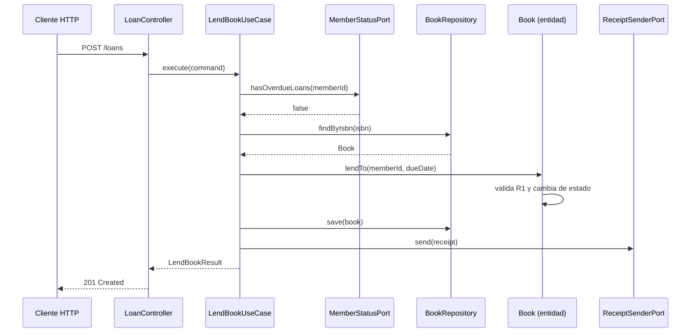

# Ejemplo de referencia — Anatomía de un caso de uso

**Complemento de `ARQUITECTURA_BACKEND_V1.md`**

---

## 1. Para qué sirve este documento

Este documento muestra **la forma** de un subsistema hexagonal: qué archivos existen, qué contiene cada uno y en qué dirección se permiten las dependencias.

Usa deliberadamente **un dominio ajeno al proyecto**. La razón es didáctica: cuando el ejemplo está escrito en el vocabulario del sistema real, el lector mezcla dos aprendizajes simultáneos —la estructura arquitectónica y las reglas del negocio jurídico— y termina copiando el código sin distinguir qué parte es patrón y qué parte es dominio. Con un dominio neutro, todo lo que queda en pie **es** el patrón.

El dominio elegido es el préstamo de libros en una biblioteca: tiene una entidad con estado, un invariante evidente, una dependencia externa y una consulta a otro subsistema. Es el mínimo caso que ejercita todas las piezas.

> El código es ilustrativo. Se omiten importaciones, validaciones exhaustivas y casos de borde que no aportan a la explicación.

---

## 2. El caso de uso de ejemplo

**Prestar un libro a un socio.**

Reglas del dominio de ejemplo:

| #   | Regla                                                                     |
| --- | ------------------------------------------------------------------------- |
| R1  | Un libro solo puede prestarse si está disponible                          |
| R2  | Un socio con préstamos vencidos no puede llevarse otro libro              |
| R3  | Todo préstamo tiene fecha de devolución, calculada según el tipo de socio |
| R4  | Al concretarse el préstamo se envía un comprobante por correo             |

---

## 3. Árbol de archivos

```
src/subsystems/loans/
│
├── core/
│   ├── domain/
│   │   ├── entities/
│   │   │   └── book.entity.ts
│   │   ├── value-objects/
│   │   │   └── isbn.vo.ts
│   │   ├── ports/
│   │   │   ├── book.repository.ts
│   │   │   ├── member-status.port.ts
│   │   │   └── receipt-sender.port.ts
│   │   └── errors/
│   │       └── loan.errors.ts
│   │
│   └── application/
│       └── use-cases/
│           └── lend-book.use-case.ts
│
└── infrastructure/
    ├── http/
    │   ├── controllers/loan.controller.ts
    │   └── dtos/lend-book.request.dto.ts
    ├── persistence/prisma/
    │   ├── prisma-book.repository.ts
    │   └── book-prisma.mapper.ts
    ├── acl/
    │   └── members-status.adapter.ts
    ├── external/
    │   └── email-receipt-sender.adapter.ts
    └── loans.module.ts
```

---

## 4. El flujo



Nótese la dirección: el caso de uso **invoca** puertos; ningún puerto invoca al caso de uso.

---

## 5. Dominio — objeto de valor

`core/domain/value-objects/isbn.vo.ts`

```typescript
export class Isbn {
	private constructor(private readonly value: string) {}

	static create(raw: string): Isbn {
		const normalized = raw.replace(/-/g, "").trim();
		if (normalized.length !== 13) {
			throw new ValidationError("El ISBN debe tener 13 dígitos");
		}
		return new Isbn(normalized);
	}

	toString(): string {
		return this.value;
	}
	equals(other: Isbn): boolean {
		return this.value === other.value;
	}
}
```

**Qué ilustra.** La validación ocurre **una sola vez**, en la construcción. A partir de ahí, cualquier `Isbn` que exista en memoria es válido por definición, y ningún controlador ni repositorio necesita revalidarlo. El constructor es privado: la única puerta de entrada es el método factoría, que valida o falla.

---

## 6. Dominio — entidad

`core/domain/entities/book.entity.ts`

```typescript
export class Book {
	private constructor(
		private readonly _id: string,
		private readonly _isbn: Isbn,
		private readonly _title: string,
		private _status: BookStatus,
		private _currentLoan: Loan | null,
	) {}

	static register(params: { id: string; isbn: Isbn; title: string }): Book {
		if (!params.title?.trim()) {
			throw new ValidationError("El libro debe tener título");
		}
		return new Book(
			params.id,
			params.isbn,
			params.title,
			BookStatus.AVAILABLE,
			null,
		);
	}

	/** R1: un libro solo puede prestarse si está disponible. */
	lendTo(memberId: string, dueDate: Date, now: Date): Loan {
		if (this._status !== BookStatus.AVAILABLE) {
			throw new BusinessRuleError(
				`El libro "${this._title}" no está disponible`,
			);
		}

		const loan = Loan.create({
			bookId: this._id,
			memberId,
			lentAt: now,
			dueDate,
		});
		this._status = BookStatus.LENT;
		this._currentLoan = loan;
		return loan;
	}

	returnCopy(now: Date): void {
		if (this._status !== BookStatus.LENT) {
			throw new BusinessRuleError("El libro no está prestado");
		}
		this._currentLoan!.close(now);
		this._status = BookStatus.AVAILABLE;
		this._currentLoan = null;
	}

	get id(): string {
		return this._id;
	}
	get isbn(): Isbn {
		return this._isbn;
	}
	get title(): string {
		return this._title;
	}
	get status(): BookStatus {
		return this._status;
	}
}
```

**Qué ilustra.**

- **No existe `setStatus()`.** Existen `lendTo()` y `returnCopy()`, que son operaciones del negocio con sus condiciones. Una responsabilidad por transición, no un método genérico de actualización de estado.
- **La entidad no hace entrada ni salida.** No consulta la base, no envía correo, no lee el reloj: recibe `now` y `dueDate` por parámetro. Esto es lo que permite verificar R1 en un test sin levantar nada.
- **Los atributos son privados.** El estado solo cambia a través de métodos que validan.
- **Sin decoradores.** Ni de NestJS ni de Prisma. Esta clase se instancia con `new` en un test.

---

## 7. Dominio — puertos

`core/domain/ports/book.repository.ts`

```typescript
export const BOOK_REPOSITORY = Symbol("BOOK_REPOSITORY");

export interface BookRepository {
	findByIsbn(isbn: Isbn): Promise<Book | null>;
	save(book: Book): Promise<void>;
}
```

`core/domain/ports/member-status.port.ts`

```typescript
export const MEMBER_STATUS = Symbol("MEMBER_STATUS");

/** Declarado por `loans`, con el vocabulario de `loans`. */
export interface MemberStatusPort {
	hasOverdueLoans(memberId: string): Promise<boolean>;
	loanPeriodInDays(memberId: string): Promise<number>;
}
```

`core/domain/ports/receipt-sender.port.ts`

```typescript
export const RECEIPT_SENDER = Symbol("RECEIPT_SENDER");

export interface ReceiptSenderPort {
	send(receipt: {
		memberId: string;
		bookTitle: string;
		dueDate: Date;
	}): Promise<void>;
}
```

**Qué ilustra.**

- **El puerto lo declara quien lo necesita, no quien lo implementa.** `loans` describe qué precisa del subsistema de socios, en sus propios términos. Si ese subsistema cambia su API interna, se modifica el adaptador y el dominio no se entera.
- **El puerto describe una necesidad, no una tecnología.** Se llama `ReceiptSenderPort`, no `SmtpService`. Mañana el comprobante podría enviarse por otro canal y la interfaz seguiría siendo correcta.
- **Cada puerto exporta un símbolo.** Las interfaces de TypeScript no existen en tiempo de ejecución; NestJS necesita un identificador concreto para resolver la inyección.

---

## 8. Aplicación — caso de uso

`core/application/use-cases/lend-book.use-case.ts`

```typescript
@Injectable()
export class LendBookUseCase {
	constructor(
		@Inject(BOOK_REPOSITORY) private readonly books: BookRepository,
		@Inject(MEMBER_STATUS) private readonly members: MemberStatusPort,
		@Inject(RECEIPT_SENDER) private readonly receipts: ReceiptSenderPort,
		@Inject(CLOCK) private readonly clock: ClockPort,
	) {}

	async execute(command: LendBookCommand): Promise<LendBookResult> {
		// 1. R2 — verificación que requiere datos de otro subsistema
		if (await this.members.hasOverdueLoans(command.memberId)) {
			throw new BusinessRuleError("El socio tiene préstamos vencidos");
		}

		// 2. Cargar el agregado
		const isbn = Isbn.create(command.isbn);
		const book = await this.books.findByIsbn(isbn);
		if (!book) {
			throw new NotFoundError(`No existe un libro con ISBN ${isbn}`);
		}

		// 3. R3 — el plazo depende del tipo de socio
		const days = await this.members.loanPeriodInDays(command.memberId);
		const now = this.clock.now();
		const dueDate = addDays(now, days);

		// 4. Decidir: la entidad valida R1 y cambia de estado
		const loan = book.lendTo(command.memberId, dueDate, now);

		// 5. Persistir
		await this.books.save(book);

		// 6. R4 — efecto complementario: su falla no invalida el préstamo
		try {
			await this.receipts.send({
				memberId: command.memberId,
				bookTitle: book.title,
				dueDate,
			});
		} catch (error) {
			this.logger.warn(
				`No se pudo enviar el comprobante del préstamo ${loan.id}`,
				error,
			);
		}

		return { loanId: loan.id, dueDate };
	}
}
```

**Qué ilustra.**

- **El caso de uso coordina; no decide.** La única regla que evalúa directamente es R2, y solo porque depende de un dato externo al agregado. R1 vive dentro de `book.lendTo()`, donde corresponde.
- **Depende de símbolos de puertos, jamás de clases concretas.** No aparece Prisma, ni el cliente de correo, ni el subsistema de socios.
- **El `try/catch` del paso 6 es la clasificación de puertos en acción.** `BookRepository` y `MemberStatusPort` son **esenciales**: su falla se propaga y aborta la operación. `ReceiptSenderPort` es **complementario**: el préstamo es válido aunque el correo falle. Esta distinción está definida en §6.6 del documento principal y debe declararse explícitamente para cada puerto.
- **El `@Injectable()` es la única concesión a NestJS dentro de `core`**, y solo en la capa de aplicación. El dominio no lleva decoradores.

> **Criterio de ubicación.** Si al escribir un caso de uso aparece un `if` sobre una regla del negocio, esa decisión probablemente pertenece a una entidad. El caso de uso describe **el orden en que pasan las cosas**; la entidad describe **qué es válido**.

---

## 9. Infraestructura — adaptador de persistencia

`infrastructure/persistence/prisma/prisma-book.repository.ts`

```typescript
@Injectable()
export class PrismaBookRepository implements BookRepository {
	constructor(private readonly prisma: PrismaService) {}

	async findByIsbn(isbn: Isbn): Promise<Book | null> {
		const row = await this.prisma.book.findUnique({
			where: { isbn: isbn.toString() },
			include: { currentLoan: true },
		});
		return row ? BookPrismaMapper.toDomain(row) : null;
	}

	async save(book: Book): Promise<void> {
		const data = BookPrismaMapper.toPersistence(book);
		await this.prisma.book.upsert({
			where: { id: data.id },
			create: data,
			update: data,
		});
	}
}
```

**Qué ilustra.** El _mapper_ es la frontera: **ningún modelo de Prisma sale de esta carpeta**. El repositorio recibe y devuelve entidades de dominio. Es tedioso, y es exactamente el precio que compra la independencia del ORM.

---

## 10. Infraestructura — adaptador anticorrupción

`infrastructure/acl/members-status.adapter.ts`

```typescript
@Injectable()
export class MembersStatusAdapter implements MemberStatusPort {
	constructor(private readonly getMemberProfile: GetMemberProfileUseCase) {}

	async hasOverdueLoans(memberId: string): Promise<boolean> {
		const profile = await this.getMemberProfile.execute({ memberId });
		return profile.overdueCount > 0; // traduce al vocabulario de `loans`
	}

	async loanPeriodInDays(memberId: string): Promise<number> {
		const profile = await this.getMemberProfile.execute({ memberId });
		return profile.category === "RESEARCHER" ? 30 : 14;
	}
}
```

**Qué ilustra.** Un subsistema expone hacia los demás **únicamente casos de uso**, nunca repositorios ni entidades. El adaptador traduce entre los dos vocabularios y concentra todo el conocimiento que `loans` tiene sobre el subsistema de socios en **un solo archivo**.

---

## 11. Infraestructura — controlador

`infrastructure/http/controllers/loan.controller.ts`

```typescript
@Controller("loans")
@UseGuards(JwtAuthGuard, PermissionsGuard)
export class LoanController {
	constructor(private readonly lendBook: LendBookUseCase) {}

	@Post()
	@RequirePermissions("loan:create")
	@HttpCode(HttpStatus.CREATED)
	async lend(@Body() dto: LendBookRequestDto): Promise<LoanResponseDto> {
		const result = await this.lendBook.execute(
			LoanHttpMapper.toCommand(dto),
		);
		return LoanHttpMapper.toResponse(result);
	}
}
```

**Qué ilustra.** Dos líneas de cuerpo. El controlador traduce HTTP a caso de uso y vuelta, y nada más. **No hay un solo `try/catch`**: los errores de dominio los traduce el filtro global, porque `BusinessRuleError` no debe conocer el código 422.

---

## 12. Composición — el módulo

`infrastructure/loans.module.ts`

```typescript
@Module({
	imports: [SharedModule, MembersModule],
	controllers: [LoanController],
	providers: [
		LendBookUseCase,
		{ provide: BOOK_REPOSITORY, useClass: PrismaBookRepository },
		{ provide: MEMBER_STATUS, useClass: MembersStatusAdapter },
		{ provide: RECEIPT_SENDER, useClass: EmailReceiptSenderAdapter },
	],
	exports: [],
})
export class LoansModule {}
```

**Qué ilustra.** Este es el **único** lugar del subsistema donde una interfaz se encuentra con su implementación. Cambiar Prisma por otra cosa, o el correo por otro canal, es cambiar una línea acá y escribir la clase nueva. `exports` vacío significa que ningún otro subsistema consume nada de `loans`: todo lo no exportado es privado.

---

## 13. Las seis reglas que el ejemplo ilustra

| #   | Regla                                                 | Dónde se ve                                                             |
| --- | ----------------------------------------------------- | ----------------------------------------------------------------------- |
| 1   | El dominio no importa nada de infraestructura         | §6, §7 — ninguna clase de `core/domain` menciona Prisma, NestJS ni HTTP |
| 2   | Los puertos los declara el consumidor                 | §7 — `MemberStatusPort` está en `loans`, no en el subsistema de socios  |
| 3   | La entidad decide; el caso de uso ordena              | §6 vs. §8 — R1 en la entidad, la secuencia en el caso de uso            |
| 4   | Los modelos de persistencia no cruzan la frontera     | §9 — el _mapper_ traduce en ambas direcciones                           |
| 5   | Cada puerto se clasifica en esencial o complementario | §8, paso 6 — la falla del correo no aborta el préstamo                  |
| 6   | La composición ocurre en un único archivo             | §12 — el módulo enlaza cada puerto con su implementación                |

---

## 14. Equivalencia con el sistema real

La estructura es idéntica; solo cambian los nombres. Al tomar una historia del backlog, este es el mapeo:

| Pieza del ejemplo            | Equivalente en VZ Causas              | Subsistema          |
| ---------------------------- | ------------------------------------- | ------------------- |
| `Book`                       | `Case`                                | `cases`             |
| `Isbn`                       | `SacNumber`                           | `cases`             |
| `Book.lendTo()`              | `Case.registerAct()`                  | `cases`             |
| R1 — disponibilidad          | RN4 — estado válido para el fuero     | `cases`             |
| R2 — socio sin vencidos      | RN13 — solo el abogado responsable    | `cases`             |
| R3 — plazo por tipo de socio | RN5 — plazo por acto procesal y fuero | `deadlines`         |
| R4 — comprobante por correo  | RNF 5 — aviso de vencimiento          | `deadlines`         |
| `MemberStatusPort`           | `PeopleLookupPort`                    | `cases → people`    |
| `ReceiptSenderPort`          | `CaseFolderPort`                      | `cases → documents` |

**Diferencia importante.** En el ejemplo, R2 se verifica en el caso de uso porque depende de un dato externo al agregado. En VZ Causas, RN13 se verifica **dentro de la entidad `Case`**, porque el identificador del abogado responsable ya está en el agregado: no hace falta salir a buscarlo. El criterio no es dónde queda más cómodo, sino **si la regla puede evaluarse con lo que el agregado ya conoce**.

---

## 15. Orden de trabajo para una historia nueva

De adentro hacia afuera, porque el dominio es lo que hay que entender primero.

| #   | Archivo                                      | Pregunta que responde                              |
| --- | -------------------------------------------- | -------------------------------------------------- |
| 1   | `domain/entities/*.entity.ts`                | ¿Qué regla del negocio aplica?                     |
| 2   | `domain/ports/*.port.ts`                     | ¿Qué necesito del exterior?                        |
| 3   | `application/use-cases/*.use-case.ts`        | ¿En qué orden pasan las cosas?                     |
| 4   | _tests de dominio y de caso de uso_          | ¿Funciona la regla? Ver `ESTRATEGIA_DE_TESTING.md` |
| 5   | `infrastructure/persistence/*.repository.ts` | ¿Cómo se guarda?                                   |
| 6   | `infrastructure/acl/*.adapter.ts`            | ¿Cómo hablo con el otro subsistema?                |
| 7   | `infrastructure/http/*.controller.ts` + DTO  | ¿Cómo se expone?                                   |
| 8   | `*.module.ts`                                | ¿Cómo se arma todo?                                |

Los pasos 1 a 4 se completan **antes** de escribir una línea de infraestructura. Si el paso 4 es difícil de escribir, casi siempre significa que la responsabilidad está mal ubicada entre los pasos 1 y 3.
