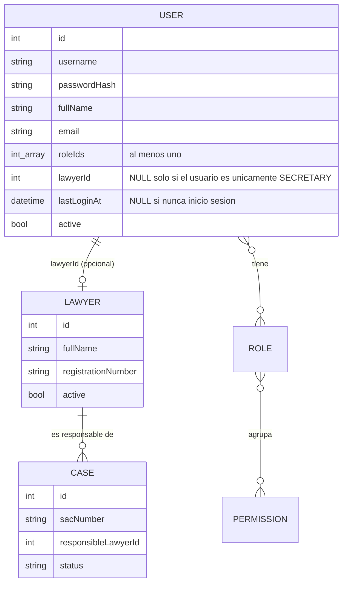
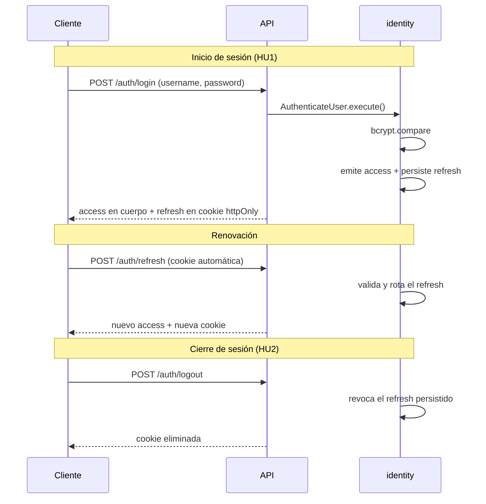
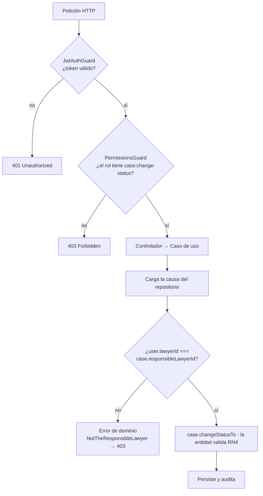

## Autenticación y autorización

- **Autenticación:** _¿sos quien decís ser?_ Se resuelve una vez, al iniciar sesión.
- **Autorización:** _¿podés hacer esto?_ Se resuelve **en cada acceso**, como exige el RNF 9.

### 1 Modelo de identidad

`User` y `Lawyer` son entidades **distintas**, en subsistemas distintos, vinculadas por identificador.



La causa referencia a `Lawyer`, no a `User`, porque el responsable de una causa es un hecho **profesional**, no un hecho de seguridad. Un abogado puede existir en el sistema antes de tener credenciales (HU12 y HU4 son historias separadas, en sprints distintos), y puede perder el acceso sin dejar de ser el responsable histórico de sus causas.

- Un usuario cuyos roles incluyan **`ADMINISTRATOR`** o **`LAWYER`** tiene `lawyerId` obligatorio.
- Solo un usuario que sea **únicamente `SECRETARY`** puede tener `lawyerId` nulo.
- La invariante cruzada no se valida en la entidad `User`, porque su factoría solo recibe identificadores numéricos de rol y no conoce los nombres. Se valida en el caso de uso de alta de usuarios, que carga los roles para armar el usuario.
- Cuando `cases` necesita saber si el usuario actuante es el responsable de la causa, compara `Case.responsibleLawyerId` con el `lawyerId` del usuario autenticado.

### 2 Resguardo de credenciales (RNF 8)

- Algoritmo: **bcrypt**, con sal generada automáticamente por cada contraseña.
- El factor de costo se define en configuración, no fijo en el código.
- La contraseña en texto plano **no se escribe en ningún log, en ningún DTO de respuesta, y en ninguna excepción**.
- La entidad `User` no expone el hash: no hay _getter_ público de `passwordHash`. La verificación se hace mediante un método de la entidad, `verifyPassword(plain, hasher)`, que recibe el servicio de hashing por puerto.

### 3 Mecanismo de sesión

**Token de acceso + token de refresco**.

| Token             | Dónde viaja                               | Vida útil       | Contenido                                         |
| ----------------- | ----------------------------------------- | --------------- | ------------------------------------------------- |
| **Access token**  | Encabezado `Authorization: Bearer`        | Corta (minutos) | `sub` (userId), `roles[]` (nombres), `lawyerId`, lista de permisos |
| **Refresh token** | Cookie `httpOnly` + `Secure` + `SameSite` | Larga (días)    | Identificador opaco, persistido en base           |

**Refresh en cookie `httpOnly`:** Es el credencial de larga vida: si lo captura código malicioso en el navegador, el atacante mantiene acceso persistente a datos sensibles alcanzados por la Ley 25.326. Una cookie `httpOnly` no es legible desde JavaScript. El atributo `Secure` exige HTTPS, lo que se apoya directamente en el RNF 7.

**Refresh Persistente:** Un token de acceso firmado no se puede invalidar antes de su expiración. Si el refresh no se persistiera, **HU2 (Cerrar Sesión) sería decorativa**: el usuario "cierra sesión" pero su token sigue siendo válido. Al persistirlo, cerrar sesión lo revoca y la renovación falla.

Flujos:



**Rotación.** Al usar el refresh N se emite el N+1 y se marca el N con `revokedAt`. Todos los refresh que descienden de un mismo inicio de sesión comparten un `familyId`, y ese linaje es lo que permite detectar el robo.

**Detección de reutilización.** Si llega un refresh cuyo `revokedAt` no es nulo, se asume robo y se revoca la **familia completa**, no solo ese token: el atacante pierde el acceso y el usuario legítimo queda forzado a iniciar sesión de nuevo. Un refresh simplemente vencido, en cambio, se rechaza sin tocar la familia — vencer es el curso normal, reutilizar no.

### 4 Modelo de permisos

**Roles con permisos predefinidos**, persistidos en base.

Un usuario podrá tener uno o muchos roles y cada rol tendrá ciertos permisos **no modificables**. Si se quiere dar o quitar permisos se dan o quitan roles.

Roles iniciales (datos semilla, no constantes de código):

Los identificadores de rol son los del contrato de la API, en inglés; la interfaz muestra la denominación en castellano.

| Rol             | Denominación en la interfaz | Descripción                                                                             |
| --------------- | --------------------------- | --------------------------------------------------------------------------------------- |
| `ADMINISTRATOR` | Administrador               | Socios directores y coordinadores. Administra usuarios, abogados, parametría y reportes |
| `LAWYER`        | Abogado                     | Abogados especialistas. Opera causas, actos procesales y documentos                     |
| `SECRETARY`     | Secretaria                  | Secretaría administrativa. Registra clientes y causas, consulta                         |

### 5 Los dos niveles de autorización

**Nivel 1 — Autorización por operación (guard de infraestructura).**
Responde: _"¿el rol de este usuario habilita invocar esta operación?"_. Es información que está íntegra en el token: no requiere leer la base. Se resuelve con un _guard_ de NestJS y un decorador declarativo sobre el método del controlador.

**Nivel 2 — Autorización por instancia (dentro del caso de uso).**
Responde: _"¿este usuario puede operar sobre **esta** causa en particular?"_. Requiere leer el dato. **No puede resolverse en un guard**, porque el guard corre antes de que la causa se haya cargado.



**Cómo llega el usuario al caso de uso.** El contexto del usuario autenticado se pasa **como parámetro explícito** al método `execute()`, dentro del comando de entrada. No se usan proveedores de alcance de petición ni almacenamiento implícito.

Razones:

1. El caso de uso se vuelve **testeable sin HTTP**: en el test se construye el usuario a mano y se invoca.
2. La dependencia de la autorización queda **visible en la firma del método**. Quien lee el código ve que ese caso de uso depende de quién lo invoca.
3. Los proveedores de alcance de petición tienen costo de rendimiento y hacen que el flujo sea imposible de seguir leyendo.

El tipo que viaja es propiedad del _kernel compartido_, no de `identity`:

```typescript
// src/shared/domain/authenticated-user.ts
export interface AuthenticatedUser {
	readonly userId: number;
	readonly roleNames: readonly string[];
	readonly lawyerId: number | null; // null solo si es únicamente SECRETARY
	readonly permissions: readonly string[];
}
```

`roleNames` es plural porque un usuario puede acumular roles: el conjunto de permisos efectivo es la unión de los permisos de todos ellos.

> **Nota sobre RN11 y el secreto de sumario.** RN11 establece que no existen causas de visibilidad restringida, y por eso **no se implementa filtrado de datos por usuario**. Sin embargo, el _Plan de Proyecto_ menciona el secreto de sumario, bajo el cual la información no es accesible ni al propio cliente. Ambas afirmaciones podrían no ser compatibles.

---
