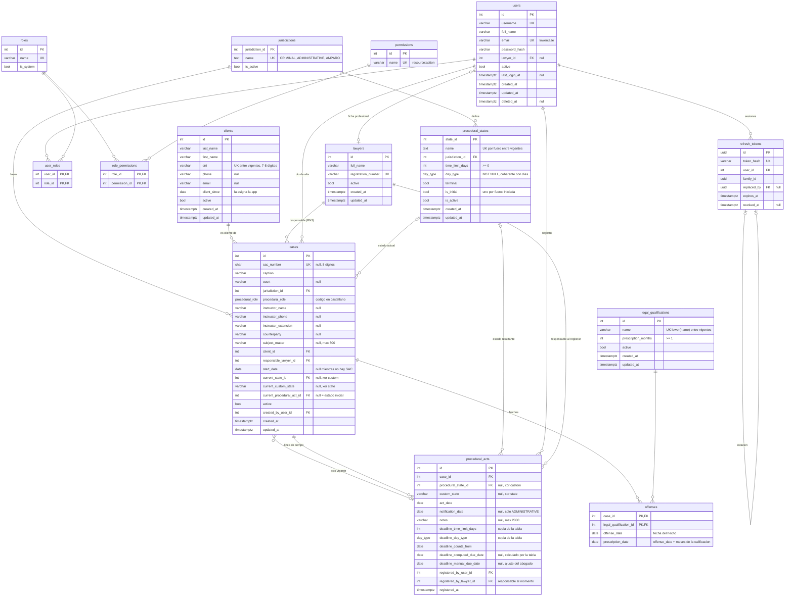

# ERD — Base de datos del Sprint 2

Diseño de la base para el Sprint 2 (revisión 3, 05/10/2026). Coincide con
`backend/prisma/schema.prisma` y con `API_CONTRACT_V3.md` (revisión del
05/10/2026, §7.8): sin `position` en estados procesales, `activeCases` solo
calculado en los `GET`, SAC / instructor / interno / calificación legal
opcionales, estado inicial "Iniciada" por fuero y vencimiento dentro de
`currentState`.

> **Estado:** `schema.prisma` actualizado. **Falta la migración** (incluido el
> SQL manual de abajo) y adaptar el código y el seed que usan `position`.
>
> **Cambio del 06/10/2026:** la tabla intermedia `case_legal_qualifications`
> pasa a llamarse `offenses` (hechos de la causa, modelo `Offense`) y suma la
> columna `prescription_date`. Falta la migración de ese cambio: debe
> renombrar la tabla (y su clave primaria, índice y claves foráneas) en lugar
> de borrarla y crearla, y completar `prescription_date` de las filas que ya
> existan.

## Restricciones que el diagrama no muestra

Van en una migración manual (`migrate dev --create-only`), porque Prisma no
las expresa:

- **Índices únicos parciales**
    - `clients (dni) WHERE active`
    - `legal_qualifications (lower(name)) WHERE active`
    - `procedural_states (jurisdiction_id, lower(name)) WHERE is_active`
    - `procedural_states (jurisdiction_id) WHERE is_initial`
- **Exclusión mutua (xor)**
    - `cases`: `num_nonnulls(current_state_id, current_custom_state) = 1`
    - `procedural_acts`: `num_nonnulls(procedural_state_id, custom_state) = 1`
- **CHECK**
    - `procedural_states`: `(time_limit_days = 0) = (day_type = 'NONE')`, `time_limit_days >= 0`
    - `procedural_states`: `NOT is_initial OR (NOT terminal AND time_limit_days = 0 AND day_type = 'NONE')`
    - `cases`: `sac_number IS NULL OR sac_number ~ '^\d{8}$'`
    - `clients`: `dni ~ '^\d{7,8}$'`
    - `legal_qualifications`: `prescription_months >= 1`
    - `procedural_acts`: `notification_date >= act_date`, `deadline_manual_due_date IS NULL OR deadline_manual_due_date >= deadline_counts_from`

## Reglas que quedan en el dominio

- Solo el abogado responsable de la causa (`users.lawyer_id = cases.responsible_lawyer_id`) registra actos y usa `deadline-preview`. Ni siquiera el administrador.
- `offenses.prescription_date` es `offense_date` más `prescription_months` de la calificación legal, y no se recalcula si esos meses cambian después. La calcula el caso de uso Registrar Causa antes de guardar el hecho; si el mes de llegada es más corto, cae en su último día.
- El estado de un acto pertenece al fuero de la causa, está vigente, no es terminal ni es el inicial.
- `custom_state` no coincide con el nombre de un estado vigente del fuero.
- El rol procesal corresponde al fuero de la causa.
- Si `current_procedural_act_id` no es nulo, el estado de la causa es el estado resultante de ese acto. Se actualiza en la misma transacción, y solo si `act_date` es mayor o igual al del acto vigente.
- `client_since` se asigna con `ClockPort.today()` (Córdoba), nunca con `CURRENT_DATE` de la base. `start_date` solo existe con SAC: la informa el usuario y, sin SAC, queda en `NULL` (D-38).

## Vencimiento del acto

- `deadline_computed_due_date`: el que resulta de la tabla del fuero (`deadline_counts_from` + `deadline_time_limit_days` según `deadline_day_type`). `null` si el estado no abre plazo.
- `deadline_manual_due_date`: solo si el abogado ajustó el vencimiento a mano.
- **Vencimiento vigente** = `COALESCE(deadline_manual_due_date, deadline_computed_due_date)`, calculado al leer.
- **Ajustado a mano** = `deadline_manual_due_date IS NOT NULL`. No hay columna booleana.
- `deadline_counts_from` es `notification_date` en `ADMINISTRATIVE` (RN6) y `act_date` en los demás fueros.

## Enumerado `procedural_role`

Los valores se guardan y viajan por la API en castellano (API Contract V3 §7.9, D-37): son la excepción a la convención de códigos en inglés de `TRADUCCION_DOMINIO.md`. El rótulo de pantalla lo resuelve el frontend:

| Código                   | Rótulo (frontend)      | Fueros                       |
| ------------------------ | ---------------------- | ---------------------------- |
| `DEFENSA`                | Defensa                | `CRIMINAL`, `ADMINISTRATIVE` |
| `QUERELLANTE_PARTICULAR` | Querellante particular | `CRIMINAL`                   |
| `RECURRENTE`             | Recurrente             | `ADMINISTRATIVE`             |
| `ACTORA`                 | Actora                 | `AMPARO`                     |
| `DEMANDADA`              | Demandada              | `AMPARO`                     |

## Correspondencia con el API Contract

`currentState` de la causa (§3.7 del contrato) se arma así:

| Campo de la API | Origen en la base |
|---|---|
| `proceduralStateId` | `cases.current_state_id`, salvo que el estado sea el inicial (`is_initial`): entonces `null` |
| `name` | `procedural_states.name` o `cases.current_custom_state` |
| `custom` | `cases.current_custom_state IS NOT NULL` |
| `initial` | `procedural_states.is_initial` del estado actual |
| `proceduralActId` | `cases.current_procedural_act_id` |
| `dueDate` | `COALESCE(deadline_manual_due_date, deadline_computed_due_date)` del acto vigente |
| `businessDaysRemaining` | Calculado al leer, contra la fecha del día en Córdoba |
| `manuallyAdjusted` | `deadline_manual_due_date IS NOT NULL` del acto vigente |

`activeCases` de estados procesales y calificaciones legales no se guarda: se
calcula con una agregación al responder los `GET`.
