# Modelo de Dominio v0.4 — VZ Causas

Revisión 0.4 (05/10/2026). Reemplaza al _Domain Model 0.3_. Está alineado con el
ERD del Sprint 2 (rev. 3) y con las decisiones del equipo del 05/10/2026.

**Propósito.** Es la guía del dominio completo, no solo del Sprint 2: incluye las
clases de sprints futuros. Muestra cómo se relacionan las clases y sirve de base
para construir el software. Los tipos de datos se omiten a propósito.

**Idioma.** El dominio se nombra en español (lenguaje del estudio). La base y la
API usan inglés según `TRADUCCION_DOMINIO.md`; la sección 8 da la correspondencia.

**Convenciones de notación**

| Notación                | Significado                                                     |
| ----------------------- | --------------------------------------------------------------- |
| `<<abstract>>`          | Clase abstracta: no tiene instancias propias                    |
| `<<enumeration>>`       | Conjunto cerrado de valores                                     |
| `<<valueObject>>`       | Objeto valor: sin identidad, inmutable, vive dentro de su dueño |
| `<<interface>>`         | Puerto: lo implementa la infraestructura                        |
| método terminado en `*` | Método abstracto: cada subclase lo implementa                   |
| `*--`                   | Composición: la parte nace y muere con el todo                  |
| `-->`                   | Asociación navegable                                            |
| `..>`                   | Dependencia: usa, no guarda referencia                          |

---

## Decisiones incorporadas

1. **Causa con herencia.** Penal, Administrativa y Amparo tienen atributos
   distintos, así que la variación es estructural y corresponde herencia, no
   Strategy. El comportamiento que cambia por fuero (desde cuándo corre el plazo,
   qué roles procesales admite) se resuelve por polimorfismo.
2. **`CausaConContraparte`** agrupa `contraparte` y `objetoDeLaCausa`, comunes a
   Administrativa y Amparo. Penal no los tiene: usa calificaciones legales.
3. **Número de SAC opcional.** La causa puede existir antes de iniciarse en sede
   judicial. Si tiene SAC, es único.
4. **Calificación legal obligatoria solo en penal** (1..\* en `CausaPenal`).
5. **Plazo 0 = sin plazo asociado.** `diasPlazo = 0` si y solo si `tipoDia = NINGUNO`.
6. **Solo el abogado responsable registra, modifica y da de baja actos procesales.**
   Ni la secretaria ni el administrador, salvo que sean el responsable de esa causa.
7. **Notificación posterior en administrativo (RN6).** El acto puede registrarse
   antes de conocer la notificación; el vencimiento se calcula cuando se registra.
8. **Baja lógica de actos**, con recálculo del acto vigente de la causa.
9. **Calendario judicial** (feriados y ferias) incluido como clase de sprint futuro.
10. **`Fuero.tipoDiaPorDefecto`** se mantiene.
11. **Persona se mantiene** como superclase, para reutilizar sus atributos y comportamiento.
12. **Tribunal** queda como atributo de `Causa`, no como clase.
13. **Plazo pasa a `Vencimiento`** (objeto valor dentro del acto) y **`TipoDia`** y
    **`RolProcesal`** pasan a enumeraciones.

### Vista completa

Todas las clases con sus atributos y métodos, y todas las relaciones, en un solo
diagrama. Es la referencia integral; para trabajar sobre un área puntual, las
vistas 2 a 5 son más fáciles de leer.

```mermaid
classDiagram
    direction TB

    class Causa {
        <<abstract>>
        -id
        -nroSac
        -caratula
        -tribunal
        -fechaInicio
        -estadoPersonalizado
        -activo
        -fechaAlta
        -fechaArchivo
        +registrarActoProcesal(datos, usuario, hoy)
        +modificarActoProcesal(acto, datos, usuario)
        +darDeBajaActoProcesal(acto, usuario)
        +consignarEstadoPersonalizado(texto)
        +conocerEstadoActual()
        +conocerVencimientoVigente(hoy)
        +conocerPlazosVigentes(hoy)
        +estadosAplicables()
        +rolesAdmitidos()*
        +fechaInicioComputo(acto)*
        +generarLineaDeTiempo()
        +generarCaratula()
        +generarExpediente()
        +modificar(datos)
        +archivar()
        +darDeBaja()
        -recalcularActoVigente()
    }

    class CausaPenal {
        -nombreImputado
        -tieneMedidaRestrictivaLibertad
        -fechaInicioComputoPrescripcion
        -fechaPrescripcion
        -fechaUltimoActoInterruptivo
        -prescripta
        +rolesAdmitidos()
        +fechaInicioComputo(acto)
        +agregarCalificacion(calificacion, fechaHecho)
        +quitarCalificacion(calificacion)
        +calcularFechaPrescripcion()
        +estaProximaAPrescribir(hoy)
        +registrarActoInterruptivo(datos, usuario)
        +reiniciarComputoPrescripcion(fecha)
        +verificarPlazoDePrescripcion(hoy)
        +registrarPrescripcion()
    }

    class CausaConContraparte {
        <<abstract>>
        -contraparte
        -objetoDeLaCausa
    }

    class CausaAdministrativa {
        -nroExpedienteAdministrativo
        -organismoInterviniente
        -via
        -fechaResolucionAdministrativa
        -fechaAgotamientoViaAdministrativa
        +rolesAdmitidos()
        +fechaInicioComputo(acto)
        +registrarNotificacion(acto, fecha, usuario)
        +verificarAgotamientoDeVia()
        +habilitarViaContenciosa()
    }

    class Amparo {
        -admisible
        -fechaActoLesivo
        -fechaLimiteInterposicion
        +rolesAdmitidos()
        +fechaInicioComputo(acto)
        +verificarAdmisibilidadTemporal(hoy)
    }

    class Instructor {
        <<valueObject>>
        -nombre
        -telefono
        -interno
    }

    class CalificacionDeCausa {
        -fechaHecho
        +fechaPrescripcion()
    }

    class Actuacion {
        <<abstract>>
        -id
        -fechaActo
        -fechaRegistro
        -notas
        -activo
        +producirEfecto(causa)*
        +modificar(datos)
        +darDeBaja()
    }

    class ActoProcesal {
        -estadoPersonalizado
        -fechaNotificacion
        +producirEfecto(causa)
        +abrePlazo()
        +calcularVencimiento(computaDesde, calendario)
        +ajustarVencimientoManual(fecha)
        +registrarNotificacion(fecha)
        +conocerVencimiento()
    }

    class ActoInterruptivo {
        -fundamentoLegal
        -fechaEfectoInterruptivo
        -fechaPrescripcionAnterior
        -fechaPrescripcionNueva
        +producirEfecto(causa)
        +conocerNuevaFechaPrescripcion()
    }

    class Fuero {
        -id
        -codigo
        -nombre
        -tipoDiaPorDefecto
        -activo
        +estadoInicial()
        +estadosVigentes()
        +agregarEstado(datos)
    }

    class EstadoProcesal {
        -id
        -nombre
        -diasPlazo
        -tipoDia
        -terminal
        -esInicial
        -activo
        +abrePlazo()
        +contarCausasActivas()
        +modificarPlazo(dias, tipoDia)
        +darDeBaja()
    }

    class CalificacionLegal {
        -id
        -nombre
        -mesesPrescripcion
        -activo
        +contarCausasActivas()
        +modificar(datos)
        +darDeBaja()
    }

    class TipoDia {
        <<enumeration>>
        HABILES
        CORRIDOS
        NINGUNO
    }

    class RolProcesal {
        <<enumeration>>
        DEFENSA
        QUERELLANTE_PARTICULAR
        RECURRENTE
        ACTORA
        DEMANDADA
    }

    class Vencimiento {
        <<valueObject>>
        -diasPlazo
        -tipoDia
        -computaDesde
        -fechaCalculada
        -fechaAjustadaManual
        +fechaVigente()
        +ajustadoManualmente()
        +conAjusteManual(fecha)
        +conComputoDesde(fecha, calendario)
        +diasHabilesRestantes(hoy, calendario)
        +estaVencido(hoy)
        +estaProximoAVencer(hoy, umbral)
    }

    class CalendarioJudicial {
        +esDiaHabil(fecha)
        +sumarDias(desde, dias, tipoDia)
        +diasHabilesEntre(desde, hasta)
    }

    class Feriado {
        -fecha
        -descripcion
        -alcance
    }

    class FeriaJudicial {
        -desde
        -hasta
        -descripcion
    }

    class Reloj {
        <<interface>>
        +hoy()
    }

    class Persona {
        <<abstract>>
        -id
        -apellido
        -nombre
        -nroDocumento
        -cuitCuil
        -domicilio
        -email
        -telefono
        -fechaNacimiento
        -activo
        -fechaAlta
        -fechaBaja
        +modificarDatosDeContacto(datos)
        +mostrarDatos()
        +darDeBaja()
    }

    class Cliente {
        -esPersonaJuridica
        -razonSocial
        -clienteDesde
        +conocerCausas()
        +conocerCausasActivas()
        +tieneCausasActivas()
    }

    class IntegranteDelEstudio {
        <<abstract>>
        -fechaIngreso
        +tieneUsuario()
    }

    class Abogado {
        -matricula
        +esResponsableDe(causa)
        +calcularCargaDeTrabajo()
        +conocerCausasACargo()
        +conocerCausasPorPrescribir(hoy)
        +conocerPlazosProximos(hoy)
    }

    class Empleado {
        -puesto
    }

    class Usuario {
        -id
        -nombreUsuario
        -email
        -hashContrasena
        -activo
        -fechaAlta
        -fechaUltimoAcceso
        -fechaBaja
        +autenticar(contrasena)
        +iniciarSesion()
        +cerrarSesion()
        +cambiarContrasena(actual, nueva)
        +tienePermiso(recurso, accion)
        +conocerRoles()
        +darDeBaja()
    }

    class Rol {
        -id
        -nombre
        -esDelSistema
        +otorga(permiso)
    }

    class Permiso {
        -id
        -recurso
        -accion
    }

    class DocumentoFormal {
        -id
        -titulo
        -descripcion
        -fechaDocumento
        -fechaCarga
        -urlDrive
        -presentadoEnSac
        -resguardadoEnFisico
        -activo
        +registrar()
        +modificar(datos)
        +descargar()
        +registrarPresentacion(fecha)
        +registrarResguardoFisico()
        +darDeBaja()
    }

    class Modelo {
        -id
        -codigo
        -nombre
        -descripcion
        -urlDrive
        -version
        -fechaAlta
        -fechaUltimaModificacion
        -activo
        +registrar()
        +modificar(datos)
        +copiarACarpetaDeCausa(causa)
        +darDeBaja()
    }

    %% Relaciones
    Causa <|-- CausaPenal
    Causa <|-- CausaConContraparte
    CausaConContraparte <|-- CausaAdministrativa
    CausaConContraparte <|-- Amparo
    Actuacion <|-- ActoProcesal
    Actuacion <|-- ActoInterruptivo
    Persona <|-- Cliente
    Persona <|-- IntegranteDelEstudio
    IntegranteDelEstudio <|-- Abogado
    IntegranteDelEstudio <|-- Empleado
    Causa "0..*" --> "1" Fuero : fuero
    Causa "0..*" --> "1" Cliente : cliente
    Causa "0..*" --> "1" Abogado : responsable
    Causa "0..*" --> "1" Usuario : creadoPor
    Causa "0..*" --> "0..1" EstadoProcesal : estadoActual
    Causa --> "0..1" ActoProcesal : actoVigente
    Causa --> "1" RolProcesal : rolProcesal
    Causa *-- "0..1" Instructor : instructor
    Causa "1" *-- "0..*" ActoProcesal : actos
    Causa "1" *-- "0..*" DocumentoFormal : documentos
    Causa ..> Reloj : hoy
    CausaPenal "1" *-- "1..*" CalificacionDeCausa : calificaciones
    CalificacionDeCausa "0..*" --> "1" CalificacionLegal : calificacion
    CausaPenal "1" *-- "0..*" ActoInterruptivo : actosInterruptivos
    Actuacion "0..*" --> "1" Usuario : registradoPor
    Actuacion "0..*" --> "1" Abogado : responsableAlRegistrar
    ActoProcesal "0..*" --> "0..1" EstadoProcesal : estadoResultante
    ActoProcesal *-- "0..1" Vencimiento : vencimiento
    Fuero "1" *-- "1..*" EstadoProcesal : estados
    Fuero --> TipoDia : tipoDiaPorDefecto
    EstadoProcesal --> TipoDia : tipoDia
    Vencimiento --> TipoDia : tipoDia
    Vencimiento ..> CalendarioJudicial : calcula con
    CalendarioJudicial "1" *-- "0..*" Feriado : feriados
    CalendarioJudicial "1" *-- "0..*" FeriaJudicial : ferias
    Usuario "0..1" --> "0..1" IntegranteDelEstudio : integrante
    Usuario "0..*" --> "0..*" Rol : roles
    Rol "0..*" --> "0..*" Permiso : permisos
    Modelo "0..*" --> "1" Fuero : fuero
    Modelo "0..*" --> "1" Abogado : creador
    Modelo ..> Causa : se copia a

    %% Notas
    note for Causa "Raíz de agregado.\nEstado actual: estadoActual xor estadoPersonalizado.\nToda escritura sobre actos pasa por la causa."
    note for CalificacionDeCausa "Clase asociación entre CausaPenal y CalificacionLegal.\nCada calificación tiene su propia fecha del hecho."
    note for ActoProcesal "Estado resultante: estadoResultante xor estadoPersonalizado.\nfechaNotificacion solo en CausaAdministrativa (RN6)."
    note for EstadoProcesal "diasPlazo = 0 si y solo si tipoDia = NINGUNO.\nUn solo estado inicial por fuero: Iniciada."
    note for Vencimiento "Copia de la tabla al momento del acto.\nSi la tabla cambia, los actos ya registrados no cambian."
    note for Reloj "Devuelve la fecha del día en Córdoba.\nNunca usar la fecha del servidor de base de datos."
    note for IntegranteDelEstudio "Solo los integrantes pueden tener usuario.\nUn cliente nunca accede al sistema."
    note for Permiso "Formato recurso:accion, por ejemplo cases:write."
    note for DocumentoFormal "RN9: toda presentación electrónica se resguarda en el expediente físico.\nRN13: cargar un documento no cambia el estado procesal."
```

