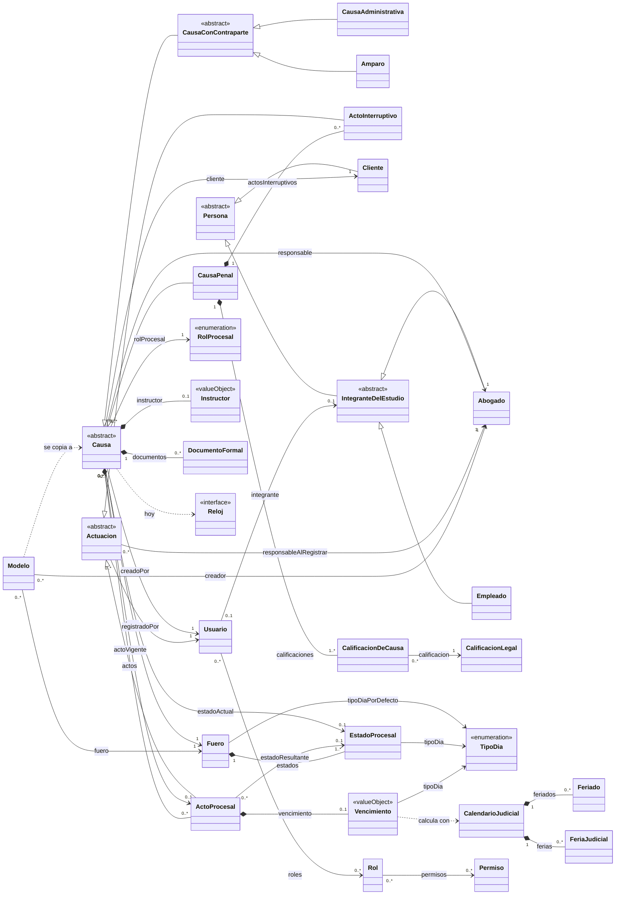
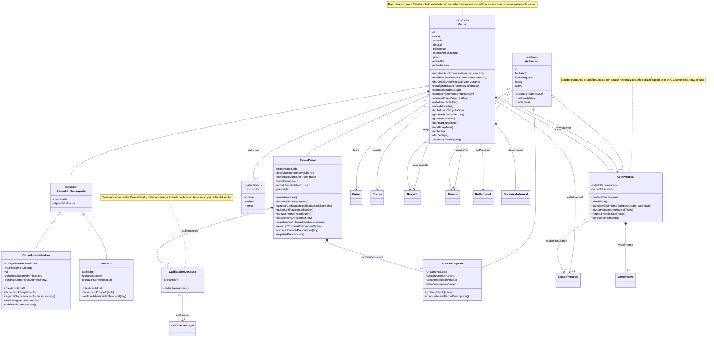
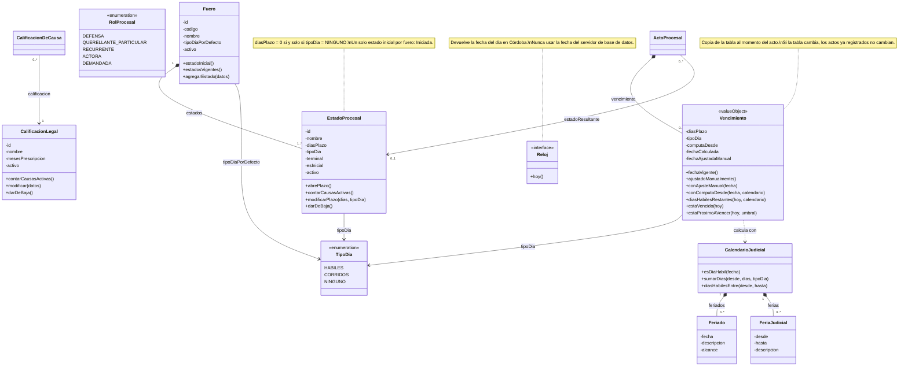
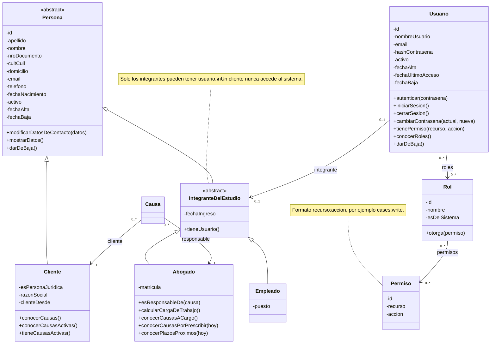
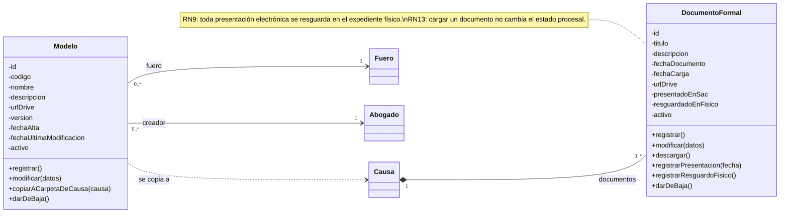

# Modelo de Dominio v0.4 — VZ Causas

Revisión 0.4 (05/10/2026). Reemplaza al _Domain Model 0.3_. Está alineado con el
ERD del Sprint 2 (rev. 3) y con las decisiones del equipo del 05/10/2026.

**Propósito.** Es la guía del dominio completo, no solo del Sprint 2: incluye las
clases de sprints futuros. Muestra cómo se relacionan las clases y sirve de base
para construir el software. Los tipos de datos se omiten a propósito.

**Idioma.** El dominio se nombra en español (lenguaje del estudio). La base y la
API usan inglés según `TRADUCCION_DOMINIO.md`; la sección 8 da la correspondencia.

**Convenciones de notación**

| Notación                | Significado                                                     |
| ----------------------- | --------------------------------------------------------------- |
| `<<abstract>>`          | Clase abstracta: no tiene instancias propias                    |
| `<<enumeration>>`       | Conjunto cerrado de valores                                     |
| `<<valueObject>>`       | Objeto valor: sin identidad, inmutable, vive dentro de su dueño |
| `<<interface>>`         | Puerto: lo implementa la infraestructura                        |
| método terminado en `*` | Método abstracto: cada subclase lo implementa                   |
| `*--`                   | Composición: la parte nace y muere con el todo                  |
| `-->`                   | Asociación navegable                                            |
| `..>`                   | Dependencia: usa, no guarda referencia                          |

---

## Decisiones incorporadas

1. **Causa con herencia.** Penal, Administrativa y Amparo tienen atributos
   distintos, así que la variación es estructural y corresponde herencia, no
   Strategy. El comportamiento que cambia por fuero (desde cuándo corre el plazo,
   qué roles procesales admite) se resuelve por polimorfismo.
2. **`CausaConContraparte`** agrupa `contraparte` y `objetoDeLaCausa`, comunes a
   Administrativa y Amparo. Penal no los tiene: usa calificaciones legales.
3. **Número de SAC opcional.** La causa puede existir antes de iniciarse en sede
   judicial. Si tiene SAC, es único.
4. **Calificación legal obligatoria solo en penal** (1..\* en `CausaPenal`).
5. **Plazo 0 = sin plazo asociado.** `diasPlazo = 0` si y solo si `tipoDia = NINGUNO`.
6. **Solo el abogado responsable registra, modifica y da de baja actos procesales.**
   Ni la secretaria ni el administrador, salvo que sean el responsable de esa causa.
7. **Notificación posterior en administrativo (RN6).** El acto puede registrarse
   antes de conocer la notificación; el vencimiento se calcula cuando se registra.
8. **Baja lógica de actos**, con recálculo del acto vigente de la causa.
9. **Calendario judicial** (feriados y ferias) incluido como clase de sprint futuro.
10. **`Fuero.tipoDiaPorDefecto`** se mantiene.
11. **Persona se mantiene** como superclase, para reutilizar sus atributos y comportamiento.
12. **Tribunal** queda como atributo de `Causa`, no como clase.
13. **Plazo pasa a `Vencimiento`** (objeto valor dentro del acto) y **`TipoDia`** y
    **`RolProcesal`** pasan a enumeraciones.

## Decisiones pendientes (resueltas de forma provisoria en este modelo)

| #   | Tema                                       | Resolución provisoria                                                                                                                                             | Qué hay que confirmar                                                           |
| --- | ------------------------------------------ | ----------------------------------------------------------------------------------------------------------------------------------------------------------------- | ------------------------------------------------------------------------------- |
| P1  | Semántica de `tipoDiaPorDefecto`           | Es el valor que se propone al crear un estado con plazo > 0. El estado guarda el suyo, que prevalece. Nunca es `NINGUNO`                                          | Si en cambio el estado debe _heredar_ del fuero sin guardar valor propio        |
| P2  | Usuarios que no son abogados (secretaria)  | Nueva clase abstracta `IntegranteDelEstudio` bajo `Persona`, con `Abogado` y `Empleado` como subclases. Solo un integrante puede tener usuario; un cliente, nunca | Si se acepta `Empleado`; el ERD hoy solo vincula usuarios con abogados          |
| P3  | Cliente persona jurídica                   | Se conservan `esPersonaJuridica` y `razonSocial`                                                                                                                  | Choca con `Persona.apellido` y con el DNI de 7 u 8 dígitos del ERD              |
| P4  | Actos interruptivos                        | Solo en `CausaPenal`, junto con la prescripción (RN7, RN8)                                                                                                        | La HU 33 menciona "causa/amparo prescripta"                                     |
| P5  | Recálculo tras dar de baja el acto vigente | Pasa a vigente el acto activo con mayor `fechaActo` (desempate por `fechaRegistro`); si no queda ninguno, la causa vuelve al estado inicial del fuero             | Validar con el estudio                                                          |
| P6  | Estados terminales                         | El ERD prohíbe que un acto lleve a un estado terminal, pero entonces ninguna causa puede llegar a uno                                                             | Si la regla quiso decir "no se registran actos en una causa en estado terminal" |
| P7  | Aportes y tasas (RN10)                     | Sin clase todavía                                                                                                                                                 | Modelar el pago de tasa cuando se aborde su HU                                  |
| P8  | Sesiones (`refresh_tokens`)                | Fuera del dominio: es infraestructura de autenticación                                                                                                            | —                                                                               |

---

## 1. Vista general

Todas las clases y relaciones, sin atributos ni métodos. El detalle está en las
vistas 2 a 5.



### Agregados

Cada agregado es una frontera transaccional: se lee y se guarda entero, y los
demás lo referencian solo por su identificador.

| Agregado (raíz)           | Contiene                                                                                      | Referencia por id a                                                 |
| ------------------------- | --------------------------------------------------------------------------------------------- | ------------------------------------------------------------------- |
| **Causa**                 | ActoProcesal, ActoInterruptivo, Vencimiento, Instructor, CalificacionDeCausa, DocumentoFormal | Fuero, EstadoProcesal, CalificacionLegal, Cliente, Abogado, Usuario |
| **Fuero**                 | EstadoProcesal                                                                                | —                                                                   |
| **CalificacionLegal**     | —                                                                                             | —                                                                   |
| **Cliente**               | —                                                                                             | —                                                                   |
| **Abogado**, **Empleado** | —                                                                                             | Usuario                                                             |
| **Usuario**               | —                                                                                             | IntegranteDelEstudio, Rol                                           |
| **Rol**                   | —                                                                                             | Permiso                                                             |
| **Modelo**                | —                                                                                             | Fuero, Abogado                                                      |
| **CalendarioJudicial**    | Feriado, FeriaJudicial                                                                        | —                                                                   |

**Por qué `ActoProcesal` vive dentro de `Causa`.** Registrar un acto cambia el
estado actual y el acto vigente de la causa. Si el acto fuera un agregado aparte,
habría dos escrituras independientes y un fallo entre ambas dejaría la causa con
un estado que no corresponde a su último acto. Dentro del agregado, la causa
valida todo y se guarda en una sola transacción.

---

## 2. Vista de causas y actuaciones



### Comportamiento polimórfico por tipo de causa

| Método                     | CausaPenal                      | CausaAdministrativa                             | Amparo            |
| -------------------------- | ------------------------------- | ----------------------------------------------- | ----------------- |
| `fechaInicioComputo(acto)` | `acto.fechaActo`                | `acto.fechaNotificacion` (puede no existir aún) | `acto.fechaActo`  |
| `rolesAdmitidos()`         | DEFENSA, QUERELLANTE_PARTICULAR | DEFENSA, RECURRENTE                             | ACTORA, DEMANDADA |

**Por qué polimorfismo y no `if (fuero == ...)`.** Si mañana se agrega un fuero, se
crea una subclase y se implementan sus dos métodos. Con condicionales habría que
encontrar y modificar cada `if` disperso por el código, y alguno siempre queda
afuera.

---

## 3. Vista de parámetros legales, plazos y calendario



**Por qué `Vencimiento` es inmutable.** `conAjusteManual(fecha)` y
`conComputoDesde(fecha, calendario)` no modifican el objeto: devuelven uno nuevo
que el acto reemplaza. Así nunca existe un vencimiento a medio cambiar, por
ejemplo con la fecha manual nueva pero validada contra un `computaDesde` viejo.

**Sprint futuro.** `CalendarioJudicial`, `Feriado` y `FeriaJudicial`. Hasta
entonces, `diasHabilesRestantes` y el cómputo en días hábiles requieren una
implementación provisoria que el equipo debe documentar (por ejemplo, contar solo
lunes a viernes) y advertir en la interfaz.

---

## 4. Vista de personas y seguridad



**Por qué `IntegranteDelEstudio`.** Si el usuario colgara de `Persona`, el modelo
permitiría que un cliente tenga usuario, y habría que prohibirlo con una regla
aparte. Con la clase intermedia, la estructura misma lo impide: lo que el
diagrama no permite, no hace falta validarlo.

**Por qué no hay `salt`.** Los algoritmos de hash de contraseñas actuales
(bcrypt, Argon2id) generan la sal y la guardan dentro del propio hash. Un atributo
`salt` separado sugiere una implementación manual, que es más propensa a errores.

**Cómo se mapea `Persona` en la base.** El ERD no tiene tabla `persons`: cada
subclase concreta tiene su tabla con las columnas comunes repetidas (herencia de
tabla por clase concreta). Es válido: la reutilización ocurre en el código del
dominio, no en la base.

---

## 5. Vista de documentos y modelos



---

## 6. Invariantes

Reglas que deben cumplirse siempre. Se expresan en notación cercana a OCL; donde
dice "base" también las garantiza una restricción del ERD.

```
-- Causa
context Causa
inv estadoXor:        estadoActual <> null xor estadoPersonalizado <> null          -- base
inv estadoDelFuero:   estadoActual <> null implies estadoActual.fuero = fuero
inv rolValido:        rolesAdmitidos()->includes(rolProcesal)
inv sacFormato:       nroSac <> null implies nroSac tiene 8 dígitos                -- base
inv sacUnico:         nroSac <> null implies es único entre todas las causas       -- base
inv vigenteCoherente: actoVigente <> null implies
                        (estadoActual = actoVigente.estadoResultante and
                         estadoPersonalizado = actoVigente.estadoPersonalizado)
inv vigenteActivo:    actoVigente <> null implies actoVigente.activo
inv vigenteEsUltimo:  actoVigente <> null implies
                        actos->select(activo)->forAll(a | a.fechaActo <= actoVigente.fechaActo)

context CausaPenal
inv fueroPenal:       fuero.codigo = CRIMINAL
inv conCalificacion:  calificaciones->notEmpty()

context CausaAdministrativa
inv fueroAdmin:       fuero.codigo = ADMINISTRATIVE

context Amparo
inv fueroAmparo:      fuero.codigo = AMPARO

-- Actos
context ActoProcesal
inv estadoXor:        estadoResultante <> null xor estadoPersonalizado <> null       -- base
inv estadoValido:     estadoResultante <> null implies
                        (estadoResultante.fuero = causa.fuero and estadoResultante.activo
                         and not estadoResultante.terminal and not estadoResultante.esInicial)
inv personalizado:    estadoPersonalizado <> null implies
                        causa.fuero.estadosVigentes()->forAll(e | e.nombre <> estadoPersonalizado)
inv notificacion:     fechaNotificacion <> null implies
                        (causa.oclIsKindOf(CausaAdministrativa) and fechaNotificacion >= fechaActo)
inv conPlazo:         vencimiento <> null = (estadoResultante <> null and estadoResultante.abrePlazo())
inv responsable:      registradoPor.integrante = responsableAlRegistrar

-- Vencimiento
context Vencimiento
inv sinComputo:       computaDesde = null implies fechaCalculada = null
inv ajusteValido:     fechaAjustadaManual <> null implies fechaAjustadaManual >= computaDesde   -- base
def fechaVigente:     if fechaAjustadaManual <> null then fechaAjustadaManual else fechaCalculada

-- Parámetros
context Fuero
inv unInicial:        estados->select(esInicial and activo)->size() = 1                  -- base
inv defaultConPlazo:  tipoDiaPorDefecto <> NINGUNO

context EstadoProcesal
inv plazoCoherente:   (diasPlazo = 0) = (tipoDia = NINGUNO)                              -- base
inv inicialNeutro:    esInicial implies (not terminal and diasPlazo = 0)                 -- base
inv nombreUnico:      activo implies nombre único (sin distinguir mayúsculas) entre los estados activos del fuero   -- base

context CalificacionLegal
inv prescripcion:     mesesPrescripcion >= 1                                             -- base
inv nombreUnico:      activo implies nombre único (sin distinguir mayúsculas) entre las activas                  -- base

-- Personas
context Cliente
inv documento:        activo implies nroDocumento único entre clientes activos y de 7 u 8 dígitos   -- base
inv sinUsuario:       garantizado por estructura: Usuario solo se asocia a IntegranteDelEstudio
```

---

## 7. Contratos de las operaciones principales

### `Causa.registrarActoProcesal(datos, usuario, hoy)`

**Precondiciones**

1. La causa está activa.
2. `usuario.integrante` es el `responsable` de la causa (decisión 6).
3. `datos` trae exactamente uno de estado tabulado o estado personalizado, y
   cumple las invariantes de `ActoProcesal`.

**Postcondiciones** (todo en una misma transacción)

1. Existe un nuevo `ActoProcesal` activo en `actos`, con `registradoPor = usuario`,
   `responsableAlRegistrar = responsable` y `fechaRegistro` asignada.
2. Si el estado abre plazo, el acto tiene un `Vencimiento` con la **copia** de
   `diasPlazo` y `tipoDia` del estado, y `computaDesde = fechaInicioComputo(acto)`.
   En administrativo sin notificación, `computaDesde` y `fechaCalculada` quedan vacías.
3. Si no había acto vigente, o `fechaActo` es mayor o igual a la del vigente:
   el nuevo acto pasa a ser `actoVigente` y la causa adopta su estado.
4. Si `fechaActo` es anterior a la del vigente, el acto se agrega a la línea de
   tiempo y el estado de la causa no cambia.

### `CausaAdministrativa.registrarNotificacion(acto, fecha, usuario)`

**Precondiciones:** el acto pertenece a la causa y está activo; `usuario` es el
responsable; `fecha >= acto.fechaActo`.

**Postcondiciones:** `acto.fechaNotificacion = fecha`. Si el acto tiene
vencimiento, se reemplaza por `vencimiento.conComputoDesde(fecha, calendario)`.
Si había un ajuste manual anterior a la nueva fecha de cómputo, la operación se
rechaza y el abogado debe revisarlo.

### `Causa.darDeBajaActoProcesal(acto, usuario)`

**Precondiciones:** el acto pertenece a la causa y está activo; `usuario` es el responsable.

**Postcondiciones:** `acto.activo = false`. Si era el vigente, se ejecuta
`recalcularActoVigente()` según la resolución provisoria P5.

---

## 8. Trazabilidad con el ERD del Sprint 2 (rev. 3)

| Clase                                | Atributo o relación                                                        | Tabla.columna                                                                                |
| ------------------------------------ | -------------------------------------------------------------------------- | -------------------------------------------------------------------------------------------- |
| Causa                                | id, nroSac, caratula, tribunal                                             | `cases.id`, `sac_number`, `caption`, `court`                                                 |
| Causa                                | fechaInicio, activo, fechaAlta                                             | `cases.start_date`, `active`, `created_at`                                                   |
| Causa                                | estadoActual / estadoPersonalizado                                         | `cases.current_state_id` / `current_custom_state`                                            |
| Causa                                | actoVigente                                                                | `cases.current_procedural_act_id`                                                            |
| Causa                                | fuero, cliente, responsable, creadoPor                                     | `cases.jurisdiction_id`, `client_id`, `responsible_lawyer_id`, `created_by_user_id`          |
| Causa                                | rolProcesal                                                                | `cases.procedural_role`                                                                      |
| Instructor                           | nombre, telefono, interno                                                  | `cases.instructor_name`, `instructor_phone`, `instructor_extension`                          |
| CausaConContraparte                  | contraparte, objetoDeLaCausa                                               | `cases.counterparty`, `subject_matter`                                                       |
| CausaPenal / Administrativa / Amparo | tipo de subclase                                                           | `cases.jurisdiction_id` (tabla única)                                                        |
| CalificacionDeCausa                  | causa, calificacion, fechaHecho                                            | `case_legal_qualifications.*`                                                                |
| Actuacion / ActoProcesal             | id, fechaActo, notas, fechaRegistro                                        | `procedural_acts.id`, `act_date`, `notes`, `registered_at`                                   |
| ActoProcesal                         | estadoResultante / estadoPersonalizado                                     | `procedural_acts.procedural_state_id` / `custom_state`                                       |
| ActoProcesal                         | fechaNotificacion                                                          | `procedural_acts.notification_date`                                                          |
| Actuacion                            | registradoPor, responsableAlRegistrar                                      | `procedural_acts.registered_by_user_id`, `registered_by_lawyer_id`                           |
| Vencimiento                          | diasPlazo, tipoDia, computaDesde                                           | `procedural_acts.deadline_time_limit_days`, `deadline_day_type`, `deadline_counts_from`      |
| Vencimiento                          | fechaCalculada, fechaAjustadaManual                                        | `procedural_acts.deadline_computed_due_date`, `deadline_manual_due_date`                     |
| Fuero                                | id, codigo, activo                                                         | `jurisdictions.jurisdiction_id`, `name`, `is_active`                                         |
| EstadoProcesal                       | todos                                                                      | `procedural_states.*` (`time_limit_days`, `day_type`, `terminal`, `is_initial`, `is_active`) |
| CalificacionLegal                    | nombre, mesesPrescripcion, activo                                          | `legal_qualifications.name`, `prescription_months`, `active`                                 |
| Cliente                              | apellido, nombre, nroDocumento, telefono, email, clienteDesde, activo      | `clients.last_name`, `first_name`, `dni`, `phone`, `email`, `client_since`, `active`         |
| Abogado                              | nombre completo, matricula, activo                                         | `lawyers.full_name`, `registration_number`, `active`                                         |
| Usuario                              | nombreUsuario, email, hashContrasena, activo, fechaUltimoAcceso, fechaBaja | `users.username`, `email`, `password_hash`, `active`, `last_login_at`, `deleted_at`          |
| Usuario                              | integrante                                                                 | `users.lawyer_id`                                                                            |
| Rol, Permiso                         | todos                                                                      | `roles`, `permissions`, `user_roles`, `role_permissions`                                     |
| EstadoProcesal, CalificacionLegal    | contarCausasActivas()                                                      | `activeCases`, calculado en los `GET`                                                        |

### Diferencias abiertas entre este modelo y el ERD rev. 3

Este documento **no modifica el ERD**. Para que ambos queden coherentes, la
rev. 4 del ERD necesita:

1. `jurisdictions.default_day_type day_type NOT NULL` con `CHECK (default_day_type <> 'NONE')` (decisión 10).
2. `procedural_acts.deadline_counts_from` nullable, y `deadline_computed_due_date` nulo mientras lo sea (decisión 7).
3. `procedural_acts.active` para la baja lógica (decisión 8).
4. `CHECK` en `cases`: `counterparty` y `subject_matter` nulos cuando el fuero es `CRIMINAL` (decisión 2).
5. Según P2: vincular `users` con empleados, no solo con abogados.
6. Según P3: el formato de `clients.dni` no admite personas jurídicas (CUIT).

Columnas del dominio sin correspondencia todavía (sprints futuros): atributos de
prescripción de `CausaPenal`, de vía de `CausaAdministrativa`, de admisibilidad de
`Amparo`, `ActoInterruptivo`, `DocumentoFormal`, `Modelo`, `Empleado`,
`CalendarioJudicial`, `Feriado`, `FeriaJudicial`, `Causa.fechaArchivo` y los
datos de `Persona` que no están en `clients` ni en `lawyers`.

### Documentos del proyecto a actualizar

- **RN2:** "Cuando la causa tiene número de SAC, este la identifica unívocamente."
- **CA-16.1:** definir el nuevo orden del listado, que ya no usa posición.
- **CA-16.11:** "Dado un estado con plazo 0, el listado muestra _Sin plazo_ en Días y Tipo de día."
- **HU 26, 28 y 29:** cambiar "abogado/secretaria" por "abogado responsable de la causa".
- **Rol Secretaría** (Definición de Producto, sección 5): quitar la carga de actos procesales.

---

## 9. Cambios respecto de la v0.3

| Elemento v0.3                                                         | v0.4                                                                 | Motivo                                                |
| --------------------------------------------------------------------- | -------------------------------------------------------------------- | ----------------------------------------------------- |
| `Plazo` (entidad)                                                     | `Vencimiento` (objeto valor del acto)                                | El plazo es una copia de la tabla al momento del acto |
| `TipoDia` (clase)                                                     | Enumeración                                                          | No tiene identidad ni comportamiento                  |
| `RolProcesal` (clase)                                                 | Enumeración                                                          | Conjunto cerrado por fuero                            |
| `EstadoProcesal.posicion`, `esFinal()`                                | Eliminados; `terminal`, `esInicial`, `activo`                        | ERD rev. 3                                            |
| Causa sin fuero                                                       | `Causa → Fuero`                                                      | RN4                                                   |
| Causa sin estado actual                                               | `estadoActual` xor `estadoPersonalizado`, `actoVigente`              | ERD rev. 3; HU 22                                     |
| `Causa 0..1 actosProcesales`                                          | `Causa 1 ◆ 0..* ActoProcesal`                                        | Línea de tiempo                                       |
| `Causa 0..1 documentos`                                               | `Causa 1 ◆ 0..* DocumentoFormal`                                     | Una causa tiene muchos documentos                     |
| `Cliente 1..* causas`                                                 | `Cliente 1 — 0..* Causa`                                             | Un cliente nuevo no tiene causas                      |
| `Causa.descripcionSituacion`                                          | `estadoPersonalizado`                                                | Mismo concepto que el ERD                             |
| `Causa.objetoDeLaCausa`, `Amparo.contraparte`, `Amparo.objetoReclamo` | `CausaConContraparte`                                                | Solo Administrativa y Amparo                          |
| `CausaPenal.fechaHecho`                                               | `CalificacionDeCausa.fechaHecho`                                     | Cada calificación tiene su hecho                      |
| `CausaAdministrativa.fechaNotificacionContraparte`                    | `ActoProcesal.fechaNotificacion`                                     | La notificación es de cada acto (RN6)                 |
| `ActoProcesal.esInterruptivo`, `generaPlazo`, `fechaFin`              | Eliminados                                                           | Subclase, `abrePlazo()` y `Vencimiento`               |
| `Actuacion.nroOrden`                                                  | Eliminado                                                            | Se ordena por `fechaActo` y `fechaRegistro`           |
| Actos interruptivos en `Causa`                                        | En `CausaPenal`                                                      | Prescripción penal (P4)                               |
| Sin registro de autoría                                               | `registradoPor`, `responsableAlRegistrar`, `creadoPor`               | Trazabilidad                                          |
| `Persona → Usuario`                                                   | `IntegranteDelEstudio`, `Empleado`; `Usuario → IntegranteDelEstudio` | P2                                                    |
| `Usuario.salt`                                                        | Eliminado                                                            | Va dentro del hash                                    |
| Sin roles ni permisos                                                 | `Rol`, `Permiso`                                                     | `tienePermiso()` necesita contra qué evaluar          |
| `Tribunal` (clase)                                                    | Atributo `Causa.tribunal`                                            | Decisión del equipo                                   |
| `CalificacionLega`                                                    | `CalificacionLegal`                                                  | Corrección de nombre                                  |
| —                                                                     | `Reloj`, `CalendarioJudicial`, `Feriado`, `FeriaJudicial`            | Fecha de Córdoba y días hábiles                       |
