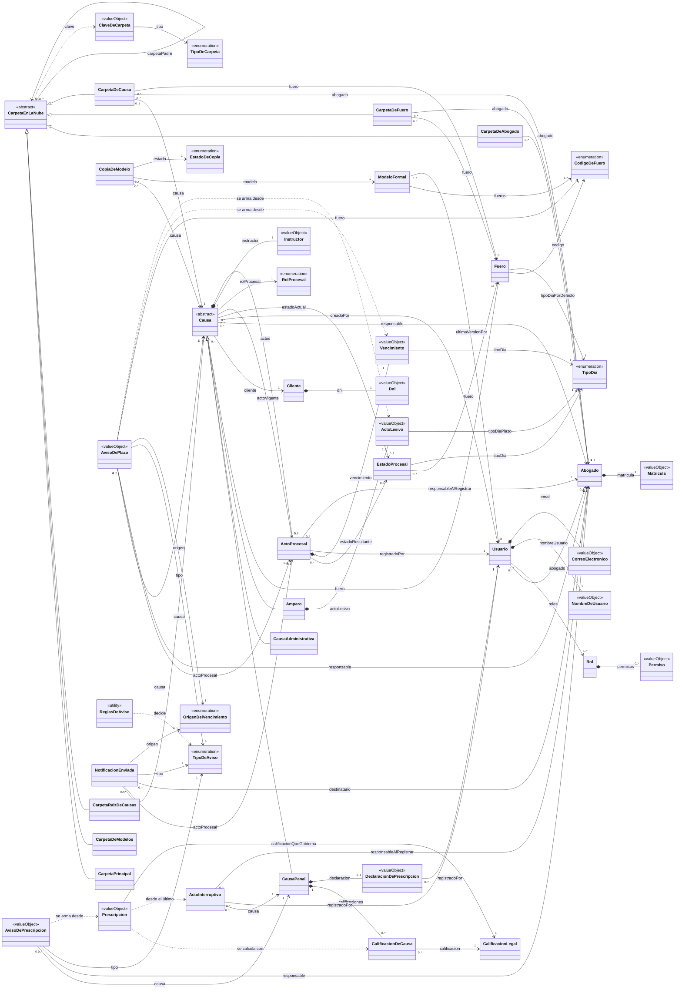
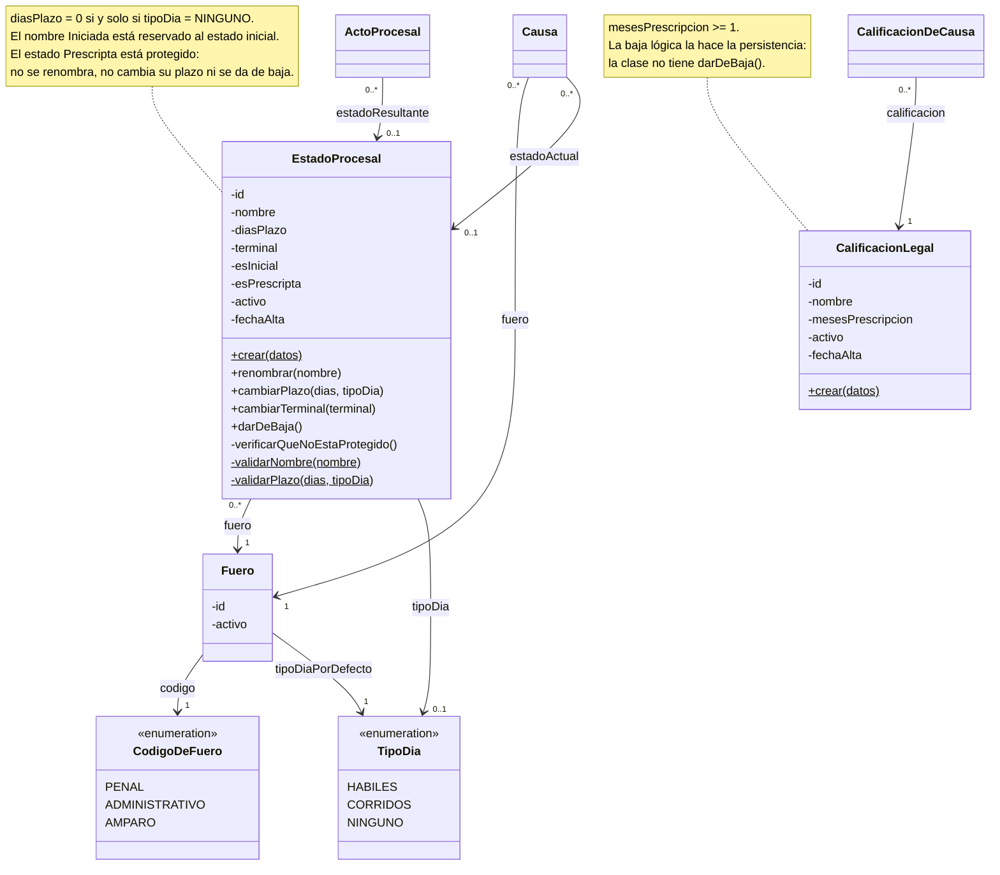
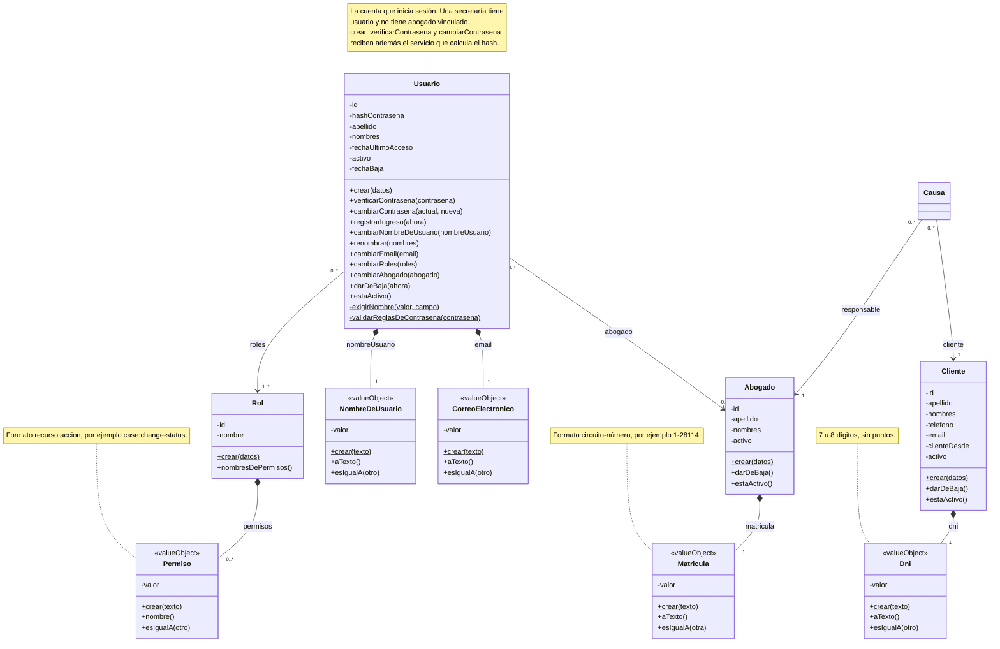
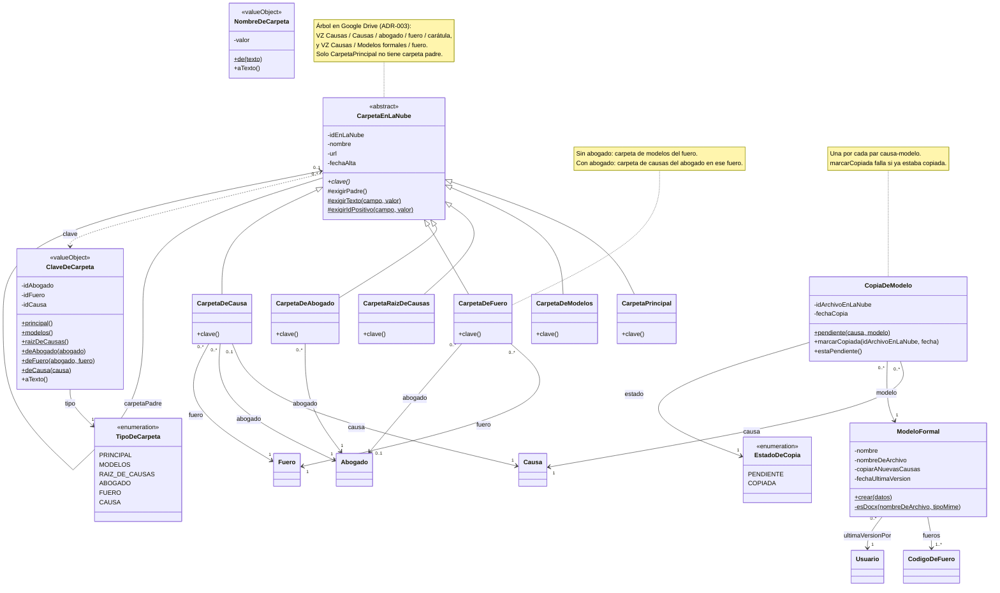

# Modelo de Dominio v0.5 — VZ Causas (Sprint 3)

Revisión 0.5 (25/10/2026). Reemplaza al `MODP_SPRINT2.md` (v0.4).

**Propósito.** A diferencia de la v0.4, que era la guía del dominio completo e
incluía clases de sprints futuros, esta versión **describe el dominio tal como
está implementado** en `backend/src/subsystems/*/core/domain` al cierre del
Sprint 3. Cada clase, atributo, método y relación sale del código o del esquema
Prisma (`backend/prisma/schema.prisma`). Lo que la v0.4 tenía y el código no,
se quitó (ver §8).

**Idioma.** El dominio se nombra en español, como en la v0.4. El código usa
inglés según `TRADUCCION_DOMINIO.md`; la §7 da la correspondencia clase por
clase.

**Qué no se muestra, a propósito.**

- Ninguna pieza de la arquitectura: puertos, adaptadores, repositorios,
  controladores, DTOs, mappers, casos de uso, eventos de integración ni
  factories.
- Los métodos `hydrate` (reconstruyen la entidad desde la base) y los
  `toSnapshot` (aplanan la entidad para persistirla): son mecánica de
  persistencia, no comportamiento del dominio.
- Los getters que solo exponen un atributo: el atributo ya está en la clase. Sí
  se muestran los getters que **calculan** algo (`fechaVigente()`,
  `actoLesivo()`, `clave()`).
- Las funciones sueltas de cálculo de días hábiles (`business-days.ts`) y de
  bloqueo de inicio de sesión (`login-lock-policy.ts`).
- Los tipos de datos (igual que en la v0.4).

**Convenciones de notación**

| Notación                | Significado                                                     |
| ----------------------- | --------------------------------------------------------------- |
| `<<abstract>>`          | Clase abstracta: no tiene instancias propias                    |
| `<<enumeration>>`       | Conjunto cerrado de valores                                     |
| `<<valueObject>>`       | Objeto valor: sin identidad, inmutable, vive dentro de su dueño |
| `<<utility>>`           | Solo métodos de clase, sin estado                               |
| método terminado en `*` | Método abstracto: cada subclase lo implementa                   |
| método terminado en `$` | Método de clase (estático)                                      |
| `*--`                   | Composición: la parte nace y muere con el todo                  |
| `-->`                   | Asociación navegable                                            |
| `..>`                   | Dependencia: usa, no guarda referencia                          |

**Referencias entre subsistemas.** El backend es modular: una clase de un
subsistema guarda solo el **id** de la clase de otro (por ejemplo
`Case.clientId`, no un `Client`). En el diagrama esas referencias se dibujan
como **asociación a la clase real**, con el nombre del rol y la multiplicidad
del esquema. Cuando la asociación cruza subsistemas, se lee "referencia por id".

---

## 1. Vista general

Todas las clases y relaciones, sin atributos ni métodos. El detalle está en las
vistas 2 a 6.

### Agregados

Cada agregado es una frontera transaccional: se lee y se guarda entero, y los
demás lo referencian solo por su identificador.

| Agregado (raíz)       | Subsistema         | Contiene                                                                                               | Referencia por id a                                                  |
| --------------------- | ------------------ | ------------------------------------------------------------------------------------------------------ | -------------------------------------------------------------------- |
| **Causa**             | `cases`            | ActoProcesal, Vencimiento, Instructor, CalificacionDeCausa, DeclaracionDePrescripcion, ActoLesivo      | Fuero, EstadoProcesal, CalificacionLegal, Cliente, Abogado, Usuario  |
| **ActoInterruptivo**  | `cases`            | —                                                                                                      | CausaPenal, Usuario, Abogado                                         |
| **EstadoProcesal**    | `legal-parameters` | —                                                                                                      | Fuero (lo carga como objeto, mismo subsistema)                       |
| **CalificacionLegal** | `legal-parameters` | —                                                                                                      | —                                                                    |
| **Cliente**           | `people`           | Dni                                                                                                    | —                                                                    |
| **Abogado**           | `people`           | Matricula                                                                                              | —                                                                    |
| **Usuario**           | `identity`         | NombreDeUsuario, CorreoElectronico                                                                     | Rol, Abogado                                                         |
| **Rol**               | `identity`         | Permiso                                                                                                | —                                                                    |
| **CarpetaEnLaNube**   | `documents`        | —                                                                                                      | CarpetaEnLaNube (padre), Abogado, Fuero, Causa                       |
| **ModeloFormal**      | `documents`        | —                                                                                                      | Usuario                                                              |
| **CopiaDeModelo**     | `documents`        | —                                                                                                      | Causa, ModeloFormal                                                  |

**Por qué `ActoInterruptivo` no vive dentro de `Causa`.** A diferencia del acto
procesal, registrar un acto interruptivo **no cambia el estado** de la causa: solo
corre el inicio del cómputo de la prescripción, y ese cómputo no se guarda, se
recalcula en cada lectura (`Prescripcion`). No hay una invariante de la causa que
obligue a escribir los dos en la misma transacción, así que en el código es una
entidad aparte con `caseId` (`interruptive-act.ts`).

---

## 2. Vista de causas y actuaciones

```mermaid
classDiagram
    direction TB

    class Causa {
        <<abstract>>
        -id
        -nroSac
        -caratula
        -tribunal
        -fechaInicio
        -tasaJudicialPagada
        -estadoPersonalizado
        -estadoActualEsTerminal
        -activo
        -fechaAlta
        -fechaModificacion
        +codigoDeFuero()*
        +resolverComputoDesde(fechaActo, fechaNotificacion, estadoAbrePlazo)*
        +registrarActoProcesal(datos)
        +resolverEstadoDestino(eleccion)
        +abrirPlazo(destino, fechas)
        +verificarQuePuedeRegistrarActos(usuario)
        +verificarQueAdmiteActos()
        +declararPrescripcion(datos)
        +declaracionDePrescripcion()
        +vencimientoDelActoLesivo(hoy)
        #computaDesdeFechaDelActo(fechaActo, fechaNotificacion)
        #cerrarEnEstado(estado, ahora)
        -actoVigente()
    }

    class CausaPenal {
        -clienteDetenido
        +codigoDeFuero()
        +resolverComputoDesde(fechaActo, fechaNotificacion, estadoAbrePlazo)
        +declararPrescripcion(datos)
        +declaracionDePrescripcion()
    }

    class CausaAdministrativa {
        -contraparte
        -objetoDeLaCausa
        -fechaAgotamientoViaAdministrativa
        +codigoDeFuero()
        +resolverComputoDesde(fechaActo, fechaNotificacion, estadoAbrePlazo)
    }

    class Amparo {
        -contraparte
        -objetoDeLaCausa
        -medidaCautelarOtorgada
        -fechaActoLesivo
        -actoLesivoSeRenueva
        -diasDeRenovacion
        -diasPlazoActoLesivo
        -tipoDiaPlazoActoLesivo
        +codigoDeFuero()
        +resolverComputoDesde(fechaActo, fechaNotificacion, estadoAbrePlazo)
        +actoLesivo()
        +vencimientoDelActoLesivo(hoy)
    }

    class Instructor {
        <<valueObject>>
        -nombre
        -telefono
        -interno
    }

    class CalificacionDeCausa {
        -fechaHecho
        -fechaPrescripcion
        +inicioComputoPrescripcion()
        +calcularPrescripcion()
    }

    class ActoProcesal {
        -id
        -estadoPersonalizado
        -fechaActo
        -fechaNotificacion
        -notas
        -fechaRegistro
        +crear(datos)$
        +validarFechas(fechas)$
        +esPersonalizado()
    }

    class ActoInterruptivo {
        -id
        -denominacion
        -fechaActo
        -notas
        -fechaRegistro
        +crear(datos)$
    }

    class Vencimiento {
        <<valueObject>>
        -diasPlazo
        -computaDesde
        -fechaCalculada
        -fechaAjustadaManual
        +crear(datos)$
        +fechaVigente()
        +ajustadoManualmente()
        +diasPlazoManual()
        +abrePlazo()
    }

    class ActoLesivo {
        <<valueObject>>
        -fecha
        -seRenueva
        -diasDeRenovacion
        -diasPlazo
        +crear(datos)$
        +vencimiento(hoy)
        -fechaVigenteDelActo(hoy)
    }

    class DeclaracionDePrescripcion {
        <<valueObject>>
        -fechaPrescripcion
        -resolucion
        -fundamentos
        -fechaRegistro
        +verificarQuePuedeDeclarar(usuario)$
        +crear(datos, contexto)$
        +esIgualA(otra)
    }

    class Prescripcion {
        <<valueObject>>
        -fechaInicio
        -fechaVencimiento
        -porcentajeTranscurrido
        -alerta
        -cumplida
        -diasRestantes
        -fechaUltimoActoInterruptivo
        +de(fuero, calificaciones, fechaUltimoActoInterruptivo, hoy)$
        +gobernante(calificaciones, fechaUltimoActoInterruptivo, hoy)$
    }

    class TipoDia {
        <<enumeration>>
        HABILES
        CORRIDOS
        NINGUNO
    }

    class RolProcesal {
        <<enumeration>>
        DEFENSA
        QUERELLANTE_PARTICULAR
        RECURRENTE
        ACTORA
        DEMANDADA
    }

    Causa <|-- CausaPenal
    Causa <|-- CausaAdministrativa
    Causa <|-- Amparo

    Causa "0..*" --> "1" Fuero : fuero
    Causa "0..*" --> "1" Cliente : cliente
    Causa "0..*" --> "1" Abogado : responsable
    Causa "0..*" --> "1" Usuario : creadoPor
    Causa "0..*" --> "0..1" EstadoProcesal : estadoActual
    Causa --> "0..1" ActoProcesal : actoVigente
    Causa --> "1" RolProcesal : rolProcesal
    Causa *-- "1" Instructor : instructor
    Causa "1" *-- "0..*" ActoProcesal : actos
    CausaPenal "1" *-- "0..*" CalificacionDeCausa : calificaciones
    CausaPenal *-- "0..1" DeclaracionDePrescripcion : declaracion
    Amparo *-- "0..1" ActoLesivo : actoLesivo
    CalificacionDeCausa "0..*" --> "1" CalificacionLegal : calificacion
    ActoInterruptivo "0..*" --> "1" CausaPenal : causa
    ActoProcesal "0..*" --> "0..1" EstadoProcesal : estadoResultante
    ActoProcesal *-- "1" Vencimiento : vencimiento
    ActoProcesal "0..*" --> "1" Usuario : registradoPor
    ActoProcesal "0..*" --> "1" Abogado : responsableAlRegistrar
    ActoInterruptivo "0..*" --> "1" Usuario : registradoPor
    ActoInterruptivo "0..*" --> "1" Abogado : responsableAlRegistrar
    DeclaracionDePrescripcion "0..*" --> "1" Usuario : registradoPor
    Vencimiento --> "1" TipoDia : tipoDia
    ActoLesivo --> "1" TipoDia : tipoDiaPlazo
    Prescripcion ..> CalificacionDeCausa : se calcula con
    Prescripcion ..> ActoInterruptivo : desde el último
    Prescripcion --> "1" CalificacionLegal : calificacionQueGobierna

    note for Causa "Raíz de agregado.<br>Estado actual: estadoActual xor estadoPersonalizado.<br>Toda escritura sobre actos procesales pasa por la causa."
    note for ActoProcesal "Estado resultante: estadoResultante xor estadoPersonalizado.<br>fechaNotificacion solo en CausaAdministrativa (RN6)."
    note for Prescripcion "No se guarda: se calcula en cada lectura.<br>Gobierna la calificación que vence primero,<br>contada desde el último acto interruptivo o,<br>si no hay, desde la fecha del hecho (CA-52.3)."
    note for Amparo "actoLesivo() arma el objeto valor<br>con los cinco atributos del acto lesivo."
```

### Comportamiento polimórfico por tipo de causa

| Método                                | CausaPenal                                   | CausaAdministrativa                                                                         | Amparo                                     |
| ------------------------------------- | -------------------------------------------- | ------------------------------------------------------------------------------------------- | ------------------------------------------ |
| `codigoDeFuero()`                     | `PENAL`                                      | `ADMINISTRATIVO`                                                                            | `AMPARO`                                   |
| `resolverComputoDesde(...)`           | `fechaActo` (rechaza `fechaNotificacion`)    | `fechaNotificacion`; si falta y el estado abre plazo, error (RN6); si no abre, `fechaActo`  | `fechaActo` (rechaza `fechaNotificacion`)  |
| `declararPrescripcion(datos)`         | Guarda la declaración y cierra en Prescripta | Error: no aplica al fuero (implementación de `Causa`)                                       | Ídem                                       |
| `vencimientoDelActoLesivo(hoy)`       | `null` (implementación de `Causa`)           | `null`                                                                                      | `actoLesivo().vencimiento(hoy)`            |

Los roles procesales admitidos por fuero ya no son un método polimórfico: son una
tabla fija junto a `RolProcesal` (`procedural-role.ts`), que valida el alta.

---

## 3. Vista de parámetros legales

---

## 4. Vista de personas y seguridad

---

## 5. Vista de documentos y modelos

`NombreDeCarpeta` no tiene asociaciones en el dominio: lo usa el alta de
carpetas para limpiar el nombre antes de crearla en Drive.

---

## 6. Vista de plazos y avisos (proceso diario, HU30/HU32/HU51/HU52)

El subsistema `deadlines` no tiene entidades propias. La detección y el envío
viven en casos de uso, que no se muestran; acá aparecen los avisos que el
proceso produce, las dos reglas que deciden qué aviso corresponde y el registro
de lo ya enviado.

```mermaid
classDiagram
    direction TB

    class AvisoDePlazo {
        <<valueObject>>
        -caratula
        -nroSac
        -fechaVencimiento
        -diasHabilesRestantes
    }

    class AvisoDePrescripcion {
        <<valueObject>>
        -caratula
        -nroSac
        -fechaReferencia
        -calificacionLegal
        -diasRestantes
    }

    class ReglasDeAviso {
        <<utility>>
        +tipoDeAvisoDePlazo(diasHabilesRestantes, diasHabilesDeAviso)$
        +tipoDeAvisoDePrescripcion(alerta, cumplida)$
    }

    class NotificacionEnviada {
        -id
        -fechaReferencia
        -fechaEnvio
    }

    class TipoDeAviso {
        <<enumeration>>
        PLAZO_POR_VENCER
        PLAZO_VENCE_HOY
        ALERTA_DE_PRESCRIPCION
        PRESCRIPCION_CUMPLIDA
    }

    class OrigenDelVencimiento {
        <<enumeration>>
        ACTO_PROCESAL
        ACTO_LESIVO
    }

    AvisoDePlazo "0..*" --> "1" Causa : causa
    AvisoDePlazo "0..*" --> "0..1" ActoProcesal : actoProcesal
    AvisoDePlazo "0..*" --> "1" Abogado : responsable
    AvisoDePlazo --> "1" TipoDeAviso : tipo
    AvisoDePlazo --> "1" OrigenDelVencimiento : origen
    AvisoDePlazo --> "1" CodigoDeFuero : fuero
    AvisoDePlazo ..> Vencimiento : se arma desde
    AvisoDePlazo ..> ActoLesivo : se arma desde
    AvisoDePrescripcion "0..*" --> "1" CausaPenal : causa
    AvisoDePrescripcion "0..*" --> "1" Abogado : responsable
    AvisoDePrescripcion --> "1" TipoDeAviso : tipo
    AvisoDePrescripcion ..> Prescripcion : se arma desde
    ReglasDeAviso ..> TipoDeAviso : decide
    NotificacionEnviada "0..*" --> "1" Causa : causa
    NotificacionEnviada "0..*" --> "0..1" ActoProcesal : actoProcesal
    NotificacionEnviada "0..*" --> "0..1" Abogado : destinatario
    NotificacionEnviada --> "1" TipoDeAviso : tipo
    NotificacionEnviada --> "0..1" OrigenDelVencimiento : origen

    note for AvisoDePlazo "tipo: solo PLAZO_POR_VENCER o PLAZO_VENCE_HOY.<br>actoProcesal vacío cuando el origen es ACTO_LESIVO."
    note for AvisoDePrescripcion "tipo: solo ALERTA_DE_PRESCRIPCION o PRESCRIPCION_CUMPLIDA.<br>fechaReferencia es la fecha de prescripción que muestra la causa."
    note for ReglasDeAviso "tipoDeAvisoDePlazo devuelve además VENCIDO,<br>que no genera aviso. Ambas devuelven vacío<br>cuando no corresponde avisar."
    note for NotificacionEnviada "No tiene clase en el código: es la tabla sent_notifications.<br>Una por aviso y destinatario. Destinatario vacío = casilla del estudio.<br>Clave única: causa, tipo, origen, fechaReferencia, destinatario.<br>Así un mismo aviso no se envía dos veces (CA-52.7),<br>y un acto interruptivo que cambia la fecha permite volver a avisar (CA-52.6)."
```

---

## 7. Correspondencia con el código

| Clase (dominio)           | Clase o tipo en el código                         | Archivo (`backend/src/subsystems/…`)                                   |
| ------------------------- | ------------------------------------------------- | ---------------------------------------------------------------------- |
| Causa                     | `Case`                                            | `cases/core/domain/entities/cases.ts`                                  |
| CausaPenal                | `CriminalCase`                                    | `cases/core/domain/entities/criminal.ts`                               |
| CausaAdministrativa       | `AdministrativeCase`                              | `cases/core/domain/entities/administrative.ts`                         |
| Amparo                    | `Amparo`                                          | `cases/core/domain/entities/amparo.ts`                                 |
| CalificacionDeCausa       | `Offense`                                         | `cases/core/domain/entities/offense.ts`                                |
| ActoProcesal              | `ProceduralAct`                                   | `cases/core/domain/entities/procedural-act.ts`                         |
| ActoInterruptivo          | `InterruptiveAct`                                 | `cases/core/domain/entities/interruptive-act.ts`                       |
| Vencimiento               | `Deadline`                                        | `cases/core/domain/value-objects/deadline.ts`                          |
| ActoLesivo                | `HarmfulAct`                                      | `cases/core/domain/value-objects/harmful-act.ts`                       |
| DeclaracionDePrescripcion | `PrescriptionDeclaration`                         | `cases/core/domain/value-objects/prescription-declaration.vo.ts`       |
| Instructor                | `Instructor`                                      | `cases/core/domain/value-objects/instructor.ts`                        |
| Prescripcion              | `Prescription`                                    | `cases/core/domain/prescription.ts`                                    |
| RolProcesal               | `ProceduralRole`                                  | `cases/core/domain/value-objects/procedural-role.ts`                   |
| TipoDia                   | `DayType` (`BUSINESS`, `CONSECUTIVE`, `NONE`)     | `cases/…/day-type.ts` y `legal-parameters/…/day-types.ts`              |
| CodigoDeFuero             | `JurisdictionCode` (`CRIMINAL`, `ADMINISTRATIVE`, `AMPARO`) | `cases`, `legal-parameters` y `deadlines`, `…/value-objects/jurisdiction-code.ts` |
| Fuero                     | `Jurisdiction`                                    | `legal-parameters/core/domain/entities/jurisdiction.ts`                |
| EstadoProcesal            | `ProceduralState`                                 | `legal-parameters/core/domain/entities/procedural-states.ts`           |
| CalificacionLegal         | `LegalQualification`                              | `legal-parameters/core/domain/entities/legal-qualification.ts`         |
| Cliente                   | `Client`                                          | `people/core/domain/entities/client.entity.ts`                         |
| Abogado                   | `Lawyer`                                          | `people/core/domain/entities/lawyer.entity.ts`                         |
| Dni                       | `Dni`                                             | `people/core/domain/value-objects/dni.vo.ts`                           |
| Matricula                 | `RegistrationNumber`                              | `people/core/domain/value-objects/registration-number.vo.ts`           |
| Usuario                   | `User`                                            | `identity/core/domain/entities/user.entity.ts`                         |
| Rol                       | `Role`                                            | `identity/core/domain/entities/role.entity.ts`                         |
| Permiso                   | `Permission`                                      | `identity/core/domain/value-objects/permission.vo.ts`                  |
| NombreDeUsuario           | `Username`                                        | `identity/core/domain/value-objects/username.vo.ts`                    |
| CorreoElectronico         | `Email`                                           | `identity/core/domain/value-objects/email.vo.ts`                       |
| CarpetaEnLaNube           | `CloudFolder`                                     | `documents/core/domain/entities/cloud-folder.entity.ts`                |
| CarpetaPrincipal          | `MainFolder`                                      | `documents/core/domain/entities/main-folder.entity.ts`                 |
| CarpetaDeModelos          | `TemplatesFolder`                                 | `documents/core/domain/entities/templates-folder.entity.ts`            |
| CarpetaRaizDeCausas       | `RootCasesFolder`                                 | `documents/core/domain/entities/root-cases-folder.entity.ts`           |
| CarpetaDeAbogado          | `LawyerFolder`                                    | `documents/core/domain/entities/lawyer-folder.entity.ts`               |
| CarpetaDeFuero            | `JurisdictionFolder`                              | `documents/core/domain/entities/jurisdiction-folder.entity.ts`         |
| CarpetaDeCausa            | `CaseFolder`                                      | `documents/core/domain/entities/case-folder.entity.ts`                 |
| ClaveDeCarpeta            | `FolderKey`                                       | `documents/core/domain/value-objects/folder-key.vo.ts`                 |
| NombreDeCarpeta           | `FolderName`                                      | `documents/core/domain/value-objects/folder-name.vo.ts`                |
| TipoDeCarpeta             | `CloudFolderKind`                                 | `documents/core/domain/value-objects/cloud-folder-kind.ts`             |
| ModeloFormal              | `DocumentTemplate`                                | `documents/core/domain/entities/document-template.entity.ts`           |
| CopiaDeModelo             | `TemplateCopy`                                    | `documents/core/domain/entities/template-copy.entity.ts`               |
| EstadoDeCopia             | `TemplateCopyStatus` (`PENDING`, `COPIED`)        | `documents/core/domain/entities/template-copy.entity.ts`               |
| AvisoDePlazo              | `UpcomingDeadlineNotice`                          | `deadlines/core/domain/types/upcoming-deadline-notice.ts`              |
| AvisoDePrescripcion       | `PrescriptionNotice`                              | `deadlines/core/domain/types/upcoming-deadline-notice.ts`              |
| TipoDeAviso               | `NotificationKind` (`DEADLINE_WARNING`, `DEADLINE_DUE_TODAY`, `PRESCRIPTION_ALERT`, `PRESCRIPTION_EXPIRED`) | `deadlines/core/domain/types/upcoming-deadline-notice.ts` |
| OrigenDelVencimiento      | `origin` / `DeadlineKind` (`PROCEDURAL_ACT`, `HARMFUL_ACT`) | `deadlines/core/domain/types/upcoming-deadline-notice.ts`    |
| ReglasDeAviso             | `deadlineNoticeKind`, `prescriptionNoticeKind`    | `deadlines/core/domain/deadline-notice-kind.ts`, `prescription-notice-kind.ts` |
| NotificacionEnviada       | modelo Prisma `SentNotification`                  | `backend/prisma/schema.prisma` (`sent_notifications`)                  |

**Enumeraciones repetidas.** `TipoDia` y `CodigoDeFuero` están definidas una vez
por subsistema en el código (cada módulo tiene su copia, por la arquitectura
modular). En el diagrama aparecen una sola vez porque son el mismo concepto.

---

## 8. Cambios respecto de la v0.4

### Quitado: estaba en la v0.4 y no existe en el código

| Elemento v0.4                                                                 | Situación en el código                                                                  |
| ----------------------------------------------------------------------------- | --------------------------------------------------------------------------------------- |
| `CausaConContraparte`                                                         | No existe: `CausaAdministrativa` y `Amparo` declaran `contraparte` y `objetoDeLaCausa` cada una |
| `Actuacion` (superclase de los actos)                                         | No existe: `ActoProcesal` y `ActoInterruptivo` son clases independientes               |
| `Persona`, `IntegranteDelEstudio`, `Empleado`                                 | No existen: `Usuario` se vincula directamente con `Abogado` (0..1)                      |
| `DocumentoFormal`                                                             | No existe                                                                               |
| `CalendarioJudicial`, `Feriado`, `FeriaJudicial`                              | No existen: el cómputo de días hábiles no excluye feriados ni feria (P-02)              |
| `Reloj`                                                                       | Es un puerto (`shared/domain/clock.port.ts`): queda fuera por ser arquitectura          |
| `Fuero` *-- `EstadoProcesal`                                                  | La navegación es al revés: `EstadoProcesal` conoce su `Fuero`; `Fuero` no tiene la lista |
| Métodos de `Causa`: `modificar`, `archivar`, `darDeBaja`, `generarCaratula`, `generarExpediente`, `generarLineaDeTiempo`, `conocerPlazosVigentes`, `darDeBajaActoProcesal`, `modificarActoProcesal` | No están en la entidad                         |
| Métodos de `CausaPenal`: `estaProximaAPrescribir`, `verificarPlazoDePrescripcion`, `reiniciarComputoPrescripcion`, etc. | El cálculo lo hace `Prescripcion`; el registro, `declararPrescripcion` |
| `ActoProcesal.activo`, `darDeBaja()`, `ajustarVencimientoManual()`            | No existen: no hay baja de actos procesales                                             |
| Métodos de `Usuario`: `iniciarSesion`, `cerrarSesion`, `tienePermiso`         | No están en la entidad                                                                  |
| `Abogado.matricula` como atributo simple, métodos de carga de trabajo         | `Matricula` es objeto valor; los métodos de carga de trabajo no existen                 |

### Agregado: está en el código y no estaba en la v0.4

| Elemento v0.5                                                   | Origen                                                    |
| --------------------------------------------------------------- | --------------------------------------------------------- |
| `DeclaracionDePrescripcion`                                     | Registro de la prescripción por resolución (HU-33)        |
| `Prescripcion`                                                  | Cálculo de prescripción de V4 §3.7, usado por HU-52       |
| `ActoLesivo`                                                    | Plazo para interponer el amparo                           |
| `EstadoProcesal.esPrescripta` y su protección                   | Estado Prescripta del fuero penal                         |
| `CarpetaEnLaNube` y sus seis subclases, `ClaveDeCarpeta`, `NombreDeCarpeta` | Carpetas en Google Drive (ADR-003)            |
| `ModeloFormal`, `CopiaDeModelo`                                 | Modelos formales y su copia a cada causa nueva            |
| `AvisoDePlazo`, `AvisoDePrescripcion`, `ReglasDeAviso`, `NotificacionEnviada` | Proceso diario (HU30, HU32, HU51, HU52)     |
| `Dni`, `Matricula`, `NombreDeUsuario`, `CorreoElectronico`, `Permiso` como objetos valor | Ya estaban en el código del Sprint 2 |
| `Causa.tasaJudicialPagada`, `CausaPenal.clienteDetenido`, `CausaAdministrativa.fechaAgotamientoViaAdministrativa`, `Amparo.medidaCautelarOtorgada` | Datos por fuero (D-67) |

### Cambiado

| Elemento                                     | v0.4                         | v0.5                               | Motivo                                                                 |
| -------------------------------------------- | ---------------------------- | ---------------------------------- | ---------------------------------------------------------------------- |
| `CausaPenal` — `CalificacionDeCausa`         | `1..*`                       | `0..*`                             | El código admite causas penales sin calificación (D-74)                |
| `ActoInterruptivo`                           | Compuesto por `CausaPenal`   | Agregado aparte, referencia a la causa | No cambia el estado de la causa (ver §1)                           |
| `ActoProcesal` — `Vencimiento`               | `0..1`                       | `1`                                | Siempre hay vencimiento; sin plazo es `diasPlazo = 0`, `NINGUNO`       |
| `Usuario` — `Rol`                            | `0..*`                       | `1..*`                             | `User.create` y `changeRoles` exigen al menos un rol                   |
| `Permiso`                                    | Clase con id                 | Objeto valor                       | Así está en el código                                                  |
| Roles procesales por fuero                   | `rolesAdmitidos()*` polimórfico | Tabla fija junto a `RolProcesal` | Así está en el código                                                  |

---

## 9. Puntos para revisar en equipo

1. **`NotificacionEnviada` no es una clase del código.** Se incluyó porque es lo
   único que el proceso diario persiste y sostiene CA-52.7. Si se prefiere un
   diagrama estrictamente de clases implementadas, se quita.
2. **`ReglasDeAviso` agrupa dos funciones sueltas** (`deadlineNoticeKind`,
   `prescriptionNoticeKind`) en una clase utilitaria que en el código no existe
   con ese nombre.
3. **`ModeloFormal` apunta a `CodigoDeFuero`, no a `Fuero`.** El dominio guarda
   los códigos del fuero; la base los traduce a `jurisdiction_id`
   (`document_template_jurisdictions`). `ModeloFormal` tampoco tiene `id` en el
   dominio, aunque la tabla sí.
4. **Las dependencias "se arma desde"** de `AvisoDePlazo` y `AvisoDePrescripcion`
   pasan por puertos entre `deadlines` y `cases` en el código. Se dibujan como
   dependencia directa porque es el contenido real del aviso.
