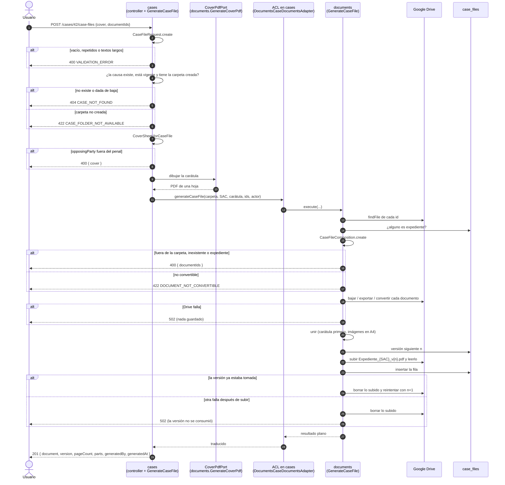

# Flujo de HU25 — Generar y emitir expediente

Contexto para quien toque la generación del expediente (HU25) o la carátula que
la abre (HU24). Describe cómo se reparten el trabajo `cases` y `documents` en
`POST /cases/{caseId}/case-files`. Estado al **03/11/2026**, rama `feature/case-files`.

- Contrato: `docs/Api-Contract/API_CONTRACT_V5.md` §3.12 (`:7657-7902`).
- Decisiones: D-92, D-94, D-102 y D-103. Punto abierto C-29 (límites de tamaño y
  tiempo), fuera de alcance.
- Plan de tests: `.claude/plans/tests-hu25-generar-expediente.md`.
- Integración: `backend/test/subsystems/cases/generate-case-file.int.spec.ts`.
- La descarga del expediente generado es la de HU38,
  `GET /cases/{caseId}/documents/{documentId}/file`
  (`docs/support/flujo-hu38-documentos-causa.md`).

**No hay migración.** `case_files` ya existía (`schema.prisma:749-770`); HU25 es la
primera que escribe en ella.

## 1. Quién sabe qué

- **`cases`** sabe de la causa y de lo que dice su carátula:
  - la forma del pedido;
  - si la causa existe y está vigente;
  - si su carpeta está creada;
  - qué va en cada recuadro de la hoja.

  La hoja la dibuja `documents` por el puerto de la carátula (`CoverPdfPort`),
  igual que `GET /cases/{caseId}/cover` (D-94).
- **El adaptador ACL** `DocumentsCaseDocumentsAdapter`
  (`cases/infrastructure/acl/documents-case-documents.adapter.ts:44`) es el mismo de
  HU38. Suma `generateCaseFile`, que llama al caso de uso que `documents` exporta y
  traduce el resultado campo por campo.
- **`documents`** sabe de archivos y del expediente guardado:
  - qué ids son documentos de la carpeta;
  - cuáles son expedientes anteriores;
  - cómo se vuelve PDF cada tipo;
  - cómo se unen;
  - qué número de versión toca;
  - cómo se guarda sin dejar nada a medias.

  **No sabe qué es una causa**: recibe el id de la causa, su SAC, el id de la
  carpeta y la carátula ya dibujada.
- **Drive** sigue detrás de `DocumentStoragePort`.

El adaptador queda en el consumidor por la misma razón que en HU38: lo que se le
pide a `documents` es un caso de uso con lógica propia (`ARQUITECTURA_BACKEND_V1.md`
§6.2, "Dónde vive el adaptador").

Las piezas que deciden:

| Pieza | Dónde | Qué decide |
| --- | --- | --- |
| `CaseFileRequest` | `cases/core/domain/value-objects/case/case-file-request.vo.ts:46` | La forma: al menos un documento, sin repetidos, `notes` y `opposingParty` hasta 500 |
| `CoverSheet.forCaseFile` | `cases/core/domain/value-objects/case/cover-sheet.vo.ts:80` | La hoja 1: la de `GET /cover` más las observaciones y, en el penal, la parte en el recuadro vacío; fuera del penal la parte es 400 |
| `CaseDocument.pdfConversion` | `documents/core/domain/entities/case-document.entity.ts` | Cómo se vuelve PDF cada tipo (D-102) |
| `CaseFileComposition` | `documents/core/domain/value-objects/case-file-composition.vo.ts:45` | Que los ids sean documentos de la carpeta y no expedientes (400), y después que sean convertibles (422). Arma `parts` |
| `CaseFile` | `documents/core/domain/entities/case-file.entity.ts:41` | El nombre `Expediente_{SAC}_v{n}.pdf` y que versión y hojas empiecen en 1 |

## 2. El flujo, paso a paso

1. El usuario pide generar el expediente de la causa 42, con los documentos
   elegidos en orden y, si quiere, `cover`. Puede ser cualquier perfil, el
   administrador sin otro rol incluido: no hay 403.
2. El controller (`case-files.controller.ts:28`) valida el `caseId`, y el DTO sólo
   los tipos.
3. `cases` arma `CaseFileRequest`. Si la lista está vacía o tiene repetidos, o un
   texto de `cover` pasa de 500, responde **400**, con todos los campos juntos.
4. `cases` busca la causa vigente con su carpeta. Si no existe o está dada de baja,
   **404** `CASE_NOT_FOUND`. Si la carpeta no está `CREATED`, **422**
   `CASE_FOLDER_NOT_AVAILABLE`.
5. `cases` arma la hoja con `CoverSheet.forCaseFile`. Si `opposingParty` llega en
   un amparo o en una causa administrativa, **400** sobre `cover`. Si no, la manda
   a dibujar.
6. `cases` le pide a su puerto el expediente, con la carátula ya dibujada. El
   adaptador lo pasa a `GenerateCaseFile` de `documents`.
7. `documents` busca cada id en Drive y en `case_files`. Si uno no está en la
   carpeta o es un expediente anterior, **400** sobre `documentIds`. Si todos son
   válidos pero uno no se puede convertir, **422** `DOCUMENT_NOT_CONVERTIBLE`.
   Hasta acá no se bajó ningún contenido.
8. `documents` lee cada documento según su tipo:
   - un PDF y una imagen se bajan tal cual;
   - un documento de Google se exporta;
   - un Word se convierte con Drive.

   Si Drive falla, **502** y no se subió nada.
9. `documents` une la carátula y los documentos en un PDF. Cada imagen va en su
   propia hoja A4.
10. `documents` guarda. En detalle: pide la versión siguiente, sube
    `Expediente_{SAC}_v{n}.pdf` a la carpeta, lo vuelve a leer para tener el recurso
    completo e inserta la fila en `case_files`.
    - Si algo falla después de subir, borra lo subido.
    - Si otra generación tomó ese número, reintenta con el siguiente.

    La versión sólo se consume cuando la fila se insertó.
11. El controller responde **201** con `document`, `version`, `pageCount`, `parts`,
    `generatedBy` y `generatedAt`. La causa no cambió.

Las flechas que van de `documents` directo al usuario son los errores. Se lanzan
en `documents` y atraviesan `cases` sin que nadie los atrape, hasta el filtro
global.

## 3. Orden de los chequeos

1. **401**: el guard global.
2. **400 de forma**: el `caseId`, `documentIds` vacío o repetido, y los largos de
   `cover`.
3. **404 `CASE_NOT_FOUND`**.
4. **422 `CASE_FOLDER_NOT_AVAILABLE`**.
5. **400 `cover`**: la parte fuera del penal.
6. **400 `documentIds`**: no está en la carpeta, no existe o es un expediente.
7. **422 `DOCUMENT_NOT_CONVERTIBLE`**.
8. **502 `DOCUMENT_STORAGE_UNAVAILABLE`**.

El 6 antes que el 7 **se aparta** de `.claude/rules/flujo-hu-backend.md`, que pone
422 → 400 de contenido: la convertibilidad de un documento que no está en la carpeta
no está definida. Decidido el 03/11/2026.

**Un pedido rechazado no escribe nada:** ni archivo en la carpeta ni fila en
`case_files`.

## 4. Detalle técnico

**Conversión con Drive** (`google-drive-document-storage.adapter.ts:270`,
`convertToPdf`). Drive sólo exporta sus propios documentos, así que un Word se
convierte en tres pasos:
1. `files.copy` con `mimeType: application/vnd.google-apps.document`, que es la
   conversión;
2. `files.export` de la copia a PDF;
3. `files.delete` de la copia, **siempre**, en un `finally`.

La copia va a la raíz de la cuenta, nunca a la carpeta de la causa, para que no
aparezca en la lista de documentos. Necesita `drive.file` para crear la copia y
`drive.readonly` para leer el original.

**Unión** (`documents/infrastructure/pdf/pdf-lib-case-file.composer.ts:25`). Usa
`@cantoo/pdf-lib`, la librería de la carátula:
- un PDF entra con todas sus hojas, con `copyPages`;
- una imagen va en su propia hoja A4, con 1,5 cm de margen, centrada y sin
  agrandarse;
- un PDF o una imagen que no se pueden abrir → 422 `DOCUMENT_NOT_CONVERTIBLE`.

**Versión** (`prisma-case-file.repository.ts:39` y `:44`):
- `nextVersion` es el máximo de la causa más 1.
- `save` inserta la fila. Si choca con el índice único `case_files_case_id_version_key`,
  lanza `CaseFileVersionTakenError` y el caso de uso reintenta, hasta 3 veces.
- Borrar un expediente en Drive no borra su fila, así que su número no se vuelve a
  usar (CA-25.6).

**Mensajes.** El 502 del expediente tiene su propio texto, "No se pudo generar el
expediente porque Drive no respondió…" (`CaseFileStorageUnavailableError`), distinto
de los dos de HU38.

**Fake en memoria.** `InMemoryDocumentStorage` exporta y convierte a un PDF real de
una hoja, para que se pueda unir, y suma `failNextCallTo(método, error)` para hacer
fallar sólo la lectura o sólo la subida.

## 5. Decisiones que no fija el contrato

Están nombradas como pendientes de anotar en `DECISIONES.md`:

1. **`documentIds` repetidos.** El contrato los prohíbe pero no da el texto. Se usa
   "No puede haber documentos repetidos.".
2. **Largo de `cover.notes` y `cover.opposingParty`.** No da el texto ni la clave.
   Se usa `cover.notes` y `cover.opposingParty`, con "Debe tener como máximo 500
   caracteres.".
3. **El orden 400 de documentos / 422 no convertible** (ver §3).

## 6. Qué cubren los tests y qué no

| CA | Dónde |
| --- | --- |
| 25.1 un único PDF, carátula primera, documentos en orden | UNIT `CaseFileComposition`, compositor, caso de uso · INT D1 |
| 25.2 sin documentos o repetidos | UNIT `CaseFileRequest` · INT D3 |
| 25.3 de otra carpeta o expediente anterior | UNIT `CaseFileComposition` · INT D3 |
| 25.4 conversión y 422 | UNIT `CaseDocument.pdfConversion`, compositor, `convertToPdf` de Drive · INT D1, D2, D3 |
| 25.5 datos de la carátula | UNIT `CoverSheet.forCaseFile`, `CaseFileRequest` · INT D2 |
| 25.6 versión correlativa | UNIT `CaseFile`, caso de uso (versión tomada) · INT D1 |
| 25.7 carpeta no creada | UNIT caso de uso de `cases` · INT D4 |
| 25.8 nada a medias | UNIT caso de uso de `documents` · INT D5 |
| 25.9 respuesta | INT D1 (forma exacta) |
| 25.10 descarga, administrador incluido | INT D1 · también `consult-case-documents.int.spec.ts` |
| 25.11 no cambia la causa | INT D1, D2 |
| 25.12 causa inexistente o dada de baja | UNIT caso de uso de `cases` · INT D4 |

**Revisión manual:**
- la conversión real de un `.docx` y la exportación de un documento de Google con
  Drive;
- que la hoja 1 se vea igual que la de `GET /cover`, con la parte y las
  observaciones en su recuadro;
- dos generaciones simultáneas contra PostgreSQL. El unitario cubre el reintento,
  no la carrera real;
- C-29: no hay límite de tamaño ni de tiempo.
