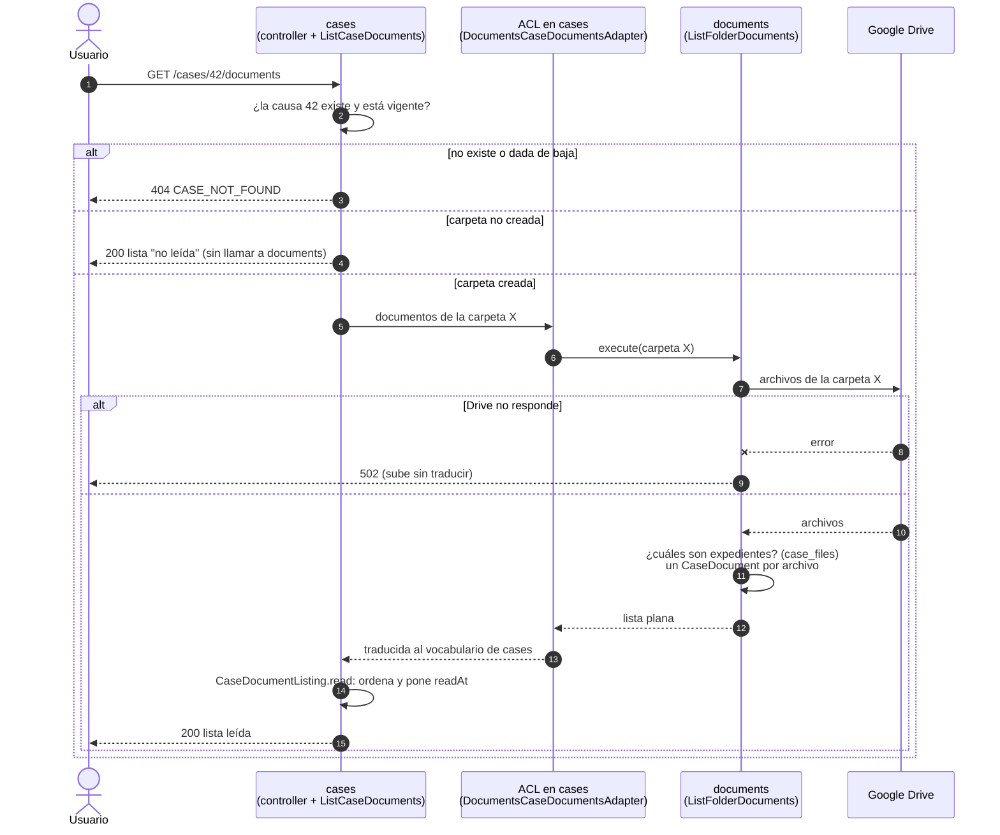
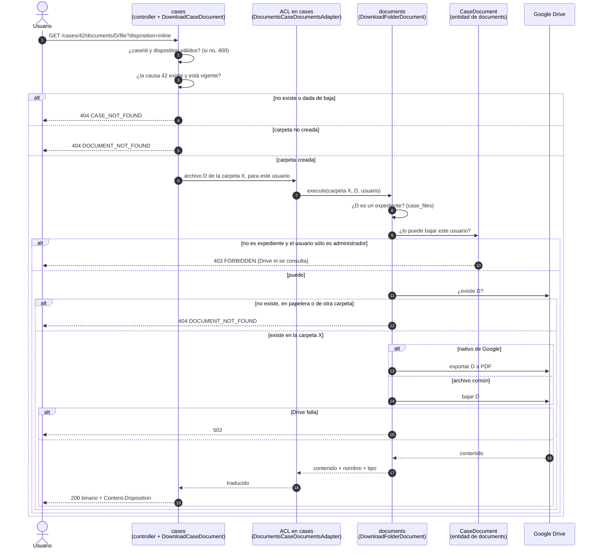

# Flujo de HU38 — Consultar documentos de causa

Contexto para quien toque los documentos de la causa (HU38) o el expediente que
los usa (HU25). Describe cómo se comunican `cases` y `documents` en los dos
endpoints. Estado al **03/11/2026**, rama `feature/list-case-documents`.

- Contrato: `docs/Api-Contract/API_CONTRACT_V5.md` §3.12 (`:7386-7653`). Decisiones
  D-100, D-101, D-102, D-103, C-24 y C-27.
- Plan de tests: `.claude/plans/tests-hu38-consultar-documentos.md`.
- Integración: `backend/test/subsystems/cases/consult-case-documents.int.spec.ts`.

| Endpoint | Caso de uso en `cases` | Caso de uso en `documents` |
| --- | --- | --- |
| `GET /cases/{caseId}/documents` | `ListCaseDocuments` | `ListFolderDocuments` |
| `GET /cases/{caseId}/documents/{documentId}/file` | `DownloadCaseDocument` | `DownloadFolderDocument` |

**No hay migración.** La lista no se guarda: se lee de Drive en cada pedido
(D-100). `case_files` ya existía (`schema.prisma:749-770`) y acá sólo se lee.

## 1. Quién sabe qué

Cuatro actores, y cada uno sabe una sola cosa:

- **`cases`** sabe de causas: si la causa existe, si está dada de baja y en qué
  estado está su carpeta. **No sabe nada de Drive ni de archivos.** Para eso
  declara un puerto propio, `CaseDocumentsPort`
  (`cases/core/domain/ports/case/case-documents.port.ts`), donde dice "necesito
  los documentos de esta carpeta" sin saber quién se los da.
- **El adaptador ACL**, `DocumentsCaseDocumentsAdapter`
  (`cases/infrastructure/acl/documents-case-documents.adapter.ts:21`), vive en
  `cases` y es lo único de `cases` que conoce a `documents`. Implementa el
  puerto llamando a los dos casos de uso que `documents` exporta, y traduce sus
  resultados campo por campo. No decide nada ni atrapa errores.
- **`documents`** sabe de archivos: lee la carpeta, reconoce cuáles son
  expedientes (su tabla `case_files`), decide quién puede descargar qué (D-103)
  y cómo se presenta cada archivo. **No sabe nada de causas**: recibe un id de
  carpeta y nada más.
- **Drive** es un detalle de `documents`, detrás de `DocumentStoragePort`. En los
  tests lo reemplaza `InMemoryDocumentStorage`.

Las dos piezas que deciden:

- **`CaseDocument`** (`documents/core/domain/entities/case-document.entity.ts:52`)
  se arma con lo que devolvió Drive más el dato de si es un expediente, y
  responde sus propias preguntas:
  - qué extensión tiene;
  - si es un nativo de Google;
  - si se puede pasar a PDF (D-102);
  - si está en esta carpeta;
  - con qué nombre y tipo se descarga.

  `assertCanBeDownloadedBy` (`:71`) decide quién descarga.
- **`CaseDocumentListing`**
  (`cases/core/domain/value-objects/case/case-document-listing.vo.ts:21`) arma la
  respuesta de la lista:
  - con la carpeta sin crear, una lista "no leída" (`notRead`, `:25`);
  - con la carpeta creada, la lista ordenada y con la hora de lectura (`read`, `:39`).

### Por qué el adaptador está en el consumidor

La opción preferida es que el adaptador viva en el proveedor
(`ARQUITECTURA_BACKEND_V1.md` §6.2, "Dónde vive el adaptador"). Acá está en
`cases`, el consumidor, porque lo que hace falta de `documents` son **casos de
uso con lógica propia**: cruzar con `case_files`, decidir el 403 antes de
llamar a Drive y exportar a PDF. `documents` exporta esos casos de uso
(`documents.module.ts`, `exports`) y devuelven **tipos planos**
(`FolderDocumentResult`, `DocumentFileResult`), nunca la entidad. Es el mismo
camino que la carátula (`DocumentsCoverPdfAdapter`, HU24).

Además evita un ciclo: `CasesModule` ya importa `DocumentsModule`
(`case.module.ts:118`), y `documents` no necesita importar nada de `cases`.

## 2. Consultar la lista — `GET /cases/{caseId}/documents`

1. El usuario pide los documentos de la causa 42. Puede ser cualquier perfil,
   el administrador incluido (C-27, V5 `:8024`): no hay 403.
2. El controller valida el `caseId`. Si no es un entero positivo, 400
   `INVALID_PATH_PARAMETER`.
3. `ListCaseDocuments` busca la causa vigente con su carpeta
   (`CaseFolderStatePort.findActiveCaseFolder`). Si no existe o está dada de
   baja, la respuesta es 404 `CASE_NOT_FOUND` y **nadie más se entera**: ni
   `documents` ni Drive (D-97).
4. Si la carpeta todavía no se creó (`PENDING`, `CREATING`, `ERROR` o sin
   carpeta), `cases` contesta "no leída": `documents: []` y `readAt: null`.
   **Tampoco llama a `documents`**: no hay nada que leer (CA-38.5).
5. Si la carpeta existe, `cases` le pide a su puerto "los documentos de la
   carpeta X", y el adaptador se lo pasa a `ListFolderDocuments`.
6. `documents` le pide a Drive los archivos de esa carpeta: sólo los directos,
   sin subcarpetas ni papelera (CA-38.3). Si Drive no contesta, falla con 502
   y el mensaje de **lectura**, que sube tal cual hasta el cliente.
7. `documents` mira en `case_files` cuáles de esos archivos son expedientes,
   arma un `CaseDocument` por archivo y devuelve una lista de datos planos.
8. El adaptador traduce esa lista a los tipos de `cases`.
9. `CaseDocumentListing.read` ordena del más reciente al más antiguo por
   `createdAt` (desempate por `id`) y pone `readAt` con la hora actual. El
   controller responde 200.



## 3. Descargar un documento — `GET /cases/{caseId}/documents/{documentId}/file`

1. El usuario pide el archivo D de la causa 42, con `disposition` `inline` o
   `attachment`. Por defecto es `attachment` (V5 `:7609`), al revés que la
   carátula.
2. El controller valida la forma: 400 si el `caseId` no es entero o si el
   `disposition` no es uno de los dos. El `documentId` es opaco (V5 `:7603`) y
   no tiene 400.
3. `DownloadCaseDocument` busca la causa. Si no existe o está dada de baja, 404
   `CASE_NOT_FOUND`. Si la carpeta no está creada, ningún documento puede estar
   en ella: 404 `DOCUMENT_NOT_FOUND`. En los dos casos no se llama a
   `documents`.
4. Si todo va bien, `cases` le pide a su puerto "el archivo D de la carpeta X,
   para este usuario", y el adaptador se lo pasa a `DownloadFolderDocument`.
5. `documents` decide primero **si el usuario puede**. Si D es un expediente,
   lo descarga cualquiera, porque cualquiera puede generarlo (HU25). Si no lo
   es, sólo `LAWYER` o `SECRETARY`; un usuario que sólo es administrador recibe
   403. Lo resuelve con `case_files`, **sin preguntarle nada a Drive** (D-103).
6. Recién entonces le pregunta a Drive por D. Si no existe, está en la papelera
   o es de otra carpeta, 404 `DOCUMENT_NOT_FOUND`: no se puede usar este
   endpoint para bajar archivos de otra causa aunque se conozca su id (CA-38.8).
7. Si D es un documento nativo de Google, se le pide a Drive que lo exporte a
   PDF y el nombre gana `.pdf`. Si no, se baja tal cual. Si Drive falla, 502
   con el mensaje de **descarga**, distinto del de la lista.
8. `documents` devuelve el contenido, el nombre y el tipo. El controller los
   responde con un `Content-Disposition` que lleva el nombre en ASCII y en UTF-8,
   así no se pierden las tildes (`shared/infrastructure/http/content-disposition.ts`).



Las flechas que van de `documents` directo al usuario son los errores. Se
lanzan en `documents` y atraviesan `cases` sin que nadie los atrape, hasta el
filtro global (`shared/infrastructure/http/domain-error.filter.ts`), que elige
el status por la clase base del error. `cases/core` no los importa ni los
conoce.

`DOCUMENT_NOT_FOUND` aparece en los dos subsistemas, cada uno con su clase y el
mismo `code` del contrato:
- `CaseDocumentNotFoundError`, en `cases`, cuando la carpeta no está creada;
- `DocumentNotFoundError`, en `documents`, cuando el archivo no está en la
  carpeta.

## 4. Orden de los chequeos de la descarga

1. **401**: el guard global.
2. **400 de forma**: el `caseId` y el `disposition`, en el controller.
3. **404 `CASE_NOT_FOUND`**: en `cases`.
4. **404 `DOCUMENT_NOT_FOUND`** por carpeta no creada: en `cases`.
5. **403 `FORBIDDEN`**: en `documents`, con `case_files` y sin Drive.
6. **404 `DOCUMENT_NOT_FOUND`**: en `documents`, con Drive.
7. **502 `DOCUMENT_STORAGE_UNAVAILABLE`**: en `documents`.

Los dos endpoints son de lectura: un pedido rechazado no escribe nada.

## 5. Detalle técnico

```
GET /cases/{caseId}/documents
CaseDocumentsController.list                (cases/infrastructure/http/controllers/case-documents.controller.ts:31)
 └─ ListCaseDocuments.execute               (cases/core/application/use-cases/case/list-case-documents.use-case.ts:29)
     ├─ CaseFolderStatePort.findActiveCaseFolder   (Prisma: prisma-case-folder-state.adapter.ts:57, where { id, active: true })
     │    null → CaseNotFoundError (404)
     ├─ cloudFolderId null → CaseDocumentListing.notRead
     └─ CaseDocumentsPort.list(cloudFolderId)
          └─ DocumentsCaseDocumentsAdapter.list     (cases/infrastructure/acl/documents-case-documents.adapter.ts:27)
               └─ ListFolderDocuments.execute       (documents/core/application/use-cases/list-folder-documents.use-case.ts:28)
                    ├─ DocumentStoragePort.listFiles      falla → CaseFolderReadUnavailableError (502)
                    ├─ CaseFileRepository.findByCloudFileIds
                    └─ CaseDocument.fromStorage(...).snapshot() → FolderDocumentResult[]
     └─ CaseDocumentListing.read(folder, documents, clock.now())
 └─ CaseDocumentHttpMapper.toResponse → 200 { data: { folderStatus, folderUrl, readAt, documents } }

GET /cases/{caseId}/documents/{documentId}/file?disposition=
CaseDocumentsController.download            (case-documents.controller.ts:37)
 ├─ parseDisposition(raw, 'attachment')     (cases/infrastructure/http/disposition.ts)
 └─ DownloadCaseDocument.execute            (cases/core/application/use-cases/case/download-case-document.use-case.ts:28)
     ├─ findActiveCaseFolder → null → CaseNotFoundError (404)
     ├─ cloudFolderId null → CaseDocumentNotFoundError (404)
     └─ CaseDocumentsPort.download(cloudFolderId, documentId, actor)
          └─ DownloadFolderDocument.execute (documents/core/application/use-cases/download-folder-document.use-case.ts:42)
               ├─ CaseFileRepository.findByCloudFileId → ¿es expediente?
               ├─ CaseDocument.assertCanBeDownloadedBy → 403, sin Drive
               ├─ DocumentStoragePort.findFile → null o !isIn(folder) → DocumentNotFoundError (404)
               └─ nativo ? exportFile(PDF) : downloadFile   falla → CaseDocumentDownloadUnavailableError (502)
 └─ StreamableFile + contentDisposition(disposition, fileName)
```

**Drive** (`google-drive-document-storage.adapter.ts`):

- `listFiles` (`:197`) consulta
  `'<id>' in parents and trashed = false and mimeType != 'application/vnd.google-apps.folder'`,
  pide `id, name, mimeType, size, createdTime, modifiedTime, owners(displayName), webViewLink, parents`
  y recorre todas las páginas de `nextPageToken`. Si la carpeta ya no existe,
  devuelve una lista vacía.
- `findFile` (`:231`) devuelve `null` si el archivo no existe, si está en la
  papelera o si es una carpeta.
- `exportFile` (`:247`) usa `files.export`.
- `uploadedBy` es `owners[0].displayName`: una cuenta de Google, no un usuario
  del sistema.

**Permiso de Drive (C-24).** Para ver lo que la gente sube a mano, la app
necesita `drive.readonly` además de `drive.file`. El permiso nuevo ya está en
`backend/scripts/google-authorize.ts`, pero **hay que reautorizar la cuenta de
gestión** con `npm run google:authorize`. Sin eso, la lista sólo muestra lo
que creó la app: los modelos copiados y los expedientes.

## 6. Decisiones que no fija el contrato

Están nombradas como pendientes de anotar en `DECISIONES.md`:

1. **El 403 de la descarga** no tiene texto en el contrato (`:7623-7625` remite
   "como en el listado", y el listado no tiene 403). Se usa "Se requiere el rol
   LAWYER o SECRETARY para realizar esta operación.", el mismo que el mock del
   frontend.
2. **Un `disposition` inválido** copia la respuesta de la carátula
   (`InvalidCoverDispositionError`, V5 `:4627-4638`). El nombre de la clase dice
   "Cover"; renombrarla es un refactor aparte.
3. **El orden de la lista** desempata por `id` ascendente cuando dos archivos
   tienen el mismo `createdAt`.
4. **El glosario** no tiene `Document`, `uploadedBy` ni `convertibleToPdf`
   (`DECISIONES.md:258-260`).

## 7. Qué cubren los tests y qué no

| CA | Dónde |
| --- | --- |
| 38.1 los tres perfiles ven la lista | INT |
| 38.2 se lee en cada pedido | INT (renombrar y borrar en Drive y volver a pedir) |
| 38.3 alcance y orden | UNIT `CaseDocumentListing`, adaptador de Drive · INT |
| 38.4 campos del documento | UNIT `CaseDocument` · INT (forma exacta) |
| 38.5 carpeta no creada | UNIT `ListCaseDocuments` · INT (con Drive apagado) |
| 38.6 Drive caído | UNIT casos de uso de `documents` · INT (los dos mensajes) |
| 38.7 descarga y 403 | UNIT `CaseDocument`, `DownloadFolderDocument` · INT |
| 38.8 documento de otra carpeta, borrado o inexistente | UNIT · INT |
| 38.9 causa dada de baja | UNIT casos de uso de `cases` · INT |

**Revisión manual:** la lista contra Drive real después de la reautorización,
`uploadedBy` real y la exportación real de un documento de Google a PDF. El
adaptador de Drive se prueba contra un cliente simulado.
